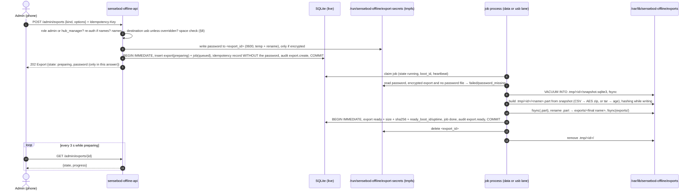
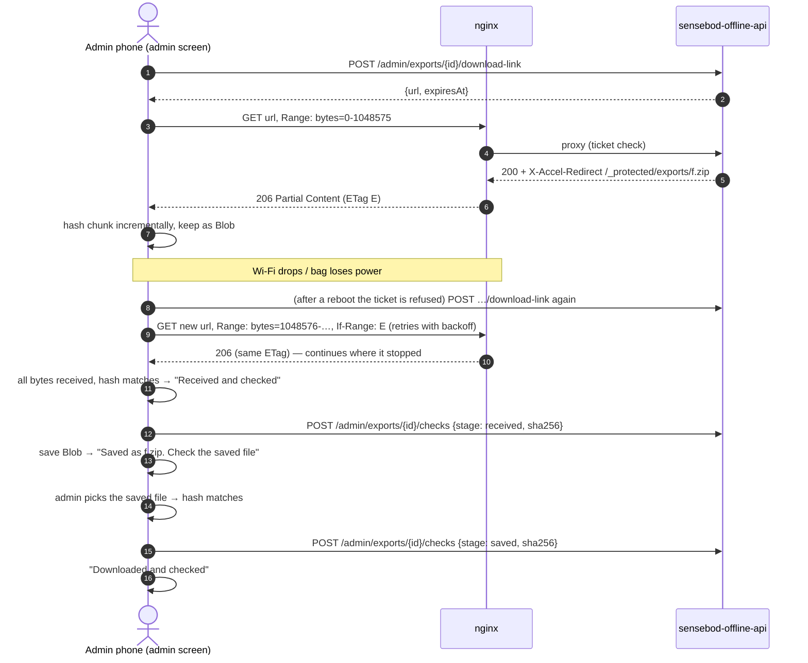
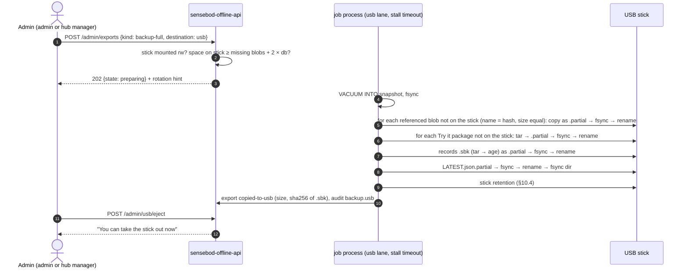
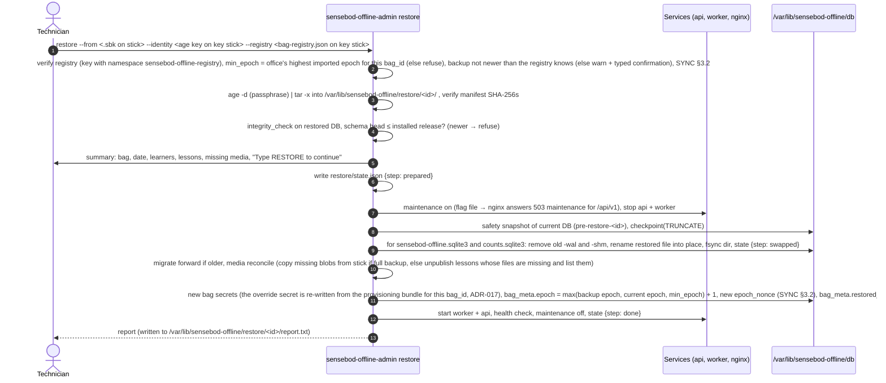
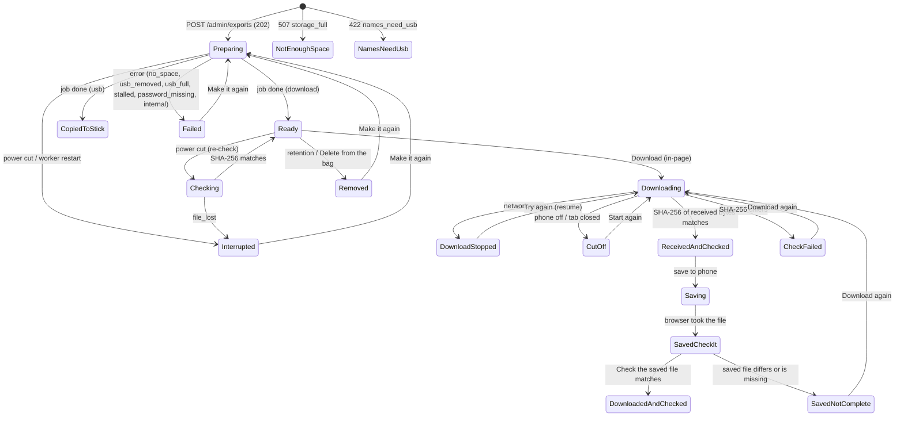

# Safe download of user data, backup and restore — with power loss

Version 0.6 · 13 Nov 2026 · System Architecture Agent · status: **revision 5 (V-030…V-036); revision 4: OWNER-2…6**

Answers the owner's requirement (DESIGN-DECISIONS §4): *"a way to download safely user data from the server by the admin, accounting for power loss also"*. Also covers power loss for uploads, the database, updates and progress writes (§15).

Related: `DATABASE.md` (tables `export`, `job`, `audit_event`; SQLite settings), `openapi.yaml` (endpoints under `/admin/exports`, `/admin/usb`, `/admin/learner-data/summary`), ADR-007, ADR-008, ADR-009, ADR-012. Proofs of concept with crash injection (run on a Mac, not a Pi): `poc/poc_export.py` (v0.1 protocol) and `poc/poc_export_v2.py` / `poc_export_v2.out` (this revision: password outside the database, worker restart, queued jobs at boot, re-check after an unclean boot).

---

## 1. Five products, kept apart

**OWNER-5: data goes to EasySTEM.** The default export on the Storage and backup screen is **"Export for EasySTEM"**: the records backup (§3.2), encrypted to EasySTEM's keys and readable by EasySTEM's office tool, which imports it into EasySTEM's records (SYNC §3.3). The CSV spreadsheet ("Download learner data") is **kept as a secondary option, "Spreadsheet for a partner"**, under "Other downloads". It is still needed for any recipient without the office tool, such as a partner the owner names later or EasySTEM staff who want a spreadsheet without running the tool. The owner may remove it, and nothing else depends on it. An export counts as **exported** for the retention rules (§8.1) when an "Export for EasySTEM" or a full backup has reached the admin: the saved file was checked, or it was copied to a stick.

| Product (UI words) | For whom | Contents | Can the bag be restored from it? | Where it can go | Encrypted |
|---|---|---|---|---|---|
| **Spreadsheet for a partner** ("Download learner data"; secondary since OWNER-5) | An admin, for a partner without EasySTEM's office tool (O-2 closed: data goes to EasySTEM by default) | CSV files in a .zip: learners (without names by default), progress outside Child protection, counts per portal, Child protection **counts only** | **No.** One-way report | Without names: admin's phone or laptop over the bag's Wi-Fi, or a USB stick. **With names: USB stick by default**; over Wi-Fi only after an explicit warning (§7.1) | Yes by default: AES-256 zip with a one-time password shown on screen (ADR-008). Protects the file at rest, **not** against someone sniffing the Wi-Fi (§2) |
| **Export for EasySTEM** (= "Back up the bag — records"; **the default export**, OWNER-5) | EasySTEM: to import the bag's learner data and to restore this bag or a replacement | Consistent snapshot of the whole database (content tree, drafts, questions, learners, progress, admin accounts' password hashes, settings, audit), plus a list of the media files it needs | **Yes**, together with the media (already on the bag, on a content pack, or in a full backup) | Phone/laptop over Wi-Fi, or USB stick | Always: encrypted to EasySTEM's backup public keys with `age` (ADR-008). The bag can make it but cannot read it, so sniffing it gains nothing |
| **Back up the bag — everything** | Same | Records backup + every media file the database refers to | **Yes**, on its own | **USB stick only** (gigabytes; 3.3 GB of livestock videos alone) | Records part encrypted as above; media files copied as they are (see §6.3) |
| **Diagnostics report** | Technician | `status.json`, health samples, boot history (power losses), job and export states, versions, and a filtered application event log (§3.4) | No | Phone/laptop or USB | No. Contains no personal data by construction **and** is scanned before it is published (§3.4) |
| **Local snapshots** (no UI button) | The bag itself | Database snapshots on the bag's own card | Automatic recovery from a corrupted database (DATABASE §9.3) | Stays on the bag | No (same protection as the live database next to it) |

"Download learner data" and "Back up the bag" are different screens with different words. A learner-data file must never be presented as a backup, and a backup must never be handed to a partner (they cannot open it anyway).

## 2. Sensitivity and the threat this protects against

- The data is about children: first names (typed by the learner), role, which lessons they opened and quiz scores. Child protection activity is the most sensitive: "a named child opened *It is not my fault*" can put the child at risk (DESIGN-DECISIONS §2.3).
- **Design rule (ADR-009):** the bag never records Child protection activity together with a learner id — not in the database, not on the wire from the current frontend, not in any log. Child protection lessons send an anonymous, de-duplicated event (`POST /lessons/{id}/activity`, DATABASE §6.4); the bag keeps only per-lesson daily counts. API request logging is template-only (SYSTEM-ARCHITECTURE §12.3), so even a wrong client cannot leave the pair on the disk. If the owner later chooses per-learner recording (a release/technician configuration, not an admin setting; ADR-009), Child protection rows are **still never written to a learner-data export**.
- Threats considered (full model in SYSTEM-ARCHITECTURE §9): someone on the bag's Wi-Fi requesting an export without signing in; sniffing the Wi-Fi (plain HTTP, and the Wi-Fi password is shared with every learner); a lost phone or laptop holding the downloaded file; a lost USB stick; theft of the bag; an admin exporting without a record; a partial or corrupt file being trusted; personal data leaking through logs or diagnostics.
- Controls, mapped (and what each does **not** do):

| Threat | Control | Limit stated honestly |
|---|---|---|
| Export without signing in | `hub_manager` session + CSRF header (§7.1) | — |
| Sniffing the Wi-Fi during an export | Names-included exports go to a USB stick by default, so the file never crosses the Wi-Fi; backups are encrypted to keys the bag does not hold | The zip password travels in the same plain-HTTP answer as the download link: **someone who can decrypt the Wi-Fi gets both**. The zip password does not protect against sniffing. The same listener can already take an admin session (T-2, accepted) |
| Lost phone, laptop or stick | Zip password (not stored with the file); backups encrypted; retention on the bag and on the stick (§8, §10.4) | Files the admin keeps on their own phone are outside the bag's control |
| Leak through logs or diagnostics | Template-only request logs, no learner ids, no IPs on learner routes; diagnostics scanned before publishing (§3.4) | — |
| No record of who exported | Audit in the same transaction (§14) | — |
| Partial or corrupt file trusted | Atomic publication, SHA-256, self-checking formats, saved-file check (§5, §7) | — |

## 3. What is in each file

### 3.1 Download learner data (`kind: learner-data`)

Options chosen on the screen (all recorded in the audit and in `manifest.json`):

| Option | Default | Notes |
|---|---|---|
| Include first names | **Off** | Off: learners appear as a stable learner code (`L-7F3KQ2`, the first 6 base32 characters of the random part of the id; lengthened to 8 for every learner if two learners in the same export would share a code). On: adds a `name` column, asks the admin to type their password again (re-authentication within 5 minutes) and **switches the destination to the USB stick** (§7.1) |
| Include Child protection counts | On | Per-lesson totals, numbers below 5 shown as `<5`. **Counted over whole calendar months only** (the period is widened to month boundaries; the current, unfinished month is left out), so two exports a day apart cannot be subtracted to reveal a single view (V-014) |
| Protect with a password | On | Off only if the owner allows it (O-2). Off shows a warning: "Anyone who gets this file can read it." |
| Period | All time | `from`/`to` dates applied to `updated_at`, with a warning when the bag's clock is not trusted |

Files inside the zip:

| File | Columns | Source |
|---|---|---|
| `README.txt` | Plain English: what each file is, how many rows, the period, that names are/are not included, that Child protection is counts only by whole months and that these counts are **page views on the bag, indicative only** (anyone on the Wi-Fi can add views, up to 10 a minute per phone: V-023), how to open in a spreadsheet, who to contact | Generated |
| `learners.csv` | `learner_code`, [`name`], `role`, `first_seen_date`, `last_active_date` | `learner` |
| `progress.csv` | `learner_code`, `portal`, `group`, `series`, `lesson_number`, `lesson_title`, `lesson_type`, `state` (`started`/`finished`), `correct`, `total`, `last_update_date` | `lesson_progress` joined to content; **portals with `sensitive = 1` excluded always** |
| `summary_by_portal.csv` | `portal`, `learners_with_progress`, `lessons_started`, `lessons_finished`, `quizzes_finished`, `average_quiz_score_percent` | Aggregated from the same snapshot (Child protection excluded) |
| `child_protection_counts.csv` | `month`, `audience`, `series`, `lesson_number`, `lesson_title`, `times_opened`, `times_finished` (values < 5 → `<5`) | `sensitive_activity_count` (only when the option is on) |
| `manifest.json` | format `sensebod-offline-learner-data/1`, bag id and name, app version, schema head, `epoch` and `change_seq` of the snapshot, created time + `clock_trust`, options, period, row counts, SHA-256 of every other member | Generated last |

Never included: video/audio positions, learner ids in full, admin data, IP addresses, the audit log, drafts, anything from the phone.

CSV rules: UTF-8 **with BOM** (so Excel shows Krio letters ɛ ɔ ŋ), CRLF line ends, RFC 4180 quoting, header row, dates as `YYYY-MM-DD`. **Formula-injection guard:** any cell that begins with `=`, `+`, `-`, `@`, tab or carriage return gets a leading `'` (names are typed by learners).

### 3.2 Back up the bag — records (`kind: backup-records`)

An `age`-encrypted (ADR-008) uncompressed POSIX tar stream, file name `sensebod-offline-backup_<bag-name>_<YYYYMMDD-HHMM>_<id>.sbk`:

| Member | What |
|---|---|
| `BACKUP-MANIFEST.json` | format `sensebod-offline-backup/1`, `scope: records`, bag id/name, app version, runtime version, last applied migration of each database file (`schema_migrations`), created time + `clock_trust`, **`epoch`, `epoch_nonce` and `change_seq` at snapshot** (SYNC §3.2), size + SHA-256 of both database files, list of media blobs referenced (`sha256`, `size`, `ext`) and Try it packages, settings that live in files (`/etc/sensebod-offline/sensebod-offline.toml` minus secrets) |
| `db/sensebod-offline.sqlite3` | `VACUUM INTO` snapshot (consistent, compact, rollback-journal mode) |
| `db/counts.sqlite3` | `VACUUM INTO` snapshot of the anonymous Child protection counts (separate file, DATABASE §6.4) |
| `keys/…` | **Not included.** Bag secrets are regenerated on restore |

Size ≈ database size (DATABASE §8: ≈ 1–100 MB across the planning scenarios). Downloadable over Wi-Fi (it is unreadable without EasySTEM's key).

### 3.3 Back up the bag — everything (`kind: backup-full`, USB only)

A folder on the stick, so FAT32's 4 GiB file limit never applies to the whole backup and later backups only copy what is new:

```
SENSEBOD-OFFLINE/
  STICK.json                               written when the bag formats the stick: {label: SENSEBOD-A|B, formattedBy: bag_id, at}
  <bag_id>/
    LATEST.json                            written last; points at the newest complete records backup
    records/sensebod-offline-backup_<…>.sbk        as §3.2 (scope: full); the newest 3 are kept (§10.4)
    media/<aa>/<sha256>.<ext>              content-addressed copies of the blobs referenced by any kept backup
    tryit/<package_id>.tar                 each unpacked animation package, as a tar
    README.txt                             what this folder is; "Do not edit or rename these files"
  learner-data/<file>.zip + <file>.zip.sha256   learner-data exports sent to this stick (kept 7 days, §10.4)
```

### 3.4 Diagnostics report (`kind: diagnostics`)

`sensebod-offline-diagnostics_<bag>_<date>.zip`, unencrypted, kept deliberately small (verifier §E):

| Member | Content |
|---|---|
| `status.json` | As `GET /admin/status` (versions, storage, database, jobs, power, clock, recovery) |
| `health.csv` | 30 days of `health_sample` |
| `boots.csv` | Boot history with `previous_clean`, `clock_trust`, `recovery_note` |
| `jobs.csv`, `exports.csv` | Ids, kinds, lanes, states, error codes, sizes, timings. No options, no names |
| `events.txt` | The last 2,000 **application events** (the structured log of SYSTEM-ARCHITECTURE §12.3: event name, route template, status, duration, error code). Not the raw journal; never the nginx logs |

Publication rule: after building, the job scans the uncompressed members for (a) the pattern `lr-[a-z2-7]{26}`, (b) every learner name of 3 or more characters in the live database, (c) IPv4 addresses of the Wi-Fi ranges `10.10.0.0/24` and `10.20.0.0/24`, (d) any Child protection lesson id. **Any hit fails the export** (`error_code: internal`, audit `export.failed` with `reason: privacy_scan`) instead of publishing it.

## 4. Consistency while the bag is in use

Exports never read the live database for long and never copy its file:

1. The job runs `VACUUM INTO '<tmp>/<export_id>/snapshot.sqlite3'` and, separately, `VACUUM INTO '<tmp>/<export_id>/counts.sqlite3'` (Child protection counts are read only from the latter; V-025). It is one read transaction: it sees exactly the committed state at its start, and in WAL mode it does not block learners' writes. Measured on the Mac: 33 ms for 8.4 MB while a writer committed every ~2 ms, writer max latency 0.5 ms, copy passed `integrity_check` (`DATABASE.md` §2). **Time on the Pi: unverified** (P-3, test EX-1).
2. `fsync` the snapshot file (`VACUUM INTO` output is not assumed durable).
3. All CSV/zip/tar building reads the snapshot (opened `mode=ro`), never the live file. The live WAL is therefore pinned only for the duration of step 1.
4. The snapshot's `epoch` and `change_seq` are recorded in the manifest.

## 5. Making the file: the job and atomic publication

### 5.1 Lanes, processes and concurrency (V-002, V-003)

- The worker has **three lanes**: `media` (conversions), `data` (exports and backups whose destination is a download), `usb` (anything that reads or writes a stick: learner data or records to USB, full backup, "Check the stick", content-pack and release staging from USB). Local snapshots, retention and garbage collection are **not** jobs: `sensebod-offline-maint` runs them on its own timer, so no export or stick can delay them.
- Every job runs in **its own child process** (for Node.js e.g. `child_process.fork` of a job runner; example only), supervised by its lane in the worker supervisor. The child writes `job.progress` and `job.heartbeat_at` at least every 30 s.
- **Database access in USB jobs (V-024):** a USB job takes its snapshot (`VACUUM INTO` into `.tmp/` on the bag's card), commits its job row, and **closes its database connection before the first byte goes to the stick**. From then on it reports progress through a pipe to its lane supervisor, which writes `progress`/`heartbeat_at`. A child stuck on the stick therefore never holds a read transaction, and checkpoints keep working. Data-lane jobs do the same after their snapshot.
- **Stall timeout:** if a job reports no progress for its kind's limit (data lane 10 min; USB lane 5 min; media lane 15 min per segment), the lane sends `SIGTERM`, then `SIGKILL` after 20 s, and marks the job `failed` / export `failed` with `error_code: stalled`. A child stuck in uninterruptible I/O on a dead stick cannot be killed; the lane then marks the job failed anyway, stops taking USB jobs (`/admin/usb` says "The stick is not answering. Take it out and put it back.") and the other lanes carry on.
- **One export `preparing` per destination** (unique index on `destination`): a long USB backup never blocks a learner-data download, and vice versa. A second request for the same destination gets `409 export_in_progress` ("Another download is being prepared. Wait for it to finish.").
- **Worker-start recovery:** there is exactly one worker process. When it starts (after a boot *or* after systemd restarted it), before claiming anything it treats every job still `running` as orphaned: data and USB jobs → `interrupted` with `error_code: worker_restart`, their temp folders and password file removed; media jobs → `queued` again (if `attempts < max_attempts`). `queued` jobs keep their place (their password file is still in tmpfs). The API also shows any `preparing` export whose job is `failed` or `interrupted` with that state (they change in one transaction anyway).

### 5.2 Steps



### 5.3 Rules

- The final directory `exports/` only ever receives complete, fsynced files by `rename`. Anything in `exports/.tmp/` is by definition incomplete.
- The database row is the **only** thing that makes a file "ready". The order is: file durable → rename → directory durable → row committed. A file without a `ready` row is never served and is deleted at boot (§13).
- Job processes run with `nice 10` (data/usb) or `nice 19` (media) and idle/best-effort I/O classes; media yields to data.
- Progress (0–100) and heartbeat are written at most every 2 s and at least every 30 s.
- Failure inside the job (exception, `ENOSPC`, USB error, stall, privacy scan): job `failed`, export `failed` with `error_code`, `.tmp/<id>` and the password file removed, audit `export.failed`.
- Proofs of concept (Mac; `SIGKILL` keeps the OS cache, so they check the protocol and recovery logic, not the card's flush behaviour, which is PL-3/P-4 on the Pi):
  - `poc/poc_export.py`: 60 random kills + boot recovery, invariants held (13 ready, 47 interrupted); reproduced by the verifier (8/52).
  - `poc/poc_export_v2.py` (revision 1): 90 trials mixing **A** kill of the job + worker-start recovery only, **B** kill + loss of tmpfs + unclean-boot recovery with re-check, **C** power cut while the job was still `queued`. Invariants held every time: no `preparing`/`checking`/`running` left, every `ready` file matches its SHA-256 and is marked encrypted, no file without a row, `.tmp` empty, a new export could be created immediately, no stray password file, and **0 of 91 generated passwords found in the database, its WAL or any file in the data folder; 0 idempotency replays carrying a password** (`poc/poc_export_v2.out`).
  - Revision 2 re-run (`poc/poc_export_v2.out`): 120 trials, adding scenario **D** (the API wrote the password file and then died before its commit; the maintenance sweep must remove it, V-021): invariants held in every trial, 22/22 orphan files removed, 0 of 121 passwords found in the database, WAL or data files, 0 replays with a password.

## 6. Encryption and passwords (ADR-008)

### 6.1 Learner data: password-protected zip
- Format: zip with WinZip AES-256 (AE-1 or AE-2) encryption of every member, written streaming or from the CSVs in the export's `.tmp/` folder (removed with it), never with the password on argv or in the environment; proven interoperable on the Mac with a writer using only `node:crypto`/`node:zlib` (`poc/poc_ae2.out`, V-027); writer choice per (SYSTEM-ARCHITECTURE §4.1 R-8; Node examples there; to be proven on the Pi: P-2). Openable with 7-Zip (Windows), Keka/The Unarchiver (macOS), ZArchiver (Android). **Windows' and macOS's built-in zip openers cannot open AES zips**; the screen says: "To open it on a computer, use 7-Zip. The password is: …".
- The password is generated by the API: 4 words from a fixed 2,048-word plain-English list + 2 digits (≈ 50 bits), e.g. `river-mango-seven-chalk-42`. It is returned **once**, in the `202` answer to `POST /admin/exports`, shown with "Write this down. You need it to open the file. The bag will not show it again."
- **Where the password lives (V-004):** never in SQLite. The API writes it to `/run/sensebod-offline/export-secrets/<export_id>` (tmpfs created by `tmpfiles.d`, directory `0700`, file `0600`, owner `sensebod-offline`; temp name + rename). The job process reads it and deletes the file as soon as the export is ready, failed or interrupted. A power cut erases tmpfs, so a password can never outlive a reboot. **Orphan files (V-021):** if the API's transaction fails after the file was written (`503 busy`, exception), the API deletes the file before answering; if the API process dies in between, `sensebod-offline-maint` (every 15 min) deletes every secret file whose export is not `preparing`, or that has no export row and is older than 10 minutes. Test EX-8.
- **Idempotency:** the stored response for `POST /admin/exports` has `password: null, passwordShown: true`. A replay with the same key returns that, and the screen says: "The password was shown once. If you did not write it down, delete this download and make it again."
- **Never unencrypted by accident:** a learner-data job with `encrypted: true` and no password file ends `failed / password_missing`; it never writes an unencrypted zip. At boot every `queued` data or USB job is marked `interrupted` (the password went with tmpfs; consistent with "data jobs are not retried").
- Why a zip password and not public-key encryption: the receiving partner must open it with ordinary tools (O-2).
- **Considered and not adopted (V-005 option):** sealing the zip password to an X25519 key generated by the admin page (TweetNaCl, ≈ 10 KB gzip). It would defeat a passive Wi-Fi listener for the password only, but the same listener can take the admin session and request the file (T-2), the extra crypto has not been measured on Chrome 58 phones, and names-included exports already avoid the Wi-Fi by default. Revisit together with HTTPS (ADR-004).

### 6.2 Backups: encrypted to EasySTEM, unreadable by the bag
- `age` (Debian package `age`) with X25519 recipients. The release installs `/etc/sensebod-offline/backup-recipients.txt` with **EasySTEM's backup public keys** (at least two, kept in different places, so losing one key does not lose all backups).
- The bag streams `tar → age -R backup-recipients.txt → file`. It cannot decrypt what it made: a stolen bag, card or stick, or a Wi-Fi listener, gets nothing readable from a backup file. `age` authenticates every 64 KiB chunk and the end of the stream, so a partial `.sbk` fails to decrypt instead of restoring garbage.
- The private keys live with EasySTEM as passphrase-protected `age` identity files (the technician carries one on a key stick; it is never copied to a bag).
- Consequence: **a facilitator cannot restore a bag without a technician**. The bag's own local snapshots (§9) cover the common, automatic case (database corruption).

### 6.3 Media on a full USB backup is not encrypted
Lesson files are what every phone on the Wi-Fi can already stream; encrypting gigabytes on the Pi costs time and battery for no gain. If the owner considers drafts sensitive, set `backup.encrypt_media = true` (each blob becomes `<sha256>.<ext>.age`); default off (O-8).

## 7. Getting the file onto a phone or laptop over HTTP

### 7.1 Who may export, and where names may go
- Signed-in admin with role `admin` or `hub_manager` (OWNER-6 assumption: both may export; only the hub manager may clean learner data, §8.1).
- Including names requires a fresh password entry (`POST /admin/session/confirm`, valid 5 minutes).
- **Names go to a USB stick by default (V-005).** When "Include first names" is on, the destination switches to "USB stick in the bag". Download over Wi-Fi stays possible only if the hub manager ticks "Send it over the Wi-Fi anyway", after the warning: "Anyone on this Wi-Fi with the right tools could copy this file and its password. Use a USB stick if you can." The request then carries `namesOverWifi: true`, which is audited. Without the tick the API answers `422 names_need_usb`.
- Learner-facing endpoints never expose exports. `/api/v1/admin/exports/**` answers `401`/`403` as the rest of `/admin`.

### 7.2 Download links
- `POST /admin/exports/{id}/download-link` → `{ url, expiresAt }`. The URL is `/api/v1/admin/exports/{id}/file?ticket=<t>`, where the ticket is `base64url(export_id | admin_id | boot_id | expiry | HMAC-SHA256(bag secret, …))`, valid **30 minutes and only within the current boot** (V-012: the wall clock cannot be trusted across a reboot without an RTC battery), usable for any number of `Range` requests in that time. It exists because some Android download handlers do not send the page's cookies (unverified on the target phones; P-6, BR-4); with the ticket the download works with or without the cookie. After a reboot the page asks for a new link (same export, same file, same ETag, so the download continues). Because admin sessions end at every boot (V-012), that request first gets `401`: the page then shows an **in-place sign-in dialog without leaving the screen** (V-022), keeps the received chunks in memory, and continues after sign-in. The same dialog is used by uploads and by "Check the saved file".
- The ticket is a capability for one file, not personal data. It never reaches a log: nginx does not write access lines for `/api/` at all, nginx's error log is at `crit` inside `/api/` locations, and the application logs route templates only (SYSTEM-ARCHITECTURE §12.3).
- `GET …/file?ticket=` → the API checks ticket, boot, expiry, export state `ready` (not `checking`), file present and its size → answers with `X-Accel-Redirect: /_protected/exports/<file name>`, `Content-Disposition: attachment; filename="<file name>"`, `X-Sensebod-Offline-SHA256: <hex>`, `Cache-Control: no-store`. nginx then serves the file itself, with `Content-Length`, `ETag`, `Last-Modified`, `Accept-Ranges: bytes`, `206` for ranges and `200` for `If-Range` mismatches. No backend request handler is held for the length of a download.
- nginx (normative fragment for the DevOps package):

```nginx
location /_protected/exports/ {
    internal;                                   # only reachable through X-Accel-Redirect
    alias /var/lib/sensebod-offline/exports/;
    add_header Cache-Control "no-store" always;
    add_header X-Content-Type-Options "nosniff" always;
    add_header Content-Security-Policy "sandbox; default-src 'none'" always;
    gzip off; gzip_static off;
    limit_rate 0;                               # no media throttle on exports
    access_log off;                             # V-001: no per-request lines with paths or IPs
    error_log /var/log/nginx/error.log crit;
}
```

(`exports/` is `0750 sensebod-offline:www-data`, files `0640`, so nginx can read them and learners cannot reach them by any URL.)

### 7.3 Two download modes (V-006)

**Mode 1 — in-page download with checks (default when `size_bytes ≤ 16 MiB`; setting `export.inpage_max_bytes`, to be raised only after P-6 measures phone memory).** Covers learner-data exports and records backups in most planning scenarios (DATABASE §8).

1. The admin screen requests the file with `XMLHttpRequest` in 1 MiB `Range` chunks (`responseType = 'arraybuffer'`, `If-Range: <ETag>`), feeds each chunk into an **incremental** pure-JS SHA-256 as it arrives, then keeps it only as a `Blob` (`new Blob([chunk])`), dropping the `ArrayBuffer`. Shows "Downloading… 3 of 7 MB. Keep this page open."
2. On a network error or timeout it waits 2 s, 4 s, 8 s… (max 30 s, max 10 tries), then shows "The download stopped. Try again" and continues from the last whole chunk. If the ticket expired or the bag rebooted, it asks for a new link and continues; a `401` opens the in-place sign-in dialog (never a page change, which would drop the chunks; V-022). If the server answers `200` instead of `206`, or the ETag changed, it starts again from zero.
3. When `received == size_bytes` it compares the hash with `sha256` from `GET /admin/exports/{id}`. Match → **"Received and checked"** and `POST /admin/exports/{id}/checks {stage: received, sha256}` (sets `receivedCheckedAt`). Mismatch → "The file did not arrive whole. Download it again."
4. It then saves: `<a download="<file name>">` with the combined `Blob`. Screen: **"Saving to this phone…"**, then **"Saved as [file name]. Tap Check the saved file to make sure it is complete."** The page cannot know whether the browser actually wrote the file (full storage is common on old phones), so it never claims more.
5. **Check the saved file** (one tap, the normal last step): a file input, the admin picks the file from Downloads, the page hashes it in 1 MiB slices and compares. Match → **"Downloaded and checked ✓"** and `POST …/checks {stage: saved, sha256}` (sets `savedCheckedAt`). Mismatch or wrong size → "The saved file is not complete. Free some space on this phone and download it again."
6. If the phone loses power or the tab is closed during steps 1–4, the bytes held in memory are gone: the screen (on its next opening, from `Export.state: ready` without `receivedCheckedAt`) says "This copy was cut off. Start again." The export is still on the bag until it expires.
7. Risk: saving a `Blob` with `<a download>` on Chrome 58 for Android is **unverified** (P-6, BR-3). If it fails on a phone, the app uses Mode 2 there.

**Mode 2 — browser download, then check (fallback; and anything above the in-page limit).**
1. `<a href="<ticket url>">` hands the download to the browser's download manager, which can resume with `Range`/`If-Range` (desktop Chrome does; Android behaviour unverified).
2. The screen then shows **Check the saved file** (same as Mode 1 step 5). On a laptop the admin can also compare the check code with `certutil -hashfile <file> SHA256` (Windows) or `shasum -a 256 <file>` (macOS/Linux); the screen shows the full SHA-256 under "Details".

### 7.4 Self-checking files, independent of the bag
- Learner data zip (AES, AE-2): AE-2 stores **no CRC-32**; instead every member is **authenticated** (HMAC-SHA1 per member), so a damaged or truncated member fails to decrypt; the zip central directory is at the end, so a truncated file will not open at all; `manifest.json` holds each member's SHA-256. 7-Zip's "Test" checks every member. A zip saved to a stick also gets a `<file>.sha256` beside it (`sha256sum` format).
- Backup `.sbk`: `age` authenticates every chunk and the end of the stream; `BACKUP-MANIFEST.json` has the database's SHA-256; restore re-checks both (§12).
- The **check code** shown in the UI is the first 12 hex characters of the file's SHA-256 in groups of four (`3F9A 21C0 7B4E`), for reading aloud over a phone call.

### 7.5 Download sequence with an interruption



If the bag lost power during the download, the export comes back as `checking`, then `ready` after its SHA-256 is re-checked (§13 step 7); the same file and ETag are served, so the download continues.

## 8. Space, limits and retention on the bag

**Before accepting** `POST /admin/exports` the API checks the filesystem holding `/var/lib/sensebod-offline`:

```
needed = db_bytes                      (snapshot)
       + estimate(kind)                (learner-data: db_bytes; backup-records: db_bytes; diagnostics: 20 MiB)
       + reserve                       (setting storage.reserve_bytes, default 1 GiB: a policy, not a measurement)
free_for_sensebod-offline (statvfs f_bavail, i.e. excluding root-reserved blocks) < needed  →  507 storage_full
```

"Not enough space on the bag. Delete old downloads, or lessons you no longer need, then try again." The same reserve protects the database: uploads and exports are refused before free space reaches the reserve, so progress writes keep working (SYSTEM-ARCHITECTURE F-4). USB jobs check the **stick's** free space (and only the snapshot against the bag's space).

**Retention on the bag (policy defaults; owner may change: O-7). Simplified in this revision (V-015):** a file is removed at the **first** of:

| Kind | Wall clock after `ready_at` | Uptime within the boot in which it became ready (`CLOCK_BOOTTIME`) | Boots after `ready_at` | Max kept at once |
|---|---|---|---|---|
| learner-data | 24 h | 24 h | **the 2nd boot** (a learner-data file never survives two boots) | 3 (a 4th deletes the oldest ready one) |
| backup-records | 7 days | 7 days | the 7th boot | 2 |
| diagnostics | 7 days | 7 days | the 7th boot | 2 |
| any USB destination | not kept on the bag | — | — | — |

So a clock that jumps backwards cannot keep children's data on the bag: the boot count and the uptime rule do not depend on it. Checked hourly by `sensebod-offline-maint` and at boot. "Delete from the bag" removes a file at once. Expired rows stay (state `expired`, no file) for 90 days so the history shows what happened. Total size of `exports/` is capped at **2 GiB** (setting): above it, new exports are refused with `507` until something is deleted.

On the admin's phone or laptop the file is outside the bag's control. The "Downloaded and checked" screen says: "This file has children's information. Send it only to [EasySTEM / partner], then delete it from this phone." (text for the designer; recipient wording depends on O-2).

### 8.1 Retention of learner data: two months, and cleaning (OWNER-5)

- **Automatic removal:** a learner and all their progress are removed **61 days after the learner's last activity** (`learner.last_active_day`). `sensebod-offline-maint` does this daily, in batches of 500 with `secure_delete=ON`, writing tombstones and an audit event `learner.expire` with counts only. Child protection counts are anonymous and follow their own 2-year rule.
- **Guard against a wrong clock (revision 5, V-033).** Retention is the **one destructive action that depends on the wall clock** (ADR-014, ADR-018), so it is guarded in five ways:
  1. **Every clock change is visible.** A time set from a phone is marked `clock_trust = manual`. Every change (manual, NTP, or a step detected at boot against `clock.json`) is audited with the old time, the new time and who made it, and listed under `clockChanges` on the status screen.
  2. **Untrusted forward jumps are recorded (revision 5a).** A forward step of **more than 7 days** creates a `clock_jump` row **only if it is not backed by a trusted clock**: a time set by hand (`manual`), or a step at boot that neither a battery-backed RTC (`rtc`) nor NTP (`synced`) explains (`unexplained`). A step that a trusted RTC reads at boot after the bag was switched off, or that NTP makes, is **real elapsed time and counts**: the bag really was off for those weeks.
  3. **Unexported data never counts a jump.** For a learner whose data has not been exported, the days inside any jump that happened after their last activity are **subtracted**, confirmed or not. Their 91 days (option B) must pass as ordinary time.
  4. **Exported data counts a jump only after confirmation.** If a jump would make exported learners removable, the hub manager sees "[n] learners would be removed because the date moved forward by [d] days. Is the date right?", with the buttons **Yes, remove** and **Fix the date** (`POST /admin/learner-data/confirm-date`). Until they confirm, the jump's days are subtracted.
  5. **A per-run cap.** Each daily run removes at most **10 % of the learners on the bag** without a confirmation; the rest wait for the next days.
  The run is never made if today is before `last_active_day`. If the clock is `unsure`, the run is postponed with the banner "Set the bag's clock so old learner data can be removed". On a bag without an RTC battery the `restored` clock lags real time, so removal comes **later** than two months, never earlier. Evidence: `poc/poc_retention_clock.out`. In the control run, a phone date one year ahead **removed all 100 learners, 50 of them unexported**, under the revision-4 rule; under this rule it **removed 0**, and after confirmation it removes only exported learners, at most 10 % a day. Real two-month aging still removes the inactive learners on time; a lagging clock delays removal and never advances it. **Revision 5a:** for a bag used one week a month with an RTC battery, the revision-5 rule kept data until day 245 (exported) or day 390 (unexported). Now that trusted-clock steps count, removal happens on day **61 / 91**, as intended; the same monthly steps made by hand stay guarded (`poc/poc_retention_clock.out` C4).
- **Before removal:** from day 45 of a learner's inactivity, the admin home shows "Learner data from [n] people will be removed on [date]. Export for EasySTEM first." whenever that data has not been exported.
- **Should unexported data be held back? (owner's choice, O-16).** In every option, data that has been exported is removed on day 61.

| Option | What happens on day 61 to data **not yet exported** | For | Against |
|---|---|---|---|
| A | Removed anyway | Strict two months; minimum data on the bag | A bag that never meets EasySTEM loses all its data unseen |
| **B (recommended)** | Held back **up to 30 more days** (day 91 at most) with a daily red banner "Export for EasySTEM now"; then removed anyway | Gives a monthly technician visit or export a second chance; still bounded (≤ 3 months) | Slightly longer than two months for unexported data |
| C | Never removed until exported | No data lost before EasySTEM has it | Unbounded on a bag that is never collected; contradicts "two months" |

  The setting is `retention.unexported_hold_days` in `sensebod-offline.toml`, with a value of 0 for option A, 30 for B, or `-1` for C. It is release or technician configuration, not an admin setting. **Default until the owner decides: 30 (option B).**
- **"Exported" is defined precisely:** a learner counts as exported when their newest change has `seq` ≤ the `snapshot_seq` of the newest `backup-records`/`backup-full` export that reached the admin (`saved_checked_at` set, or `copied-to-usb`). The partner spreadsheet does **not** count, because it does not go to EasySTEM.
- **Cleaning on demand (hub manager):** Storage and backup → **"Remove learner data"**. The screen first shows **the date and kind of the last export** and how many learners have changes since then. If any have, it warns: "[n] people have data that has not been exported. If you remove it now, EasySTEM will never receive it. Export for EasySTEM first?", with the buttons **Export first** and **Remove anyway**. The removal needs a re-entered password, a typed `CLEAN`, and `acknowledgeUnexported` when unexported data is included (`POST /admin/learner-data/clean`). Scope is all learners, or those inactive for at least *n* days. It also deletes local `auto-*` snapshots, then takes a fresh one, so removed names do not stay in rotation copies. `pre-update`/`pre-restore`/`corrupt` copies keep their own limits (30/30/90 days; DATABASE §7). This is audited as `learner.clean`.
- **Admins (non-hub-manager)** see the last export date and the "Export first" reminders but cannot remove data (OWNER-6 assumption).

## 9. Local snapshots (automatic, no button)

- Made by **`sensebod-offline-maint`** (its own process on its own timer, not a worker lane, so exports and sticks never delay it; V-003) when **(a)** at least 2 h of uptime have passed since the last snapshot and `change_seq` moved, **(b)** before every update or restore, **(c)** at the first idle moment after a boot whose `previous_clean = 0` — only if the database passed `quick_check`.
- Procedure (for `sensebod-offline.sqlite3` and `counts.sqlite3` **as a pair**, same name stem, rotated together; V-025): `VACUUM INTO snapshots/.tmp/<id>.sqlite3` → fsync → `integrity_check` on the copy → rename to `snapshots/auto-<epoch>-<seq>-<YYYYMMDDTHHMM>.sqlite3` → fsync dir.
- Rotation: keep the newest 6 `auto-*`, plus the newest per calendar day for **at most 7 days**; `pre-update-*` and `pre-restore-*` for **30 days** (V-013); `db/corrupt-*/` for 90 days (DATABASE §7). Oldest deleted only after a new one is complete. Total capped at 10 % of free space or 2 GiB, whichever is smaller (policy); when over, the oldest daily ones go first, never the newest.
- RPO for database corruption on the bag: changes since the newest good snapshot (≤ 2 h of uptime with changes). RPO for loss of the whole card: the last off-bag backup (§10–§11). The admin home shows "Last copy off the bag: 12 days ago" and turns into a reminder after 14 days.

## 10. USB stick in the bag

### 10.1 Mounting (root helper, narrow) — dirty-bit policy (V-007)
- A udev rule starts `sensebod-offline-usb@<kernel name>.service` for a USB partition with `ID_FS_TYPE` `vfat` or `exfat`, and sets `UDISKS_IGNORE=1` so the desktop's automounter does not also mount it. Other filesystems: state `unreadable` ("Use a stick formatted as FAT32 or exFAT, or let the bag format it").
- The helper runs `fsck.vfat -n` / `fsck.exfat -n` (check only) and classifies the result:

| Result of the check | Action | State shown |
|---|---|---|
| Clean | Mount read-write | `mounted` |
| **Only the dirty bit is set** (not unmounted cleanly: pulled out, power cut, or a PC that was not told to eject) | Mount read-write; the bag clears the bit when it unmounts cleanly | `mounted` (with the note "This stick was not removed safely last time") |
| Other errors, and the stick carries `SENSEBOD-OFFLINE/STICK.json` written by **this** bag | Repair (`fsck.vfat -a` / `fsck.exfat -y`), then mount read-write; the repair report goes into the audit | `mounted` ("The bag repaired this stick") |
| Other errors on any other stick | Mount read-only, never repair someone else's stick | `errors` ("This stick has errors. Check it on a computer, or let the bag format it.") |

  How `dosfstools`/`exfatprogs` report a dirty bit versus real errors must be pinned to exit codes and message patterns of the versions on the image — **unverified**, test USB-3.
- Mount at `/run/sensebod-offline/usb` with `nosuid,nodev,noexec,uid=sensebod-offline,gid=sensebod-offline,umask=0077`, plus `flush` for vfat. One stick at a time; a second one is ignored (`state: busy`).
- The helper writes `/run/sensebod-offline/usb.json` (state, label, filesystem, total/free bytes, dirty note, `STICK.json` content); the API reads it for `GET /admin/usb`.
- "Remove the stick safely" → `POST /admin/usb/eject` → `sensebod-offline-usb-eject.service` (polkit allows the `sensebod-offline` user to start exactly this unit) → `sync`, `umount`, state `ejected` → "You can take the stick out now."
- **Format this stick for Sensebod Offline** (hub manager only, `POST /admin/usb/format {label: A|B, confirm: "FORMAT"}`, re-authentication within 5 minutes, typed confirmation "This deletes everything on the stick"): exFAT, volume label `SENSEBOD-A` or `SENSEBOD-B`, writes `SENSEBOD-OFFLINE/STICK.json`. The API checks the confirmation and writes a one-time request file; the root helper `sensebod-offline-usb-format@<kernel name>.service` performs the format only after its own target checks: the device must be the one the mount helper recorded, on the USB bus, removable, not the disk holding `/` or `/boot/firmware`, never `mmcblk*`/`nvme*` (V-020; full rules in SYSTEM-ARCHITECTURE §9.8). It rewrites the stick's partition table (one exFAT partition on the whole stick).

### 10.2 Writing to the stick
- Every file is written as `<name>.partial`, `fsync`ed, renamed, and the directory `fsync`ed. `LATEST.json` is written last. On FAT, `rename` is not guaranteed atomic across power loss; correctness does not rely on it: restore and "Check the stick" verify SHA-256 against the manifest, and `.partial` files are ignored and removed by the next backup.
- **A power cut while FAT sectors are written can also damage earlier files on the same stick** (the allocation table is shared). `LATEST.json` ordering protects the *new* backup only. The answer is two sticks (§10.3), not a promise about one.
- Files larger than 4 GiB on vfat are refused with "This file is too big for this stick. Use a stick formatted as exFAT, or let the bag format it."
- Stick removed during a copy → `EIO`/`ENODEV` → job `failed`, `error_code: usb_removed` → "The stick was taken out too early. Plug it in and make the copy again." Stall → §5.1.
- Stick full → `ENOSPC` → `usb_full` → "The stick is full."

### 10.3 Two sticks, used in turn
The recommended kit has **two sticks, A and B**, formatted by the bag. The bag remembers which label received the last full backup and the backup screen says "Use stick B this time" (`GET /admin/usb.rotationHint`). A power cut or a bad stick then never touches the only off-bag copy. Using one stick is allowed (the hint stays visible).

### 10.4 Retention on the stick
Applied by the USB job at the end of every write to a stick, and at plug-in for learner-data files, only inside `SENSEBOD-OFFLINE/`:

| Item | Kept on the stick | Removed |
|---|---|---|
| Records backups (`records/*.sbk`) per bag | the newest **3** complete ones (the one `LATEST.json` names is always kept) | older ones, after the new backup is complete |
| Media copies (`media/`) | blobs referenced by any kept records backup's manifest | the rest |
| Learner-data zips (children's data) | **7 days** from their creation time recorded in their name and `STICK.json` log | at the next plug-in into the bag after 7 days; the screen says "Removed 2 old learner-data files from the stick" |
| `.partial` files | — | at the next write |

Files outside `SENSEBOD-OFFLINE/` are never touched. Learner-data files copied off the stick to a computer are outside the bag's control (same text as §8).

### 10.5 Learner data to USB
Same job, USB lane, but the final rename happens on the stick (`SENSEBOD-OFFLINE/learner-data/<file>`), with `<file>.sha256` beside it; state `copied-to-usb` (nothing kept on the bag). The password rule is the same; the password is shown on the admin's screen (over the Wi-Fi), the file is not.

## 11. Back up the bag — everything, to USB



Media copies are incremental (only blobs whose `<sha256>.<ext>` name is missing or has the wrong size). "Check the stick" (`POST /admin/usb/check`, USB lane) re-reads every file on the stick after a remount and compares hashes; it is slow and optional, and the stall timeout applies.

## 12. Restore (technician; CLI in phase 1)

Restoring replaces everything on a bag, needs EasySTEM's private key, and is rare. It is a command for a technician (`sudo sensebod-offline-admin restore …`), not a facilitator button. The admin UI only shows the result ("This bag was restored from a backup made on [date]").



Rules:
- The old `-wal` and `-shm` files **must** be removed (after a `TRUNCATE` checkpoint, with all connections closed) before the restored file is renamed in; otherwise SQLite replays the old WAL onto the restored database (measured in verification V-T3).
- The new epoch is greater than the backup's epoch, the bag's current epoch **and the highest epoch the office has imported for this bag** (from the signed `bag-registry.json` the technician carries, or a typed `--min-epoch`; without either the CLI refuses unless the technician states that no backup of this bag ever reached the office). Only with the office's number does the new lineage sort after everything the office has seen; v0.2's rule `max(backup, bag) + 1` did not, on a fresh card (V-008 remainder; `poc/poc_sync_epoch.out` scenarios 2–3). A new random `epoch_nonce` lets the office detect and stop any remaining clash (scenario 4).
- If the bag holds learners that are not in the backup, the confirmation says so with the count: "This bag has 12 learners that are not in the backup. They will be lost."
- `bag_id` is kept from the backup (a replacement card becomes the same bag). The CLI warns that the old card must not be used again in the field.
- Restore drill: every release candidate is restored onto a spare card in a second Pi (test BK-3).

## 13. Recovery: at boot, and when the worker restarts

**At boot** — `sensebod-offline-boot-recover.service` (`Type=oneshot`, `Before=sensebod-offline-api.service sensebod-offline-worker.service`), in this order:

1. Record the boot: `previous_clean` = whether `/var/lib/sensebod-offline/run/clean-shutdown` exists (written by the API's `ExecStop`, removed at boot). Clock handling (ADR-014). **Delete every admin session** and clear `locked_until` (V-012: their expiry used a clock that may have jumped; failure counts are kept).
2. Finish or roll back an interrupted update (SYSTEM-ARCHITECTURE §10.6) or restore (`restore/state.json`): before `swapped` → discard the extracted files, original untouched; at `swapped` → continue from migration (transactional, re-runnable).
3. Database checks on **both** files and, if needed, automatic recovery of the main file from a local snapshot **with an epoch increment** (DATABASE §9.3, V-008); a corrupt `counts.sqlite3` is replaced from its snapshot or recreated empty and never blocks the API (DATABASE §9.4, V-025).
4. Jobs: every `running` job → data/USB: `interrupted`, `error_code: power_or_crash`; media: back to `queued` if `attempts < max_attempts`. **Every `queued` data or USB job → `interrupted`** as well (V-004: its password, if any, was in tmpfs and is gone; data jobs are not retried automatically, so a stale request is never fulfilled without the admin asking again).
5. (tmpfs `/run/sensebod-offline/export-secrets/` is empty after a boot by construction; the step only asserts it.)
6. Remove `exports/.tmp/*`, `snapshots/.tmp/*`, `jobs/tmp/*`, `/var/lib/sensebod-offline/tmp/*`; `fsync` the parents.
7. Exports: every file in `exports/` without a `ready` row → delete. If `previous_clean = 1`: every `ready` export → file must exist with the recorded size. **If `previous_clean = 0` (power cut or crash): every `ready` export → `checking`** (not downloadable; `GET …/file` answers `409 checking`), and `sensebod-offline-maint` re-hashes them shortly after boot: `sensebod-offline-maint.timer` has `OnBootSec=1min` (as well as `OnUnitActiveSec=15min`), so exports stay `checking` for about a minute plus the hashing time (seconds for files under the 2 GiB cap; unverified on the Pi) (V-017): match → `ready`; mismatch or missing → `interrupted`, `error_code: file_lost`, file removed (V-017).
8. Uploads: `receiving` uploads keep their `.part` file truncated to `received_bytes` (the database value is the truth) so the phone can resume; `receiving` uploads untouched for 24 h → `abandoned`, file removed.
9. Blobs: files in `media/c/` that are not in `blob` and are older than 1 h → moved to `media/.orphans/` (deleted after 7 days); rows in `blob` whose file is missing → reported in `/admin/status` and the lessons using them are unpublished with a note.
10. Retention by boot count (§8): learner-data exports ready before the previous boot are deleted now.
11. Write `boot.recovery_note` (plain words) and exit `0`. Exit non-zero only if the database cannot be made usable (then the API starts in maintenance mode).

**When the worker starts** (every start, including restarts by systemd within one boot after a crash or an OOM kill; V-002): steps 4 (for `running` jobs only, with `error_code: worker_restart`), the temp-folder removal of step 6 for those jobs, and deletion of their password files. `queued` jobs are kept and run. Test PL-6.

## 14. Audit log

Every action below writes one `audit_event` row **in the same transaction** as the change it records (or, for downloads, when the API authorises the first byte range). The audit holds no learner names.

| Action | When | `detail_json` |
|---|---|---|
| `export.create` | `POST /admin/exports` accepted or refused | kind, destination, includeNames, **namesOverWifi**, includeChildProtectionCounts, encrypted, period; refusal reason |
| `export.ready` / `export.failed` / `export.interrupted` | job end / recovery | size, row counts, error code (incl. `stalled`, `worker_restart`, `password_missing`, `privacy_scan`) |
| `export.download_link` | ticket issued | export id, expiry |
| `export.download` | a request with `Range` absent or starting at byte 0 is authorised | export id (no IP: V-001 applies to the audit too for learner-data; the admin is identified by the session) |
| `export.received_checked` / `export.saved_checked` | the admin's page reports a matching hash for the received bytes / the saved file | — |
| `export.delete` / `export.expire` | admin delete / retention | — |
| `learner.expire` / `learner.clean` | automatic two-month removal / hub manager cleaning | counts removed, held back, scope, whether unexported data was acknowledged; never names |
| `admin.override.request` / `.used` / `.refused` / `.paused` | override code (SYSTEM-ARCHITECTURE §9.9) | request id, username, attempts; never the code |
| `backup.usb` | full or records backup written to a stick | stick label, bytes copied, blobs copied, old backups removed |
| `usb.eject`, `usb.format`, `usb.repair`, `usb.retention` | — | label, counts |
| `restore` | CLI restore (written into the restored database) | backup id, backup date, learners lost count, new epoch |
| `admin.signin` (`ok`/`refused`) | sign-in | username tried (not the password), IP (admin routes only) |
| `admin.reauth`, `admin.password.change`, `admin.account.create/disable/reset` | — | target account |
| `learner.delete` | by the learner (id only) or by an admin | learner id (the name is not recorded) |
| `settings.change`, `clock.set`, `power.off`, `update.apply`, `update.rollback`, `config.child_protection_mode` | — | old/new values (no secrets) |

Hub managers read it with `GET /admin/audit` (paged, filter by action). It is kept 2 years or 50,000 rows (DATABASE §7), included in records backups, and never in learner-data exports or diagnostics.

## 15. Power loss elsewhere (uploads, database, updates, progress)

| Situation | What protects it | What the user sees after power returns |
|---|---|---|
| A progress or admin write is being committed | WAL + `synchronous=FULL`: a transaction is either fully on storage (if the API answered 2xx) or absent. **Assumes the SD card honours flush requests**: P-4/PL-1 | Learner: the last unconfirmed save may be missing; the client never showed it as saved |
| A Child protection event is being counted | Same; the event is de-duplicated per page view, so a retry after power returns is harmless | Nothing |
| A file upload is arriving (resumable protocol, ADR-006) | Each chunk is appended to `uploads/.partial/<id>.part`, `fsync`ed, then `received_bytes` is committed; boot truncates the file to it | Sign in again (sessions end at reboot), then "Try again" continues from the last confirmed chunk |
| Upload complete, being moved into the media store | `fsync` → `rename` into `media/c/<aa>/<sha256>.<ext>` → `fsync` dir → commit `blob` + `upload.state` | If power failed before the commit, the file is an orphan (§13.9) and the next chunk request finishes the upload |
| A smaller video copy / page rendering is being made | Output to `jobs/tmp/<job>/`, renamed into the store only when complete; job re-queued (max 3 attempts) | "Making a smaller copy…" continues by itself |
| Content pack install (USB) | Files copied one by one into the content-addressed store; the database activation is **one** transaction at the end | Before activation: nothing changed for learners; "Install again" resumes (already-copied files are skipped) |
| Software update | Journaled update with pre-update snapshot and A/B release folders (SYSTEM-ARCHITECTURE §10.6) | Either the old or the new version runs; never a mix |
| Local snapshot being written | Temp + rename; rotation deletes only after a new snapshot is complete | Nothing |
| Learner data export / backup being made, or waiting to be made | §5, §13.4 | "The download was interrupted. Make it again." |
| A ready export | §13.7 re-check | "Checking the file after the power cut…" for seconds, then Ready |
| Download to the phone | Range resume, new link after reboot, checks (§7) | Continues, or "This copy was cut off. Start again." |
| USB copy | §10.2, two sticks (§10.3) | "The copy to the stick was interrupted. Make it again." / "This stick was not removed safely last time" |
| Restore | Restore journal (§12, §13.2) | Technician reruns; original database untouched until the swap |

**Switching off with a stuck stick (V-024).** `sensebod-offline-poweroff.service` stops the worker and API with a bounded wait (30 s), lazily detaches the stick (`umount -l /run/sensebod-offline/usb`) so a child stuck on it cannot hold the filesystem, writes the clean-shutdown marker, and calls `systemctl poweroff`; the whole sequence is bounded at 60 s. A job child still stuck in uninterruptible I/O holds no database connection (§5.1), so the databases are consistent at power-off. Test PL-7.

**Reducing power cuts themselves (recommendations for the owner):** a "Switch off the bag safely" button (`POST /admin/power-off`, hub manager) and a printed card: "Before you unplug: tap Switch off, or press the Pi's power button, and wait 20 seconds" (Pi 5 power button behaviour on this OS edition **unverified**, DEP-6); a power bank with pass-through charging; the Pi 5 RTC battery (ADR-014).

## 16. UI states for the designer

Server states come from `Export.state` (`preparing`, `ready`, `checking`, `copied-to-usb`, `failed`, `interrupted`, `expired`, `deleted`) and the two check timestamps; the screen-only states are marked *(screen)*.



| State | Plain words (proposal for the designer) | Data the screen has |
|---|---|---|
| Choose | "Download learner data" · options of §3.1 · "This file has children's information." · names on → destination becomes "USB stick in the bag" | `GET /admin/learner-data/summary`, `GET /admin/storage`, `GET /admin/usb` |
| Names need a stick | "Files with names go on a USB stick. Plug one in, or tick Send it over the Wi-Fi anyway." + the warning of §7.1 | `422 names_need_usb` |
| Not enough space | "Not enough space on the bag. Delete old downloads, or lessons you no longer need." | `507`, `availableBytes`, `neededBytes` |
| Preparing | "Preparing your download… [progress]%. You can leave this screen; the bag keeps working." + the password, once, with "Write this down" | `state: preparing`, `progress`, `password` (only in the `202`) |
| Password already shown *(screen)* | "The password was shown once. If you did not write it down, delete this download and make it again." | replay answer `password: null, passwordShown: true` |
| Ready to download | "Ready to download · [size] · made [date, time] · removed from the bag [in 23 hours or at the next restart]" · **Download** · Delete from the bag | `sizeBytes`, `readyAt`, `expiresAt`, `checkCode`, `clockTrust` |
| Checking | "Checking the file after the power cut…" | `state: checking` |
| Downloading *(screen)* | "Downloading… [x] of [y] MB. Keep this page open." | client counter |
| Download stopped *(screen)* | "The download stopped. Check you are on the bag's Wi-Fi, then tap Try again." | client |
| Cut off *(screen)* | "This copy was cut off. Start again." | `ready` without `receivedCheckedAt` after the page reopens |
| Received and checked → Saving *(screen)* | "Received and checked. Saving to this phone…" | `receivedCheckedAt` |
| Saved — check it *(screen)* | "Saved as [file name]. Tap **Check the saved file** to make sure it is complete." | client |
| Downloaded and checked | "Downloaded and checked ✓ · Password: the one you wrote down · Send it only to [recipient], then delete it from this phone." | `savedCheckedAt` |
| Not complete *(screen)* | "The file did not arrive whole. Download it again." / "The saved file is not complete. Free some space on this phone and download it again." | client |
| Interrupted — make it again | "The download was interrupted, perhaps by a power cut. Nothing else was affected. Make it again." | `state: interrupted`, `errorCode: power_or_crash`/`worker_restart`/`file_lost` |
| Failed | "Something went wrong. Nothing on the bag was changed. Make it again." | `state: failed`, `errorCode` |
| Removed | "This download was removed from the bag. Make it again." | `state: expired` or `deleted` |
| USB: no stick | "Plug a USB stick into the bag." (polls `GET /admin/usb` every 3 s on this screen only) | `usb.state: none` |
| USB: rotation hint | "Use stick B this time." | `usb.rotationHint` |
| USB: not removed safely last time | "This stick was not removed safely last time. It is fine to use." | `usb.dirtyNote` |
| USB: cannot read / errors / busy / not answering | "The bag cannot read this stick…" / "This stick has errors. Check it on a computer, or let the bag format it." / "The stick is not answering. Take it out and put it back." | `usb.state` |
| USB: format | "Format this stick for Sensebod Offline? This deletes everything on the stick." (type FORMAT) | hub manager only |
| USB: copying | "Copying to the USB stick… [progress]%. Do not take it out." | `state: preparing` |
| USB: copied | "Copied. Tap Remove the stick safely before you take it out." (+ "Removed 2 old files from the stick" when retention ran) | `state: copied-to-usb` |
| USB: safe to remove | "You can take the stick out now." | `usb.state: ejected` |
| USB: taken out too early / full / stalled | "The stick was taken out too early. Plug it in and make the copy again." / "The stick is full." / "The stick stopped answering. Try another stick." | `errorCode: usb_removed` / `usb_full` / `stalled` |
| Clock unsure (badge on any date) | "(the bag's clock may be wrong)" | `clockTrust: unsure` |

The same component serves "Back up the bag" with different headings; the backup's Ready screen has no password line and says "Only EasySTEM can open this file."

### 16.1 Retention and cleaning states (OWNER-5)

| State | Plain words (proposal) | Data |
|---|---|---|
| Home reminder (day 45+) | "Learner data from [n] people will be removed on [date]. Export for EasySTEM first." | `nextAutomaticRemoval`, `unexportedLearners` |
| Held back (option B) | Red: "[n] people's data is past two months and kept only because it has not been sent to EasySTEM. Export for EasySTEM now." | `retentionHeldBack` |
| Clock unknown | "Set the bag's clock so old learner data can be removed." | `clockTrust: unsure` |
| Date jump (V-033) | "[n] learners would be removed because the date moved forward by [d] days. Is the date right?" **Yes, remove** / **Fix the date** | `clockJumps` |
| Clock changes (status screen) | "Clock changed on [date] from [old] to [new] by [name / at start-up]" | `clockChanges` |
| Remove learner data, step 1 | "Last export for EasySTEM: [date] ([kind]). [n] people have changes since then." | `lastExportAt`, `lastExportKind`, `unexportedLearners` |
| Step 2, if unexported | Warning text of §8.1 with **Export first** / **Remove anyway** | — |
| Step 3 | "Type CLEAN and your password to remove [n] people and their progress. This cannot be undone." | — |
| Done | "Removed [n] people." | `learnersRemoved` |
| Not allowed | "Ask your hub manager." (role `admin`) | `403 forbidden` |

## 17. Assumptions and owner questions raised here

| # | Assumption taken (conservative) | Owner question |
|---|---|---|
| A-1 | Child protection activity is counted anonymously, never per learner (ADR-009) — **decided by the owner (OWNER-2, option A)** | O-1 closed |
| A-2 | The default export is "Export for EasySTEM" (OWNER-5, decided). The partner spreadsheet leaves names out unless turned on with a re-entered password; with names it goes to a USB stick unless overridden | O-2 closed |
| A-3 | Admins and hub managers may export; only hub managers clean data or manage accounts (OWNER-6, unconfirmed) | O-15 |
| A-4 | Exports are password-protected by default; recipients use 7-Zip or similar | O-2 |
| A-5 | Backups are readable only by EasySTEM (public-key encryption); restore needs a technician | O-4 |
| A-6 | USB sticks are FAT32 or exFAT; two sticks (A/B) per bag recommended | O-12 (buy two sticks per bag?) |
| A-7 | Export-file retention of §8 and §10.4 unchanged; learner data two months (§8.1, decided); unexported hold-back option B until the owner chooses | O-7 closed; O-16 |
| A-8 | Media on USB full backups is not encrypted | O-8 |

## 18. Tests for this document (pass/fail; full plan in SYSTEM-ARCHITECTURE §14)

| Id | Test | Pass when |
|---|---|---|
| EX-1 | Learner export on the Pi with 1,000 learners × 100 progress rows while a load generator writes progress at 5/s | Export `ready`; zip opens with the password in 7-Zip; row counts equal a direct query of the same snapshot; p95 progress write latency during the export < 2× the baseline; WAL < 64 MiB 1 min after the export |
| EX-2 | Formula injection: learner named `=HYPERLINK("x")` | Cell in `learners.csv` starts with `'=` |
| EX-3 | Names off | No seeded learner name appears anywhere in the zip (byte search after decryption) |
| EX-4 | Child protection | No row of a `sensitive` portal in `progress.csv`; counts < 5 shown as `<5`; counts only for whole months |
| EX-5 | Password lifetime (V-004) | Replay of `POST /admin/exports` with the same key never returns a password; after the job ends, grep of the DB, `-wal`, snapshots and backups for the generated password → 0 hits; `/run/sensebod-offline/export-secrets/` empty |
| EX-6 | Encrypt without password | A queued encrypted export whose password file was removed ends `failed/password_missing`; no zip is written |
| EX-8 | Orphan password file (V-021) | With an injected commit failure after the file was written, and with the API killed between file and commit: no secret file remains after the API's error path / the next maintenance run |
| EX-9 | Hardened units (V-004 remainder) | EX-5 and EX-8 pass with the api and worker units exactly as in SYSTEM-ARCHITECTURE §10.2 (`ProtectSystem=strict`, `ReadWritePaths` incl. `/run/sensebod-offline/export-secrets`) |
| EX-7 | Names to USB (V-005) | Names on + destination download without override → `422 names_need_usb`; with override → works and `namesOverWifi: true` in the audit; names on to USB works |
| PL-3 | Power cut (relay) at random moments during 100 exports, including while queued | After each boot: no `preparing`/`queued` data jobs; `ready` exports pass through `checking`; every `ready` file's SHA-256 matches; no file in `exports/` without a row; `.tmp` empty; no download served while `checking`; live `integrity_check` ok |
| PL-6 | `kill -9` the worker (not the Pi) during an export and during a conversion (V-002) | Within 30 s: the export is `interrupted/worker_restart`, a new export can start, `.tmp` and the password file are gone, the conversion resumes |
| PL-7 | Hung stick (FUSE or `dm-delay` device on the test Pi) during a full backup (V-003, V-024) | A local snapshot is still taken on schedule; a learner-data download export completes; the USB job ends `failed/stalled` within the timeout; the stuck child holds no SQLite connection; WAL below `journal_size_limit` after a checkpoint; "Switch off the bag safely" completes within 60 s |
| DL-1 | In-page download of a 15 MB export on the oldest phone, Wi-Fi switched off and on 3 times during it | Ends "Downloaded and checked" only after **Check the saved file**; saved file's SHA-256 matches |
| DL-2 | Truncated file (Mode 2, Wi-Fi cut, browser gives up) | "Check the saved file" says not complete; 7-Zip reports an error |
| DL-3 | Ticket expired mid-download, and bag rebooted mid-download | Client gets a new link and continues without restarting |
| DL-4 | Range through `X-Accel-Redirect` on nginx 1.26.3 | `206` with correct `Content-Range`; `If-Range` with wrong ETag returns `200` full; `Content-Disposition` passed through |
| DL-5 | Phone storage nearly full (V-006) | No "Downloaded and checked" shown; the saved-file check reports not complete |
| DL-6 | Ticket from a previous boot (V-012); bag rebooted during a Mode 1 download (V-022) | `403 ticket_invalid`; the page shows the in-place sign-in dialog, and after sign-in the download continues from the last whole chunk (no page reload, no restart) |
| USB-1 | Stick pulled during a full backup, two brands, FAT32 and exFAT | `failed/usb_removed`; at the next plug-in the stick mounts read-write ("not removed safely"); the next backup completes and `LATEST.json` points to it |
| USB-2 | 30 power cuts during full backups to stick A, alternating with stick B | Each stick mounts read-write after every cut; the newest complete backup on the *other* stick always restores (BK-3); stick retention keeps 3 backups |
| USB-3 | Dirty bit only vs. real FAT errors on a foreign stick vs. on a bag-formatted stick | rw / read-only `errors` / repaired + rw, respectively |
| USB-4 | Learner-data retention on the stick | A 7-day-old learner-data zip is removed at plug-in; `.sha256` sits beside every zip; nothing outside `SENSEBOD-OFFLINE/` touched |
| BK-3 | Restore drill on a second Pi from (a) records + content pack, (b) full USB backup | Learners, progress, lessons, order, drafts, admin sign-in all present; media plays; `integrity_check` ok; epoch greater than before |
| SEC-E1 | Export endpoints (role matrix of ADR-019, V-035): without session → 401; as `admin` → allowed (an `admin` may also export names after re-auth, following the owner's "the admin exports"); as `hub_manager` → allowed; `POST /admin/learner-data/clean` as `admin` → 403; with a forged, expired or previous-boot ticket → 403 | Exactly as listed; nothing served on 401/403 |
| SEC-E4 | Clock (V-033): set the date +1 year from a phone, then run maintenance for 3 days | No learner removed; banner with the count; after **Yes, remove** only exported learners go, ≤ 10 % per day; unexported learners kept |
| SEC-E2 | Diagnostics report after FN-1 with saved learners using Child protection | Contains no learner id, no learner name, no Wi-Fi client IP, no Child protection lesson id; a planted learner id in the event log makes the export fail (`privacy_scan`) |
