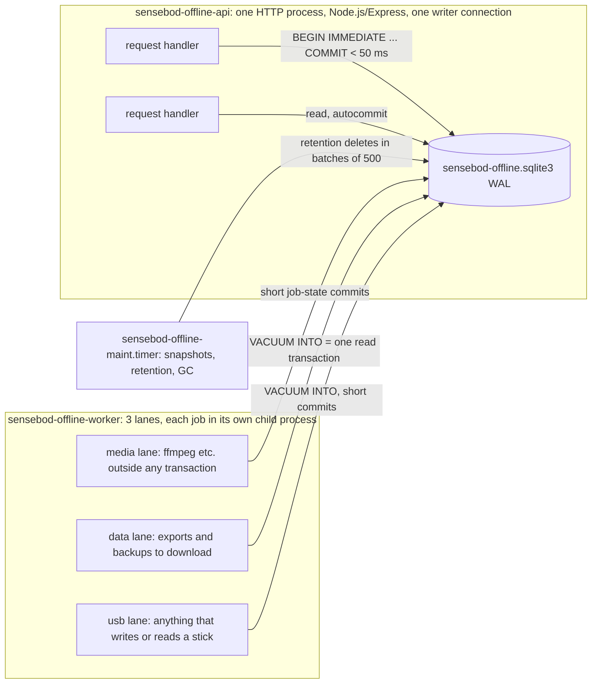
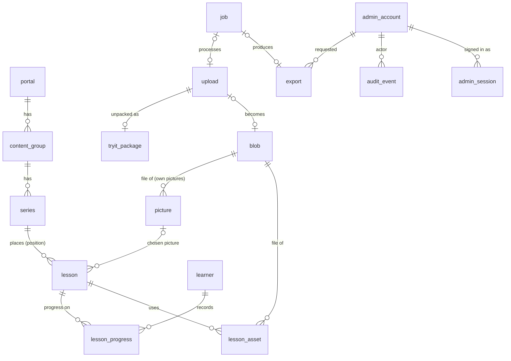

# Sensebod Offline database design (deliverable C)

Version 0.6 · 13 Nov 2026 (revision 5: V-030…V-036; revision 4: OWNER-2…6) · System Architecture Agent · status: **revision 3 (answers verification round 3); revisions 1–2 and OWNER-1 included**

Related: `SYSTEM-ARCHITECTURE.md` (context), `ADR/ADR-002-sqlite.md` (why SQLite), `DATA-EXPORT-AND-BACKUP.md` (snapshots, backup, restore), `SYNC.md` (ownership, change sequence), `openapi.yaml` (shapes). Measurements quoted here were taken **on a Mac (Apple M1 Pro, macOS, Python 3.14, SQLite 3.51.2), not on a Raspberry Pi**; scripts and raw output are in `poc/`. The PoCs are Python only because they test SQLite and filesystem behaviour, which does not depend on the backend's runtime (the backend is Node.js/Express, OWNER-1).

---

## 1. Decision summary

| Topic | Decision |
|---|---|
| Engine | SQLite 3, one database file, accessed only by the Sensebod Offline backend processes on the Pi (ADR-002) |
| Location | `/var/lib/sensebod-offline/db/sensebod-offline.sqlite3` (+ `-wal`, `-shm`), directory `0700`, owner `sensebod-offline`. **Plus a second, separate file `counts.sqlite3`** in the same directory that holds only the anonymous Child protection counts (§6.4, V-019): it shares no transaction, no WAL, no sequence counter and no row ordering with the personal data |
| Journal | `journal_mode=WAL` (persistent, set once at provisioning, asserted at every start) |
| Durability | `synchronous=FULL`: a commit is on storage before the API answers 2xx. Required by "nothing is presented as saved until the server confirms it" (DESIGN-DECISIONS §1) |
| Concurrency | Many readers, one writer at a time. All write transactions are `BEGIN IMMEDIATE`, short (target < 50 ms on the Pi, to be measured), contain no network or bulk file I/O. **Lock waits never block the API's event loop** (§3, §4 rule 5; SYSTEM-ARCHITECTURE §4.1 R-3L): API connections `busy_timeout=0`, writes through a single-flight gate with asynchronous retry, ≤ 5 s per request from arrival; non-HTTP processes `busy_timeout=5000` |
| Large files | Never in the database. Media lives in a content-addressed file store (`blob` table holds metadata only) |
| Ids | Public records created on the bag: prefixed, 128-bit random, base32 (`lr-…`, `ls-…`). Shipped content keeps its stable slugs (`cp-child-staying-safe-1`). See ADR-016 |
| Ordering | Never by wall clock. A per-bag monotonic `change_seq` is stamped on every changed syncable row (ADR-014) |
| Migrations | Numbered, forward-only SQL migrations recorded in `schema_migrations`, run only by the update procedure after a pre-update snapshot (runtime-agnostic; SYSTEM-ARCHITECTURE §4.1 R-5) |
| Backup | Online snapshot with `VACUUM INTO` (or the backup API in one step), never a file copy of the live database |

## 2. Workload and why SQLite fits

Derived from the API contract, the boards and the frontend code (not measured on real use):

| Workload | Source | Rate assumption (to verify in field) |
|---|---|---|
| Content reads (`/portals`, `/groups`, `/series`, `/lessons`) | every learner screen | Bounded by Wi-Fi; at most tens of requests/s for a full room. Small indexed reads, cacheable by ETag |
| Progress writes | `markStarted` on lesson open, `savePosition` on pause/leave, `finishLesson` (see `app/src/features/lessons/progress/progress.ts`) | About 1–3 writes per learner per lesson. 40 phones each opening a lesson per minute is < 2 writes/s |
| Learner create/delete | "Save my progress" | Rare |
| Admin writes | uploads, placement, questions, order | Rare, a few per minute at most |
| Background writes | job state, upload chunk offsets, health samples | < 1/s |
| Long reads | exports, backups, snapshots | Minutes per day at most |

Writes are rare and tiny; reads dominate; one backend owns the file; a separate server process would cost RAM, a second thing to recover after power loss, and an upgrade path that needs the internet. SQLite fits. PostgreSQL is evaluated and rejected in ADR-002; the conditions that would reverse that decision are listed there.

**Measured on the Mac (`poc/poc_sqlite.out`)** — evidence of behaviour, not of Pi speed:

| Check | Result on the Mac | What it shows |
|---|---|---|
| Commit rate, WAL, `synchronous=FULL`, `fullfsync=ON` (a real flush on macOS) | 209 commits/s | Order of magnitude with a real flush. The Pi's microSD will differ; target on the Pi is ≥ 50 commits/s (test DB-1) |
| Same without `fullfsync` (macOS `fsync` does not flush the drive cache) | 12,451 commits/s | Not representative of durable commits; quoted only to explain why the figure above is the relevant one |
| `VACUUM INTO` of an 8.4 MB database while a writer commits every ~2 ms | 33 ms, copy passes `integrity_check`, writer max latency 0.5 ms during the copy | The snapshot does not block writers in WAL mode |
| Backup API, one step (`pages=-1`), same conditions | 41 ms, `integrity_check` ok, writer max 1.2 ms | Same; copy keeps the WAL flag in its header, `VACUUM INTO` output is in rollback mode and smaller (6.8 MB vs 8.4 MB) |
| WAL while a read transaction stays open for 3,000 commits | WAL grew to 35.9 MB; `wal_checkpoint(TRUNCATE)` after the reader closed brought it to 0 bytes | Long readers (exports) make the WAL grow; bounded by export duration; checkpoint afterwards |
| `kill -9` of a writer in the middle of a 20,000-row transaction | `integrity_check` ok, 0 rows of the killed transaction visible | Crash atomicity of the transaction. A process kill is **not** a power cut (the OS cache survives); power-cut tests are in SYSTEM-ARCHITECTURE §14 |
| File size: 2,000 learners + 80,000 progress rows (32-char ids) | 8.38 MB, ≈ 102 bytes per progress row including the primary-key index | The SQLite file format is the same on the Pi, so this size figure carries over |

## 3. SQLite configuration

Applied by the backend's connection-open routine on every connection, in every process (API, worker, job children, maintenance), except `journal_mode`, which is persistent and checked at start-up.

| Setting | Value | Why | Consequence |
|---|---|---|---|
| `journal_mode` | `WAL` | Readers never block the writer and the writer never blocks readers; crash recovery is a WAL replay | Three files on disk (`.sqlite3`, `-wal`, `-shm`); all must be on a local filesystem (they are) |
| `synchronous` | `FULL` | In WAL mode `NORMAL` can lose the last transactions on power loss (no corruption); the product promises that a confirmed save survives | One extra flush per commit. Affordable at < 5 writes/s (see §2); measured target ≥ 50 commits/s on the Pi |
| `foreign_keys` | `ON` | Integrity of placement, progress and assets | Must be set per connection |
| `busy_timeout` | **API process: `0`** (writes through the single-flight gate with asynchronous retry and backoff, ≤ 5 s per request counted from its arrival, R-3a; or `5000` only if all DB access runs off the event loop, R-3b). **Worker supervisor, job children, `sensebod-offline-maint`, boot-recover, CLIs: `5000` ms**, except the connection that attempts a `TRUNCATE` checkpoint: ≤ 100 ms | A synchronous driver blocks the whole Node process while SQLite waits for the lock (V-026; measured 1,503 ms frozen for a 1.5 s lock with 5000 ms; with 200 concurrent writes, 1,521 ms with `busy_timeout=20` per-request retry and 6 ms with `busy_timeout=0` + single-flight gate, `poc/poc_lock_wait.out`); processes that serve no requests may wait inside SQLite | After 5 s in total the API answers `503 busy` with `Retry-After: 2`; test DB-6 |
| Write transactions | always `BEGIN IMMEDIATE` (e.g. `better-sqlite3`: `db.transaction(fn).immediate()`; example only) | Takes the write lock at `BEGIN`, which avoids the "read then upgrade to write" deadlock that `busy_timeout` cannot resolve | Use explicit transactions only around writes; read paths run in autocommit |
| `journal_size_limit` | `67108864` (64 MiB) | The WAL file is truncated back to this size after a checkpoint, so one long export cannot leave a large WAL behind | — |
| `wal_autocheckpoint` | `1000` pages (default) | Normal passive checkpoints | The maintenance timer also runs `wal_checkpoint(TRUNCATE)` when idle |
| `cache_size` | `-16000` (≈ 16 MB per connection) | Enough for the hot content tree | ≤ 17 connections ⇒ ≤ ≈ 270 MB worst case; typical far less (pages are only cached when read) |
| `temp_store` | `FILE` (default) | Sorting large exports must not grow RAM unboundedly | Temp files land in `/var/lib/sensebod-offline/tmp` (`SQLITE_TMPDIR`), not `/tmp` (may be tmpfs) |
| `mmap_size` | `0` (default, off) | A read error on a failing SD card under mmap becomes `SIGBUS` and kills the process; with normal I/O it becomes `SQLITE_IOERR`, which the API can report | Slightly more CPU per read; irrelevant at this scale |
| `secure_delete` | `OFF` globally; `ON` for the transaction that deletes a learner (`DELETE /learners/{id}` and admin removal; rare) so the name is overwritten in the database pages (V-013) | Avoid extra writes on every delete | Old copies in snapshots expire by retention (§7); the WAL is overwritten after the next truncating checkpoint |
| `auto_vacuum` | `NONE` | Free pages are reused; deletions are rare | A monthly `VACUUM` is not scheduled; the snapshot (`VACUUM INTO`) is already compact |

**Start-up assertions** (`sensebod-offline-boot-recover.service`, before the API starts): `PRAGMA journal_mode` returns `wal`; `PRAGMA quick_check` returns `ok` (full `integrity_check` weekly, see §9); `PRAGMA foreign_key_check` empty; schema migration state equals the release's expected head. Any failure follows the corrupted-database procedure (§9.3).

**Versions to confirm on the Pi** (unverified): the SQLite library the backend actually links (a Node driver such as `better-sqlite3` usually bundles its own SQLite; check `select sqlite_version()` through the driver, not the system CLI) must report ≥ 3.35 (for `RETURNING`, used by `change_seq`); Debian 13 is expected to ship 3.46.x.

## 4. Write-concurrency model



Rules (normative for the backend engineer):

1. **One writer at a time** is accepted, not fought. Every write is a short `BEGIN IMMEDIATE` transaction. No HTTP calls, `ffmpeg`, `fsync` of media, zip writing or sleeping while a write transaction is open.
2. **Large bodies are written to files first**, then a single short transaction records the result (uploads, derivatives, exports, snapshots).
3. **Batching**: retention and garbage collection delete in batches of ≤ 500 rows per transaction.
4. **Progress writes are coalesced on the server**: a `PUT …/progress/{lessonId}` that changes only `positionSeconds` by less than 10 s, and whose row was written less than 60 s ago, returns the stored row without writing (saves SD-card writes; DESIGN-DECISIONS §2.6). State changes always write.
5. **Busy handling (V-026)**: in the API, `busy_timeout=0`; all writes pass through **one single-flight write gate** (only the head of the queue touches SQLite); on `SQLITE_BUSY` the head retries `BEGIN IMMEDIATE` **asynchronously** with timer-based backoff (5, 10, 20 … ms, ≤ 200 ms per step, ±20 % jitter); each request waits at most 5 s from its arrival (queue time included), then `503 {"error":{"code":"busy"}}`, `Retry-After: 2`. Reads stay outside the gate and retry asynchronously on the rare `SQLITE_BUSY`. No synchronous lock wait in the API at all; a per-request retry with a non-zero `busy_timeout` is not allowed (the waits of many requests add up: 1,521 ms measured with 200 concurrent writes). Alternative allowed: all API database access off the event loop (worker thread / writer process), where a 5 s `busy_timeout` is fine. **Lock-hold budget for everyone else** (so the API's waits stay short): ≤ 50 ms per write transaction on the Pi (target, DB-6); job progress/heartbeat = one-row commits ≤ every 2 s; retention/GC batches ≤ 500 rows with ≥ 100 ms pauses; checkpoints `PASSIVE`, and `TRUNCATE` only when no job runs and with `busy_timeout` ≤ 100 ms so it gives up rather than blocking writers (Mac: gave up after 117 ms with a reader open); update and restore stop the API first. The client already shows "Something went wrong… Try again". Learner progress writes are fire-and-forget on the client.
6. **Change sequence**: inside each write transaction that modifies a syncable table, the code calls `next_seq()` once (`UPDATE bag_meta SET value = value + 1 WHERE key = 'change_seq' RETURNING value`) and stamps that value on every row it inserts or updates. **The anonymous Child protection counts are not syncable rows of this database and never take a `seq`** (they live in `counts.sqlite3`, §6.4; V-019). Because writes are serialised, `seq` is a strict total order of committed changes, independent of the wall clock. Every replacement of the live database (automatic recovery, restore, pre-update snapshot restore) increments `epoch` and lifts the counter to `max(change_seq, epoch × 2^40)` in the same step, so changes after a replacement always sort after anything stamped before it (SYNC §3.2, V-008; `poc/poc_sync_epoch.py`).
7. **Long reads** (exports, backups) never read the live database for minutes: they take a snapshot with `VACUUM INTO` (one read transaction, seconds) and then work from the snapshot file. This keeps the WAL small (§2, WAL growth measurement).
8. **Connection lifecycle**: each process opens long-lived connections at start and applies §3 to each; the API process uses **one writer connection** (all its writes are serialized through it; with a synchronous driver in a single-threaded runtime this is automatic, and every transaction must stay short because it blocks the process while it runs); the worker supervisor holds one connection for job claiming; each job child process opens its own and closes it as soon as its snapshot is taken (DATA-EXPORT §5.1).

Expected contention: with < 5 writes/s and transactions in the low milliseconds, the probability that a writer waits is small; it is measured in test DB-2 (40 simulated phones). **Unverified on the Pi.**

## 5. Entity–relationship diagram



The anonymous Child protection tables live in the separate file `counts.sqlite3` and have no relationship to any table here (by design, V-019). Supporting tables without relationships worth drawing: `bag_meta`, `setting`, `idempotency_record`, `tombstone`, `boot`, `health_sample`, `content_pack`.

## 6. Schema (normative DDL)

Conventions: ids are `TEXT`; times are ISO 8601 UTC text `YYYY-MM-DDTHH:MM:SS.sssZ` from the server clock (ordering uses `seq`, never time); booleans are `INTEGER` 0/1 with `CHECK`; JSON columns are `TEXT` validated by the application (`CHECK (json_valid(x))`). The migrations create exactly these tables (they may be written as this DDL verbatim); a schema-conformance test (HANDOFF-PACKAGES BE-2) compares the migrated database with this DDL. The DDL avoids `STRICT` so that any SQLite ≥ 3.35 accepts it; `WITHOUT ROWID` is used only in `counts.sqlite3`.

<!-- DDL-BEGIN -->
```sql
-- ---------------------------------------------------------------- bag
CREATE TABLE bag_meta (
  key   TEXT PRIMARY KEY,        -- 'bag_id','bag_name','provisioned_at','change_seq','epoch' (+1 at every replacement of the live database, SYNC §3.2),'epoch_nonce' (random, new with every epoch),'uptime_total_s' (accumulated bag uptime across boots, written at least every 5 min and at clean shutdown — binding, V-034; used for override expiry, ADR-017),'boot_seq' (monotonic, incremented and committed by boot-recover before the API starts, V-034),'epoch_base_seq' (the counter right after the last replacement; rows with a higher seq were changed in the current lineage, used by `new-epoch` re-stamping, SYNC §3.2),'content_rev','restored_from'
  value TEXT NOT NULL
);

CREATE TABLE setting (           -- values admins can change; defaults live in code
  key        TEXT PRIMARY KEY,   -- e.g. 'export.learner_ttl_hours','storage.reserve_bytes'. The Child protection mode is NOT a setting (V-014): it is release/technician configuration in /etc/sensebod-offline/sensebod-offline.toml
  value_json TEXT NOT NULL CHECK (json_valid(value_json)),
  updated_at TEXT NOT NULL,
  updated_by TEXT                -- admin_account.id or 'system'
);

CREATE TABLE boot (              -- one row per start of the backend after a boot
  boot_id            TEXT PRIMARY KEY,           -- /proc/sys/kernel/random/boot_id
  started_at         TEXT NOT NULL,
  previous_clean     INTEGER NOT NULL CHECK (previous_clean IN (0,1)),  -- 0 = previous run ended without clean shutdown (power loss or crash)
  clock_trust        TEXT NOT NULL CHECK (clock_trust IN ('synced','rtc','restored','unsure')),
  recovery_note      TEXT                         -- what boot recovery did, plain words
);

-- ---------------------------------------------------------------- files
CREATE TABLE blob (              -- one immutable file in the content-addressed store
  sha256      TEXT PRIMARY KEY CHECK (length(sha256) = 64),
  size_bytes  INTEGER NOT NULL CHECK (size_bytes >= 0),
  ext         TEXT NOT NULL CHECK (ext IN ('mp4','m4a','mp3','ogg','opus','webm','jpg','png','webp','vtt','pdf','json','txt')),
  mime_type   TEXT NOT NULL,
  rel_path    TEXT NOT NULL UNIQUE,  -- 'c/ab/ab12…ef.mp4' under /var/lib/sensebod-offline/media/
  origin      TEXT NOT NULL CHECK (origin IN ('upload','derived','content-pack','builtin')),
  created_at  TEXT NOT NULL,
  unreferenced_since TEXT          -- set by GC scan; file deleted 24 h later if still unreferenced
);

-- ---------------------------------------------------------------- content tree
CREATE TABLE picture (           -- gallery pictures
  id          TEXT PRIMARY KEY,
  grp         TEXT NOT NULL CHECK (grp IN ('child-protection','agriculture','climate','school','people-places','own')),
  url_path    TEXT,              -- builtin pictures shipped with the web release ('/illustrations/…')
  blob_sha256 TEXT REFERENCES blob(sha256),  -- own pictures
  alt         TEXT NOT NULL,
  created_at  TEXT NOT NULL,
  seq         INTEGER NOT NULL,
  CHECK ((url_path IS NOT NULL) <> (blob_sha256 IS NOT NULL))
);

CREATE TABLE portal (
  id          TEXT PRIMARY KEY CHECK (id IN ('primary','jss','child-protection','agriculture','climate')),
  title       TEXT NOT NULL,
  description TEXT NOT NULL DEFAULT '',
  theme       TEXT NOT NULL CHECK (theme IN ('blue','agriculture')),
  group_kind  TEXT NOT NULL CHECK (group_kind IN ('class','audience','topic')),
  picture_id  TEXT REFERENCES picture(id) ON DELETE SET NULL,
  listen_blob TEXT REFERENCES blob(sha256),
  sort_order  INTEGER NOT NULL,
  sensitive   INTEGER NOT NULL DEFAULT 0 CHECK (sensitive IN (0,1)),  -- 1 = Child protection rules apply (ADR-009)
  updated_at  TEXT NOT NULL,
  seq         INTEGER NOT NULL
);

CREATE TABLE content_group (
  id           TEXT PRIMARY KEY,
  portal_id    TEXT NOT NULL REFERENCES portal(id),
  kind         TEXT NOT NULL CHECK (kind IN ('class','audience','topic')),
  title        TEXT NOT NULL,
  description  TEXT NOT NULL DEFAULT '',
  picture_id   TEXT REFERENCES picture(id) ON DELETE SET NULL,
  availability TEXT NOT NULL DEFAULT 'available' CHECK (availability IN ('available','not-in-bag')),
  icon         TEXT,             -- ContentIconKey or NULL; unknown keys tolerated by the app
  audience     TEXT CHECK (audience IN ('child','parent','elder')),
  sort_order   INTEGER NOT NULL,
  updated_at   TEXT NOT NULL,
  seq          INTEGER NOT NULL
);
CREATE INDEX content_group_portal ON content_group(portal_id, sort_order);

CREATE TABLE series (
  id           TEXT PRIMARY KEY,
  group_id     TEXT NOT NULL REFERENCES content_group(id),
  title        TEXT NOT NULL,
  description  TEXT NOT NULL DEFAULT '',
  picture_id   TEXT REFERENCES picture(id) ON DELETE SET NULL,
  availability TEXT NOT NULL DEFAULT 'available' CHECK (availability IN ('available','not-in-bag')),
  icon         TEXT,
  listen_blob  TEXT REFERENCES blob(sha256),
  sort_order   INTEGER NOT NULL,
  created_by   TEXT,             -- admin_account.id, NULL for shipped content
  updated_at   TEXT NOT NULL,
  seq          INTEGER NOT NULL
);
CREATE INDEX series_group ON series(group_id, sort_order);

CREATE TABLE lesson (
  id            TEXT PRIMARY KEY,
  series_id     TEXT REFERENCES series(id),         -- NULL = waiting to be placed
  position      INTEGER CHECK (position IS NULL OR position <> 0),  -- negative only inside a renumbering transaction (§6.2)
  type          TEXT NOT NULL CHECK (type IN ('watch','listen','read','try','check')),
  interactive   INTEGER NOT NULL DEFAULT 0 CHECK (interactive IN (0,1)),
  captions      INTEGER NOT NULL DEFAULT 0 CHECK (captions IN (0,1)),
  read_along    INTEGER NOT NULL DEFAULT 0 CHECK (read_along IN (0,1)),
  needs_sound   INTEGER NOT NULL DEFAULT 0 CHECK (needs_sound IN (0,1)),
  length_seconds INTEGER CHECK (length_seconds IS NULL OR length_seconds >= 0),
  pages         INTEGER CHECK (pages IS NULL OR pages >= 1),
  title         TEXT NOT NULL CHECK (length(title) BETWEEN 1 AND 120),
  summary       TEXT NOT NULL DEFAULT '',
  language      TEXT NOT NULL DEFAULT 'en',
  status        TEXT NOT NULL DEFAULT 'draft' CHECK (status IN ('draft','published')),
  source        TEXT NOT NULL CHECK (source IN ('upload','notes-photos','typed','animation','questions','content-pack')),
  picture_id    TEXT REFERENCES picture(id) ON DELETE SET NULL,
  listen_blob   TEXT REFERENCES blob(sha256),
  file_names_json TEXT NOT NULL DEFAULT '[]' CHECK (json_valid(file_names_json)),
  body_json     TEXT NOT NULL DEFAULT '{}' CHECK (json_valid(body_json)),
                -- type-specific: read {blocks}, listen {transcript}, watch {learningPoints}, try {mode,…hotspots},
                -- check/watch {questions:[{id,prompt,listenBlob,answers:[{id,text,correct,feedback}],allowRetry,atSeconds?,pauseUntilAnswered?}]}
  version       INTEGER NOT NULL DEFAULT 1,          -- optimistic concurrency (If-Match)
  created_by    TEXT,
  created_at    TEXT NOT NULL,
  updated_at    TEXT NOT NULL,
  seq           INTEGER NOT NULL,
  CHECK (series_id IS NOT NULL OR position IS NULL),
  CHECK (type <> 'check' OR position IS NULL),               -- the quiz has no number; it is always last
  CHECK (type = 'check' OR series_id IS NULL OR position IS NOT NULL),
  CHECK (status = 'draft' OR series_id IS NOT NULL)          -- published implies placed
);
CREATE UNIQUE INDEX lesson_series_position ON lesson(series_id, position) WHERE position IS NOT NULL;
CREATE UNIQUE INDEX lesson_one_quiz_per_series ON lesson(series_id) WHERE type = 'check' AND series_id IS NOT NULL;
CREATE INDEX lesson_unplaced ON lesson(updated_at) WHERE series_id IS NULL;
CREATE INDEX lesson_status ON lesson(status, series_id);

CREATE TABLE lesson_asset (      -- files a lesson uses, in order
  lesson_id   TEXT NOT NULL REFERENCES lesson(id) ON DELETE CASCADE,
  role        TEXT NOT NULL CHECK (role IN ('source','smaller','poster','caption','audio','page_image','cover','question_audio','spot_audio','scene')),
  ordinal     INTEGER NOT NULL DEFAULT 0,
  blob_sha256 TEXT NOT NULL REFERENCES blob(sha256),
  language    TEXT,
  label       TEXT,
  PRIMARY KEY (lesson_id, role, ordinal)
);
CREATE INDEX lesson_asset_blob ON lesson_asset(blob_sha256);

CREATE TABLE tryit_package (     -- an unpacked animation package under media/tryit/<id>/
  id          TEXT PRIMARY KEY,
  lesson_id   TEXT REFERENCES lesson(id) ON DELETE SET NULL,
  zip_sha256  TEXT NOT NULL,
  dir_name    TEXT NOT NULL UNIQUE,
  index_path  TEXT NOT NULL DEFAULT 'index.html',
  total_bytes INTEGER NOT NULL,
  checks_json TEXT NOT NULL CHECK (json_valid(checks_json)),
  created_at  TEXT NOT NULL
);

CREATE TABLE upload (
  id              TEXT PRIMARY KEY,
  file_name       TEXT NOT NULL,           -- as sent, for display and search only; never used as a path
  mime_type       TEXT NOT NULL,
  size_bytes      INTEGER NOT NULL CHECK (size_bytes >= 0),  -- declared total
  received_bytes  INTEGER NOT NULL DEFAULT 0 CHECK (received_bytes >= 0 AND received_bytes <= size_bytes),
  state           TEXT NOT NULL CHECK (state IN ('receiving','processing','ready','failed','abandoned')),
  kind            TEXT NOT NULL DEFAULT 'unknown' CHECK (kind IN ('video','audio','voice-note','pdf','word','photo','animation','h5p','unknown')),
  becomes         TEXT CHECK (becomes IN ('watch','listen','read','try','check')),
  duration_seconds INTEGER,
  pages           INTEGER,
  smaller_copy    INTEGER NOT NULL DEFAULT 0 CHECK (smaller_copy IN (0,1)),
  blob_sha256     TEXT REFERENCES blob(sha256),
  processing_note TEXT,
  checks_json     TEXT NOT NULL DEFAULT '[]' CHECK (json_valid(checks_json)),
  created_by      TEXT NOT NULL,
  created_at      TEXT NOT NULL,
  updated_at      TEXT NOT NULL
);
CREATE INDEX upload_state ON upload(state, updated_at);

-- ---------------------------------------------------------------- learners (personal data; ADR-009)
CREATE TABLE learner (
  id              TEXT PRIMARY KEY CHECK (id LIKE 'lr-%' AND length(id) = 29),
  name            TEXT NOT NULL CHECK (length(name) BETWEEN 1 AND 40),
  role            TEXT NOT NULL CHECK (role IN ('learner','teacher','other')),
  created_at      TEXT NOT NULL,
  last_active_day TEXT,                    -- 'YYYY-MM-DD' only; coarse on purpose
  seq             INTEGER NOT NULL,
  pin_hash        TEXT                     -- scrypt string of the learner's 4-digit secret number; NULL = none set. Never exported.
);

CREATE TABLE lesson_progress (
  learner_id       TEXT NOT NULL REFERENCES learner(id) ON DELETE CASCADE,
  lesson_id        TEXT NOT NULL REFERENCES lesson(id) ON DELETE CASCADE,
  state            TEXT NOT NULL CHECK (state IN ('started','finished')),  -- 'not-started' is the absence of a row
  position_seconds INTEGER CHECK (position_seconds IS NULL OR position_seconds >= 0),
  correct          INTEGER CHECK (correct IS NULL OR correct >= 0),
  total            INTEGER CHECK (total IS NULL OR total >= 0),
  updated_at       TEXT NOT NULL,
  seq              INTEGER NOT NULL,
  PRIMARY KEY (learner_id, lesson_id),
  CHECK (correct IS NULL OR total IS NULL OR correct <= total)
);
CREATE INDEX lesson_progress_seq ON lesson_progress(seq);
CREATE INDEX lesson_progress_lesson ON lesson_progress(lesson_id);

-- (The anonymous Child protection tables are NOT in this file: see the counts.sqlite3 DDL below, V-019.)

-- ---------------------------------------------------------------- admin and security
CREATE TABLE admin_account (
  id                  TEXT PRIMARY KEY,
  username            TEXT NOT NULL UNIQUE COLLATE NOCASE CHECK (length(username) BETWEEN 3 AND 32),
  display_name        TEXT NOT NULL,
  role                TEXT NOT NULL CHECK (role IN ('hub_manager','admin')),   -- OWNER-6 (assumption): hub_manager everything; admin content + export
  password_hash       TEXT NOT NULL,       -- memory-hard KDF (Argon2id or scrypt) in a self-describing string with parameters and salt; never plaintext
  is_active           INTEGER NOT NULL DEFAULT 1 CHECK (is_active IN (0,1)),
  must_change_password INTEGER NOT NULL DEFAULT 0 CHECK (must_change_password IN (0,1)),
  failed_count        INTEGER NOT NULL DEFAULT 0,
  locked_until        TEXT,
  created_at          TEXT NOT NULL,
  password_changed_at TEXT NOT NULL,
  seq                 INTEGER NOT NULL
);

CREATE TABLE override_request (     -- offline override challenges (OWNER-4, ADR-017)
  id               TEXT PRIMARY KEY CHECK (length(id) = 26),  -- 128 random bits, base32 (V-036)
  username         TEXT NOT NULL COLLATE NOCASE, -- as typed; may not exist (no enumeration); never redeemable then
  nonce            TEXT NOT NULL UNIQUE CHECK (length(nonce) = 8),  -- 40-bit random, Crockford base32
  key_version      INTEGER NOT NULL,
  epoch            INTEGER NOT NULL,             -- a replacement of the database voids it
  created_boot_seq INTEGER NOT NULL,             -- bag_meta.boot_seq at creation (expires after 20 more boots; never a row count, V-034)
  secret_sha256    TEXT NOT NULL,                -- SHA-256 of the 256-bit secret in the creating browser's sb_ovr cookie (V-032)
  presence         INTEGER NOT NULL DEFAULT 0 CHECK (presence IN (0,1)),  -- created via the USB-presence path (V-030)
  created_uptime_s INTEGER NOT NULL,             -- bag_meta.uptime_total_s at creation (expires after 72 h more)
  created_wall_at  TEXT NOT NULL,
  created_clock_trust TEXT NOT NULL,             -- wall-clock expiry only applies if trusted (synced/rtc) now and then; never 'manual'
  attempts         INTEGER NOT NULL DEFAULT 0 CHECK (attempts BETWEEN 0 AND 5),
  state            TEXT NOT NULL CHECK (state IN ('open','waiting-for-easystem','code-received','declined','send-failed','used','expired','void')),
  received_code    TEXT,                          -- online path: the code fetched from the reset service, until completed (V-032)
  used_at          TEXT,
  client_ip        TEXT
);
CREATE INDEX override_request_open ON override_request(state, created_uptime_s);

CREATE TABLE override_presence (    -- "I am at the bag" tokens (V-030, V-038); rows older than 2 minutes deleted
  token_sha256     TEXT PRIMARY KEY,
  created_uptime_s INTEGER NOT NULL,
  client_ip        TEXT NOT NULL,             -- 3 tokens per hour per IP
  insertion_at_uptime_s INTEGER              -- set when a USB block-device add event happens while the token is live
);

CREATE TABLE override_notice (      -- banner to every admin until a hub manager acknowledges (V-031)
  id              TEXT PRIMARY KEY,
  request_id      TEXT NOT NULL REFERENCES override_request(id),
  username        TEXT NOT NULL,
  used_at         TEXT NOT NULL,
  acknowledged_by TEXT,
  acknowledged_at TEXT
);

CREATE TABLE clock_jump (           -- forward wall-clock steps > 7 days (V-033)
  id          TEXT PRIMARY KEY,
  at_uptime_s INTEGER NOT NULL,      -- bag_meta.uptime_total_s when detected
  from_time   TEXT NOT NULL,
  to_time     TEXT NOT NULL,
  days        INTEGER NOT NULL CHECK (days > 7),
  source      TEXT NOT NULL CHECK (source IN ('manual','unexplained')),  -- trusted RTC/NTP steps are real time and are not recorded here (revision 5a)
  by_admin    TEXT,
  confirmed_by TEXT,
  confirmed_at TEXT
);

CREATE TABLE admin_session (
  token_sha256        TEXT PRIMARY KEY,    -- the cookie holds the random token; only its hash is stored
  admin_id            TEXT NOT NULL REFERENCES admin_account(id) ON DELETE CASCADE,
  created_at          TEXT NOT NULL,
  last_seen_at        TEXT NOT NULL,       -- written at most every 5 minutes per session
  idle_expires_at     TEXT NOT NULL,
  absolute_expires_at TEXT NOT NULL,
  client_ip           TEXT NOT NULL,
  boot_id             TEXT NOT NULL
);
CREATE INDEX admin_session_admin ON admin_session(admin_id);

CREATE TABLE idempotency_record (
  scope          TEXT NOT NULL,            -- 'admin:<id>' or 'anon'
  key            TEXT NOT NULL CHECK (length(key) BETWEEN 8 AND 128),
  method         TEXT NOT NULL,
  path           TEXT NOT NULL,
  request_sha256 TEXT NOT NULL,
  state          TEXT NOT NULL CHECK (state IN ('in_progress','done')),
  status_code    INTEGER,
  response_json  TEXT,
  created_at     TEXT NOT NULL,
  PRIMARY KEY (scope, key)
);
CREATE INDEX idempotency_created ON idempotency_record(created_at);

CREATE TABLE audit_event (       -- append-only from the application; local integer id is fine (never synced as a key)
  id          INTEGER PRIMARY KEY AUTOINCREMENT,
  at          TEXT NOT NULL,
  boot_id     TEXT NOT NULL,
  clock_trust TEXT NOT NULL,
  actor_id    TEXT,                -- admin_account.id, 'system', 'technician-cli'
  actor_name  TEXT,                -- copied, so the record survives account deletion
  action      TEXT NOT NULL,       -- e.g. 'export.create','export.download','export.delete','backup.usb','restore','admin.signin.fail'
  target_type TEXT,
  target_id   TEXT,
  outcome     TEXT NOT NULL CHECK (outcome IN ('ok','refused','failed','interrupted')),
  detail_json TEXT NOT NULL DEFAULT '{}' CHECK (json_valid(detail_json)),  -- never names of learners
  client_ip   TEXT
);
CREATE INDEX audit_event_action ON audit_event(action, id);

-- ---------------------------------------------------------------- background work, exports
CREATE TABLE job (
  id            TEXT PRIMARY KEY,
  kind          TEXT NOT NULL,    -- media lane: 'inspect','smaller_copy','voice_convert','pdf_pages','docx_text','package_check'
                                  -- data lane:  'export_learner_data','backup_records','diagnostics' (destination download)
                                  -- usb lane:   the same kinds with destination usb, 'backup_full_usb','usb_check','content_pack_install','release_stage'
                                  -- (snapshots, retention and GC are NOT jobs: sensebod-offline-maint runs them, V-003)
  lane          TEXT NOT NULL CHECK (lane IN ('media','data','usb')),
  state         TEXT NOT NULL CHECK (state IN ('queued','running','done','failed','interrupted','cancelled')),
  payload_json  TEXT NOT NULL DEFAULT '{}' CHECK (json_valid(payload_json)),
  attempts      INTEGER NOT NULL DEFAULT 0,
  max_attempts  INTEGER NOT NULL DEFAULT 3,
  not_before    TEXT,
  progress      INTEGER NOT NULL DEFAULT 0 CHECK (progress BETWEEN 0 AND 100),
  boot_id       TEXT,             -- boot in which it last ran
  heartbeat_at  TEXT,             -- written by the job process at least every 30 s (monotonic stall check is in memory, V-003)
  created_at    TEXT NOT NULL,
  started_at    TEXT,
  finished_at   TEXT,
  error_code    TEXT,
  error_detail  TEXT
);
CREATE INDEX job_queue ON job(lane, state, created_at);

CREATE TABLE export (            -- learner-data downloads, backups, diagnostics (DATA-EXPORT-AND-BACKUP.md)
  id               TEXT PRIMARY KEY,
  kind             TEXT NOT NULL CHECK (kind IN ('learner-data','backup-records','backup-full','diagnostics')),
  destination      TEXT NOT NULL CHECK (destination IN ('download','usb')),
  state            TEXT NOT NULL CHECK (state IN ('preparing','ready','checking','copied-to-usb','failed','interrupted','expired','deleted')),
  options_json     TEXT NOT NULL DEFAULT '{}' CHECK (json_valid(options_json)),  -- includeNames, includeChildProtectionCounts, encrypted, namesOverWifi. NEVER the password (V-004)
  job_id           TEXT REFERENCES job(id),
  created_by       TEXT NOT NULL,
  created_at       TEXT NOT NULL,
  ready_at         TEXT,
  ready_boot_id    TEXT,           -- retention by boots and uptime (V-015)
  ready_boot_seq   INTEGER,        -- bag_meta.boot_seq when it became ready (monotonic, V-034)
  ready_uptime_s   INTEGER,        -- CLOCK_BOOTTIME seconds when it became ready
  expires_at       TEXT,
  file_name        TEXT,
  size_bytes       INTEGER,
  sha256           TEXT,
  snapshot_seq     INTEGER,        -- change_seq of the snapshot it was built from (OWNER-5: "exported" tracking)
  row_counts_json  TEXT CHECK (row_counts_json IS NULL OR json_valid(row_counts_json)),
  error_code       TEXT,           -- 'power_or_crash','worker_restart','stalled','password_missing','no_space','usb_removed','usb_full','file_lost','internal'
  download_count   INTEGER NOT NULL DEFAULT 0,
  last_download_at TEXT,
  received_checked_at TEXT,        -- the admin's page received every byte and the SHA-256 matched (in memory)
  saved_checked_at TEXT,           -- the admin checked the SAVED file and its SHA-256 matched (V-006)
  usb_path         TEXT,
  CHECK (state NOT IN ('ready','checking','copied-to-usb') OR (size_bytes IS NOT NULL AND sha256 IS NOT NULL))
);
CREATE INDEX export_state ON export(state, created_at);
CREATE UNIQUE INDEX export_one_preparing ON export(destination) WHERE state = 'preparing';  -- one per destination: a USB job never blocks a download (V-003)

-- ---------------------------------------------------------------- sync support, diagnostics, content packs
CREATE TABLE tombstone (          -- deletions of syncable rows, for incremental collection (SYNC.md)
  entity     TEXT NOT NULL,       -- 'learner','lesson_progress','lesson','series'
  entity_id  TEXT NOT NULL,       -- for lesson_progress: '<learner_id>|<lesson_id>'
  seq        INTEGER NOT NULL,
  deleted_at TEXT NOT NULL,
  PRIMARY KEY (entity, entity_id)
);
CREATE INDEX tombstone_seq ON tombstone(seq);

CREATE TABLE health_sample (      -- hourly, kept 30 days
  at              TEXT PRIMARY KEY,
  boot_id         TEXT NOT NULL,
  cpu_temp_c      REAL,
  throttled_bits  TEXT,           -- raw 'vcgencmd get_throttled' value
  load1           REAL,
  mem_available_mb INTEGER,
  disk_free_bytes INTEGER,
  db_bytes        INTEGER,
  wal_bytes       INTEGER
);

CREATE TABLE content_pack (
  id              TEXT PRIMARY KEY, -- e.g. 'agriculture-livestock'
  version         TEXT NOT NULL,
  manifest_sha256 TEXT NOT NULL,
  state           TEXT NOT NULL CHECK (state IN ('copying','installed','failed','removed')),
  copied_files    INTEGER NOT NULL DEFAULT 0,
  total_files     INTEGER NOT NULL,
  installed_at    TEXT,
  updated_at      TEXT NOT NULL
);
```
<!-- DDL-END -->

**Second file, `counts.sqlite3` (V-019).** Same pragmas as the main file (§3). No foreign key to `lesson` (it cannot cross files); the application checks the lesson, and `sensebod-offline-maint` deletes counts of lessons that no longer exist. No `seq`, no time of day, `WITHOUT ROWID` so not even an insertion-order rowid exists (it has its own numbered migrations and its own `schema_migrations` table, applied by the same runner).

<!-- COUNTS-DDL-BEGIN -->
```sql
CREATE TABLE counts_meta (key TEXT PRIMARY KEY, value TEXT NOT NULL) WITHOUT ROWID;   -- 'schema_version', 'bag_id'

CREATE TABLE sensitive_activity_count (  -- Child protection: counts only, never linked to a learner (ADR-009)
  lesson_id TEXT NOT NULL,
  day       TEXT NOT NULL CHECK (length(day) = 10),   -- 'YYYY-MM-DD' server date; nothing finer
  opened    INTEGER NOT NULL DEFAULT 0 CHECK (opened >= 0),
  finished  INTEGER NOT NULL DEFAULT 0 CHECK (finished >= 0),
  PRIMARY KEY (lesson_id, day)
) WITHOUT ROWID;

CREATE TABLE sensitive_activity_seen (   -- de-duplication of anonymous events (V-009); only the current day is kept
  view_id   TEXT NOT NULL CHECK (length(view_id) = 32),   -- random per page view, made by the phone
  lesson_id TEXT NOT NULL,
  event     TEXT NOT NULL CHECK (event IN ('opened','finished')),
  day       TEXT NOT NULL CHECK (length(day) = 10),
  PRIMARY KEY (view_id, lesson_id, event)
) WITHOUT ROWID;
```
<!-- COUNTS-DDL-END -->

The DDL above was executed against SQLite 3.51.2 on the Mac with `foreign_keys=ON` (`poc/ddl_check.out`): all tables and indexes create without error.

### 6.1 Why some data is JSON

Quiz questions, read blocks, transcripts, Try it hotspots and learning points are always read and written **as a whole set** (the contract's `PUT …/questions`, `PUT …/try-it`, `PATCH` with `blocks`/`transcript`), never queried by field, and are small. Storing them as one validated JSON column per lesson avoids five tables, five joins per lesson read and partial-update bugs. The files they reference (question audio, spot audio, scene) are still tracked relationally in `lesson_asset`, so garbage collection and backups see every file.

### 6.2 Placement and renumbering (transaction boundary)

"Insert at position *p*" and `PUT /admin/series/{id}/order` run as **one** `BEGIN IMMEDIATE` transaction:

1. `SELECT id, version FROM lesson WHERE series_id = ? AND type <> 'check' ORDER BY position` — the current list.
2. For `PUT …/order`: compare the set of ids with the body; different → roll back, `409 conflict`.
3. Move every affected row to a temporary negative position (`position = -position`), then write the final positions 1..n. SQLite checks `UNIQUE` per statement and has no deferrable unique constraints; the negative pass avoids transient duplicates. This is why the column CHECK is `position <> 0` rather than `position >= 1`. The invariant "after commit, the numbered lessons of a series are exactly 1..n" is asserted by the code before `COMMIT` (`SELECT min(position), max(position), count(*)`) and by test BE-T5.
4. Bump `version` and `seq` on every moved lesson; bump `bag_meta.content_rev` if any published lesson moved.
5. Commit. Learners see the new order on their next request (ETag changes with `content_rev`).

### 6.3 Progress rules (transaction boundary)

`PUT /learners/{id}/progress/{lessonId}`, one transaction:

1. Lesson must exist and be published; the learner must exist.
2. If the lesson's portal is `sensitive = 1` and the configured Child protection mode is `counts-only` (default, ADR-009): refuse with `409 sensitive_lesson` and write nothing. The frontend never sends this request for Child protection lessons (it uses §6.4); the refusal only protects against old or wrong clients. Note that such a request has already put a learner id next to a Child protection lesson id on the wire; the logging rules (SYSTEM-ARCHITECTURE §12.3) keep it off the disk.
3. Otherwise: read the row; never downgrade `finished` to `started`; apply the coalescing rule of §4.4; write with a new `seq`; set `learner.last_active_day`.

### 6.4 Anonymous Child protection activity (V-009, V-019, V-023)

`POST /lessons/{lessonId}/activity {event: opened|finished, viewId}`: no learner id, no session; `viewId` is 128 random bits made by the page (`crypto.getRandomValues`, available on plain HTTP) once per page view of the lesson. One transaction:

1. Lesson must be published and its portal `sensitive = 1`; otherwise `409 not_sensitive`.
2. In `counts.sqlite3` (its own connection and transaction; nothing is written to `sensebod-offline.sqlite3`): `INSERT OR IGNORE INTO sensitive_activity_seen(view_id, lesson_id, event, day)`. If a row was inserted (`changes() = 1`), upsert `sensitive_activity_count(lesson_id, day)` with `opened += 1` or `finished += 1`. **No `seq`, no timestamp.**
3. Answer `204`. Repeats (pauses, retries, double "finished") are no-ops, so the counter is idempotent per view.

Definitions: **opened** = a page view of the lesson (counted once, guests and saved learners alike); **finished** = that view reached the end (once). `sensitive_activity_seen` rows of earlier days are deleted by `sensebod-offline-maint` with `secure_delete=ON` followed by `wal_checkpoint(TRUNCATE)` on `counts.sqlite3`. Per-IP rate limit **10/min** at nginx (V-023: a person opens far fewer lessons; a script can still add at most 10 per minute per address, so the export's README calls the counts "page views on the bag, indicative").

**Why a separate file (V-019).** In v0.2 the count row carried the bag-wide `seq`, so on a stolen card or in a decrypted backup it sat between the named learner's own progress writes (measured in verification, neighbours seq 7 and 9 both Fatmata). Dropping the column is not enough: in the shared file the count update would still be a WAL frame between her frames until the next checkpoint. With its own file, a Child protection event appends **nothing** to the main database or its WAL. Evidence (Mac, real SQLite files, `poc/poc_cp_unlink.out`): v0.2 design — the count row's seq neighbours are both Fatmata, 12,360 bytes appended to the main WAL by the event; v0.3 design — no ordering column shared with personal tables, 0 bytes appended to the main WAL, and the count file contains no learner id, name or time of day.

**Residual, stated:** the file system's modification time of `counts.sqlite3-wal` reveals when the file was last written (the last Child protection event or the last maintenance run). `sensebod-offline-maint` writes to the file at every run (purge/checkpoint, every 15 min), so the time is blurred to that interval at best; anyone holding the card also holds all names. Accepted.

**Sync and backup of counts.** Counts are merged by their natural key `(bag_id, lesson_id, day)` with **`max(opened)`, `max(finished)`** at the office (they only grow within a lineage; after a recovery a smaller value is a loss on the bag, never a correction), so no sequence number is needed (SYNC §2). Snapshots and backups copy `counts.sqlite3` with its own `VACUUM INTO` next to the main file; restoring the main database does not need it.

### 6.5 Moving a lesson into a sensitive portal (V-014c)

Placing a lesson in a series of a `sensitive` portal, in counts-only mode, deletes its `lesson_progress` rows (with tombstones, `secure_delete=ON`) in the same transaction; the admin screen's confirmation says "Learners' saved progress on this lesson will be removed, because Child protection progress is not kept."

## 7. Data retention

| Data | Kept | Removed by |
|---|---|---|
| Learner + progress | **OWNER-5: two months.** A learner and all their progress are removed automatically **61 days after their last activity** (`learner.last_active_day`), daily by `sensebod-offline-maint`, only while the clock is trusted (never when today is before `last_active_day`; if the clock is `unsure` the run is postponed and a banner asks the hub manager to set the time). **Revision 5 (V-033):** a forward date step of more than 7 days that no trusted clock explains (a manual set, or an unexplained step at boot; **not** a step read from a battery-backed RTC or made by NTP, revision 5a) is a `clock_jump`; the jumped days **never count for unexported learners**, and count for exported learners only after a hub manager confirms the date; each run removes at most 10 % of learners without confirmation (DATA-EXPORT §8.1; `poc/poc_retention_clock.out`). Earlier by the learner (`DELETE /learners/{id}`) or by a hub manager (`POST /admin/learner-data/clean`). Whether data that has **not been exported** is held back is the owner's choice (DATA-EXPORT §8.1; recommendation: option B). (O-6 closed.) | Hard delete + `tombstone` row (id only, no name), `secure_delete=ON` |
| Override requests | 30 days after they end (used, expired, void) | `sensebod-offline-maint` |
| Child protection counts | 2 years by day, then folded into monthly rows | `sensebod-offline-maint` |
| Child protection de-duplication (`sensitive_activity_seen`, in `counts.sqlite3`) | The current day only | `sensebod-offline-maint`, first run each day, `secure_delete=ON` + truncating checkpoint |
| Admin sessions | Until idle (2 h) or absolute (12 h) expiry, sign-out, password change, account disable, **or the next boot** (V-012: expiry is not trusted across a reboot without a trusted clock) | Deleted on expiry check (hourly) and by boot recovery |
| Idempotency records | 24 h (contract asks for ≥ 10 min) | Hourly |
| Audit events | 2 years or 50,000 rows, whichever first | Batch delete of oldest |
| Jobs | `done`/`failed` rows 30 days | Hourly |
| Exports (rows) | 90 days after the file is gone (so the audit view can show "interrupted", "expired") | Daily |
| Export files | See DATA-EXPORT-AND-BACKUP §8 | Worker / maint timer |
| Health samples | 30 days | Hourly |
| Tombstones | Until collected by a sync/collection with a later cursor, max 1 year | Daily |
| Local snapshots | `auto-*` ≤ 7 days; `pre-update-*` 30 days; `pre-restore-*` 30 days (DATA-EXPORT §9) | Maint timer |
| Corrupt database copies (`db/corrupt-*/`) | 90 days, then deleted (a technician copies it off earlier if salvage is wanted) (V-013) | Maint timer |

So a removed learner's name is gone from every file on the bag within 90 days at most (30 days unless the database was found corrupt). Product text for "Remove my name": "Your name is removed now. Saved copies on the bag are cleared within a few weeks." Copies already taken off the bag (backups at EasySTEM) follow EasySTEM's retention (O-6).

## 8. Growth estimates

From the measured ≈ 102 bytes per progress row (2026 PoC, same file format on the Pi):

| Scenario (assumption, not a measurement of real use) | Progress rows | Database size estimate |
|---|---|---|
| 200 named learners × 50 lessons touched | 10,000 | ≈ 1 MB + content tables |
| 1,000 learners × 100 lessons | 100,000 | ≈ 10 MB |
| 5,000 learners × 200 lessons (upper bound used for disk planning) | 1,000,000 | ≈ 100 MB |

Content tables (231 seeded lessons in the mock, JSON bodies of a few KB) are well under 5 MB. Audit at the 50,000-row cap ≈ 15 MB (estimate). The database stays far below 1 GB in every scenario; storage planning is dominated by media (DATA-EXPORT §8, SYSTEM-ARCHITECTURE §11). **To verify:** `ls -l` of the database after a month of field use.

## 9. Integrity, backup and recovery of the database

### 9.1 Routine checks
- Every start: `quick_check`, `foreign_key_check`, `journal_mode` (boot recovery service).
- Weekly (maint timer, when idle, data lane): full `integrity_check` on a fresh local snapshot rather than on the live file, so the live database is not held in a long read. A failing snapshot triggers the live check immediately.

### 9.2 Snapshots
`VACUUM INTO '<tmp>'` → `fsync(file)` → `rename` → `fsync(dir)` (the `VACUUM INTO` output is not assumed to be durable by itself), for `sensebod-offline.sqlite3` and, separately, `counts.sqlite3`. Local snapshot policy, encrypted off-bag backups and restore are specified in `DATA-EXPORT-AND-BACKUP.md` §9–§12. Never `cp` the live `.sqlite3`; never copy it without its `-wal`.

### 9.3 Corrupted database at start
1. `quick_check` fails or the file cannot be opened → the API does **not** start on it.
2. Boot recovery moves `sensebod-offline.sqlite3`, `-wal`, `-shm` to `/var/lib/sensebod-offline/db/corrupt-<boot_id>/` (kept 90 days for salvage, §7). Moving the `-wal` aside is required: a stale `-wal` next to a swapped-in file would be replayed onto it (measured in verification V-T3).
3. It takes the newest local snapshot that passes `integrity_check`, copies it into place (temp + fsync + rename + fsync dir), runs migrations if the snapshot is older than the release, **increments `bag_meta.epoch` and sets a new `epoch_nonce`** (every replacement of the live database does, SYNC §3.2; V-008), and records `bag_meta.restored_from` and a `boot.recovery_note`, all in one transaction before the API starts.
4. The API starts; admin screens show the banner "The bag went back to its saved copy from [date]. Changes after that were lost." (`GET /admin/status` → `recovery`).
5. If no snapshot passes, the API starts in **maintenance mode** (`503 maintenance` for everything under `/api/v1` except `/health`); learners still get the app shell and nginx-served media but no lesson lists. A technician restores from an off-bag backup (DATA-EXPORT §12).

Recovery point: the age of the newest good local snapshot (≤ 2 h of uptime with changes, §9 of DATA-EXPORT). Recovery time: one boot plus the copy, seconds for a database of the sizes in §8 (to verify).

### 9.4 Lifecycle of `counts.sqlite3` (V-025)

| Moment | What happens to `counts.sqlite3` |
|---|---|
| Boot | `quick_check` on **both** files. A failing `counts.sqlite3` never blocks the API: it is moved with its `-wal`/`-shm` to `db/corrupt-<boot_id>/`, replaced by its newest snapshot that passes `integrity_check`, or recreated empty from its migrations if none passes, and a `boot.recovery_note` records it ("Child protection counts went back to [date]" / "were reset"). This is not a replacement of the live (personal) database, so the epoch does not change |
| Local snapshots | Taken **as a pair** with `sensebod-offline.sqlite3` (same name stem, `auto-<epoch>-<seq>-<time>.sqlite3` and `auto-<…>.counts.sqlite3`), rotated together (DATA-EXPORT §9) |
| Export | The learner-data export takes `VACUUM INTO` snapshots of **both** files into its `.tmp/` folder and reads `child_protection_counts.csv` from the counts snapshot (DATA-EXPORT §4) |
| Backup | `db/counts.sqlite3` in every records and full backup (DATA-EXPORT §3.2) |
| Restore | Both files are swapped in with the same rule: old `-wal`/`-shm` removed after a truncating checkpoint with all connections closed, then the restored file renamed in (DATA-EXPORT §12) |
| Automatic recovery of the main file | The counts file is left as it is (it is independent); only if it is corrupt too does the row "Boot" apply |
| Retention | Count rows: 2 years by day, then monthly (§7); de-duplication rows: the current day only; corrupt copies: 90 days, like the main file |

## 10. Migrations

- Numbered SQL migrations (`0001_initial.sql`, `0002_….sql`, …) committed with the release, one set for `sensebod-offline.sqlite3` and one for `counts.sqlite3`. The runner applies each pending migration **in one transaction** together with its row in `schema_migrations(id, applied_at, checksum)` (SQLite DDL is transactional), and skips migrations already recorded, so re-running it after a power cut is safe. Changes SQLite cannot do with `ALTER TABLE` use the documented 12-step rebuild (create new table, copy, drop, rename) inside that transaction with `foreign_keys` checked afterwards. Tooling is the backend engineer's choice (a small script or a migration library), as long as it meets these rules (SYSTEM-ARCHITECTURE §4.1 R-5).
- **Run only by the update procedure** (`sensebod-offline-update`), never at API start: snapshot first (`snapshots/pre-update-<from>-<to>.sqlite3`), then the migration runner, then switch the release (SYSTEM-ARCHITECTURE §10).
- **Forward-only on the bag.** Rolling back the code after a schema change means restoring the pre-update snapshot (data written after the update is lost; only done automatically before the bag reopens to users).
- **Expand/contract rule** so that a code rollback within one release step works without a restore whenever possible: release *N* only adds tables, nullable columns or columns with defaults; columns are removed or tightened in release *N+1* after *N* is known good. A migration that breaks this rule is marked `irreversible` in the release manifest, and the updater then refuses automatic rollback after the bag reopens.
- Data migrations that touch more than 10,000 rows are written in batches with `seq` stamping and run by the updater before reopening.
- Backups record the migration head; restore refuses a backup from a newer schema than the installed release and migrates an older one forward (DATA-EXPORT §12).
