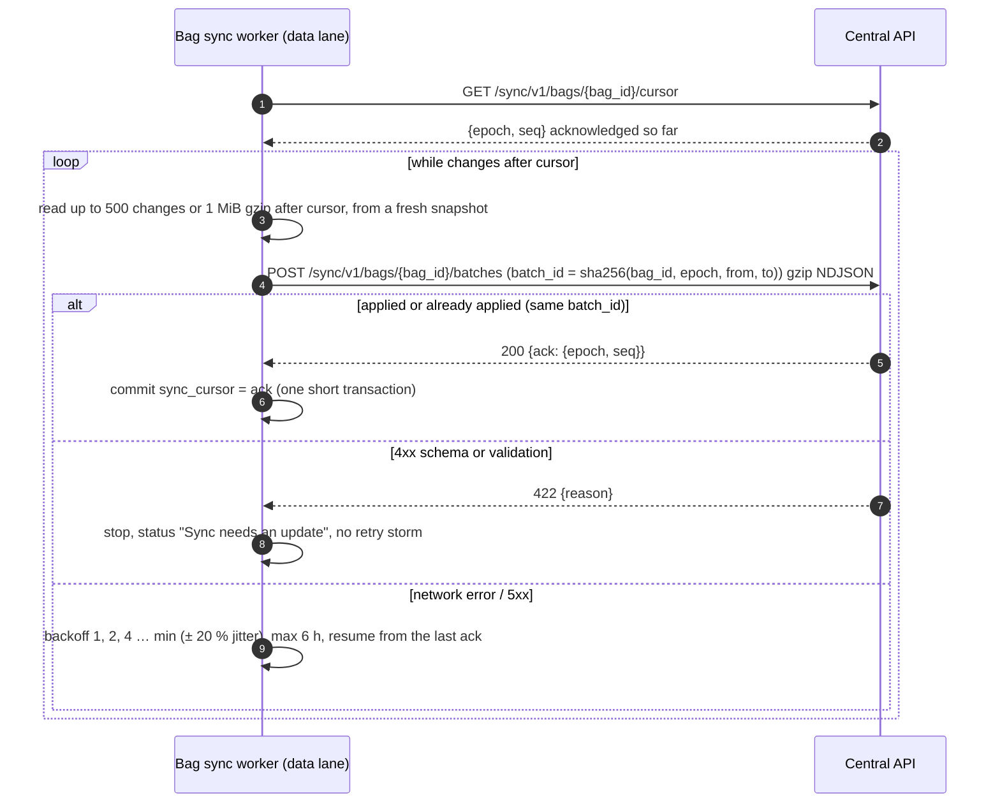

# Synchronisation specification (deliverable E)

Version 0.6 · 13 Nov 2026 (revision 5) · System Architecture Agent · status: **revision 3 (answers verification round 3)**

## 1. Conclusion first

- **Phase 1 (build now): no network synchronisation.** Each bag is a stand-alone system of record for what happens on it. Data moves by **USB stick or a downloaded file, carried by a person**: encrypted "Back up the bag" files and "Download learner data" zips go to the office; signed content packs and releases come back. This matches the kit's decision "Offline, one Pi per location … no link to other kits" (KIT `decisions.md`) and owner question O-4 is unanswered.
- **Phase 2 (only if O-4 = yes): an optional, outbound-only HTTPS sync** from the bag to a central server when the bag happens to have an uplink. It reuses phase 1's identifiers, change sequence, tombstones and manifests, so no schema redesign is needed. Nothing on the bag ever waits for it.
- The design keeps conflicts out by **ownership**, not by merging: learner data is written only on its bag; content is written centrally (packs) or on its bag (local lessons), never both.

## 2. Data ownership matrix

"Bag" = the Sensebod Offline edge. "Office" = EasySTEM central tooling (phase 1: a technician's laptop tool; phase 2: a server). Security classes: **P** public lesson content, **I** internal, **S** personal, **S+** sensitive personal (children).

| Entity (table) | System of record | Created | Updated | Deleted | Offline changes | Direction | Conflict rule | Retention | Class |
|---|---|---|---|---|---|---|---|---|---|
| Learner (`learner`) | The bag where it was created | Bag (learner) | Bag (never renamed today) | Bag (learner or hub manager) | Yes, always | Bag → office | None possible: one writer; ids random per bag | Until deleted (O-6) | S |
| Progress (`lesson_progress`) | Bag | Bag | Bag (monotonic state) | Bag (cascade with learner/lesson) | Yes | Bag → office | None (one writer); office keeps the row with the higher `seq` (§3.2) | With learner | S |
| Child protection counts (`sensitive_activity_count`, in the separate file `counts.sqlite3`) | Bag | Bag (anonymous events, no learner) | Bag (increment) | Bag (retention) | Yes | Bag → office | **No sequence number** (V-019). Merged by natural key `(bag_id, lesson_id, day)` with `max(opened)`, `max(finished)`: within a lineage the totals only grow, so a smaller value can only be a loss on the bag, and taking the maximum is idempotent and order-independent | 2 years | I (no person) |
| Pack content: portals, groups, series, lessons, assets from a pack | Office (content pack) | Office | Office (new pack version) | Office (pack removal) | Bag may only place/unplace, publish/unpublish and choose a picture (assumption A-S1) | Office → bag | Pack version wins for the fields the pack owns; bag-owned fields (placement, status, picture) are kept | While installed | P |
| Local content: lessons, series, pictures, uploads created by admins on the bag | Bag | Bag | Bag | Bag | Yes | Bag → office (inside backups only) | None (one writer) | Until deleted | P/I |
| Media files (`blob`) | Owner of the lesson that references it | Office (pack) or bag (upload) | Never (immutable, content-addressed) | GC when unreferenced | — | Both, by hash | Identical hash = identical file; no conflict possible | While referenced | P |
| Admin accounts | Bag | Bag (hub manager, technician CLI) | Bag | Bag | Yes | Not synchronised in phase 1 | — | Until removed | S (hash) |
| Audit events | Bag | Bag | Never | Retention | Yes | Bag → office (inside backups) | Append-only, local integer ids, office keys by `(bag_id, epoch, epoch_nonce, id)` | 2 years / 50k | I |
| Settings | Bag | Bag | Bag | — | Yes | Not synchronised | — | — | I |
| Exports, jobs, sessions, health, idempotency | Bag | Bag | Bag | Bag | Yes | Not synchronised (diagnostics report carries summaries) | — | Short | I |
| Releases, content packs, signing and backup public keys | Office | Office | Office | Office | — | Office → bag | Version ordering; signature required | — | P |

Assumption **A-S1** (conservative, for the owner): text and files of lessons that came from a content pack are read-only on the bag; an admin who wants a different version makes a local lesson. This removes the only possible two-writer case.

## 3. Phase 1: collection by USB or file

### 3.1 What travels
- **Edge → office:** the records backup (`.sbk`, encrypted to EasySTEM, DATA-EXPORT §3.2), which contains the whole database snapshot including learners, progress, counts, local content metadata and audit; optionally the full USB backup (media). The learner-data zip is for partners and is **not** an input to the office database.
- **Office → edge:** signed content packs and signed releases on a stick (SYSTEM-ARCHITECTURE §8.3, §10.6).

### 3.2 Event identity and ordering on the bag
Every syncable row carries `seq` from the bag's single counter `bag_meta.change_seq`, stamped inside the same write transaction (DATABASE §4.6). Deletions leave a `tombstone(entity, entity_id, seq)`. Because SQLite serialises writers, `seq` is a gap-tolerant, strictly increasing order of committed changes, **independent of the wall clock** (ADR-014).

`bag_meta.epoch` (integer, starts at 1) is incremented by **every replacement of the live database** (V-008), and each new epoch gets a random `bag_meta.epoch_nonce` that names this particular lineage:

| Where the live database is replaced | New epoch | Document |
|---|---|---|
| Automatic recovery from a local snapshot at boot | bag epoch + 1 | DATABASE §9.3 step 3 |
| Update: restore of the pre-update snapshot (automatic rollback at step 6, or later by a technician) | bag epoch + 1 | SYSTEM-ARCHITECTURE §10.6 |
| **Technician restore from a backup** (often onto a **fresh card**, whose own epoch is 1) | **max(backup epoch, bag epoch, office's highest imported epoch for this `bag_id`) + 1** (V-008 remainder) | DATA-EXPORT §12 |
| Any future path that swaps the database file | through the same `replace_live_database(new_epoch)` routine | — |

**The office's number reaches the bag without a network.** `sensebod-offline-office bag-registry --out <key stick>` writes `bag-registry.json`: for every bag, its `bag_id`, the highest epoch imported, and that epoch's nonce, plus (revision 4) the non-secret override `key_version` and a `revoked` flag (ADR-017; the override secrets are never in the registry), signed with the office's OpenSSH key (namespace `sensebod-offline-registry`). The technician carries it on the same key stick as the `age` identity (it is needed anyway to decrypt). `sensebod-offline-admin restore` reads it, verifies the signature, and uses its epoch as `--min-epoch`. If the registry is missing, fails verification or does not list the bag, the CLI **refuses**, unless the technician types `--min-epoch <n>` read from the office tool by phone, or `--no-office-record` with the typed statement "No backup of this bag ever reached the office." (audited). Evidence: the verifier's case (fresh card restored from an older backup after the office had imported epoch 2 from the dead card) fails with the revision-1 rule and passes with this one (`poc/poc_sync_epoch.out` scenarios 2 and 3; the verifier's own script runs unchanged against the new PoC classes).

**Registry key, freshness and rotation (V-029).**
- *Key.* A dedicated Ed25519 **registry signing key**, separate from the release and content-pack keys. Its private half lives only on the EasySTEM office machine that runs `sensebod-offline-office` (passphrase-protected; backed up in the same place as the backup private keys, O-11). Its public half is shipped in every release in `/etc/sensebod-offline/allowed_signers` as `registry@easystem namespaces="sensebod-offline-registry" ssh-ed25519 …`; the release and content keys carry `namespaces="sensebod-offline-release"` / `"sensebod-offline-content"`, so a file signed with the wrong key or namespace is refused (`ssh-keygen -Y verify -n sensebod-offline-registry`).
- *Rotation.* A new registry key is added to `allowed_signers` in a release with `valid-after="<date>"`; the old one gets `valid-before="<date + 90 days>"` and is removed one release later. If the private key is lost or exposed, the next release removes it at once and the office re-signs with the new key; a bag that has not received that release still accepts the old key (inherent to offline bags; the epoch nonce check below remains the safety net).
- *Freshness without the bag's clock.* The registry records, per bag, the highest imported `(epoch, change_seq)` and the `backup_id`s imported, plus `generated_at` (office clock) — it is never compared with the bag's clock (which may be `unsure`, ADR-014). The CLI checks: (a) the backup being restored is listed in the registry **or** its manifest `(epoch, change_seq)` is not above the registry's newest for that bag; otherwise (b) it warns "The office has not seen this backup. Import it at the office first, or continue." and continues only after a typed confirmation (audited). Any backup the office has not yet seen can still cause a clash later; that is caught by the nonce check.

**Second line of defence at the office: the epoch nonce.** If a backup arrives whose `(epoch, epoch_nonce)` differs from a pair already imported for the same `bag_id` and the same epoch number, two lineages share an epoch (for example a restore done with a wrong `--min-epoch`). The office tool then **does not import it automatically**: it reports `epoch_clash` with both backups for a technician to resolve. **Clash remedy without data loss (V-029):** on the bag, `sudo sensebod-offline-admin new-epoch --registry <bag-registry.json>` (or `--min-epoch <n>`) stops the API, moves the live database to epoch `max(current, registry max) + 1` with a new nonce and the counter lift, **without** restoring anything, and **re-stamps under the new epoch every row and tombstone changed since the last replacement** (all syncable rows and tombstones with `seq > bag_meta.epoch_base_seq`, in their original `seq` order, each with a fresh `next_seq()`), all in one transaction; then it restarts and audits `epoch.new` with the number of rows re-stamped. Without the re-stamp, the rows written during the clash keep `seq` values the office already holds from the other lineage and are ignored: a learner's name removal is lost (revision 3a, V-029; `poc/poc_sync_epoch.out` scenario 5a fails, 5b passes). With it, the next backup imports cleanly and nothing is lost. The clashing backup stays in the office's report and is resolved there by hand (its rows are usually a subset of what the bag still has). `poc/poc_sync_epoch.out` scenarios 4–5; the remedy is test SYNC-1 (extended).

**Why, and how ordering stays a single number.** If the live database goes back to an older state (snapshot or backup at seq 300) after the office has already seen seq 500, new changes would reuse 301…500 and look *older* than what the office holds; a later tombstone (a learner who removed their name) would then be ignored. To avoid that without adding a column to every table, the increment also lifts the counter: `change_seq = max(change_seq, epoch × 2^40)`. Every change made after a replacement therefore has a larger `seq` than anything stamped before it, in any epoch (2^40 ≈ 10^12 changes per epoch; SQLite integers are 64-bit). The pair `(epoch, seq)` is kept in manifests for people; comparisons use `seq` alone.

### 3.3 Import at the office (idempotent)
The office tool (`sensebod-offline-office import <file.sbk>`; HANDOFF SYNC-1, a small CLI over a central SQLite or PostgreSQL) does, per backup:

1. Decrypt with the office key; verify manifest and both database SHA-256s; read `bag_id`, `epoch`, `epoch_nonce`, `change_seq`, schema head (all in `BACKUP-MANIFEST.json`).
2. Record the backup in `imports(bag_id, backup_id, epoch, epoch_nonce, change_seq, imported_at)`; importing the same `backup_id` again is a no-op (**idempotency**).
3. For each syncable row: upsert keyed by `(bag_id, entity, id)` **only if** the incoming `seq` is greater than the stored one. Tombstones delete under the same rule. An older backup imported after a newer one therefore changes nothing (**no regression**; test SYNC-1).
4. Epoch clash check: a backup whose `(epoch, epoch_nonce)` differs from an imported pair with the same epoch number is not imported; it is reported as `epoch_clash` (§3.2).
5. Because every backup is a full snapshot: when a backup's `epoch` is greater than the last imported epoch of that bag, rows the office holds for the bag that are neither in the snapshot nor tombstoned are marked `lost_on_bag` (kept, not deleted, and listed in the import report): they were written on the bag after its last good snapshot and lost in the recovery. Example (test SYNC-1, V-008): B1 imported at seq 500 → bag recovers to a snapshot at seq 300, epoch 2 → a learner removes their name (tombstone at seq 2·2^40 + 1) → B2 imported: the learner is deleted at the office, and rows 301…500 not in B2 are reported as lost on the bag.
6. Child protection counts (from `counts.sqlite3` in the backup): merged with `max(opened)`, `max(finished)` per `(bag_id, lesson_id, day)` (§2; V-019).
7. Schema compatibility: the tool knows every schema head it has ever been released with and maps older ones forward; a backup from a newer schema than the tool is refused with "Update the office tool first".

### 3.4 Retry and failure handling
There is no network to retry. A stick that is lost or unreadable is replaced by another backup; because every backup is a full snapshot, nothing depends on receiving every stick (no gaps to repair). The bag records `lastOffBagBackupAt` and reminds the facilitator after 14 days.

## 4. What the office learns, and does not
It learns learners (names as typed), progress, Child protection **counts**, local lesson metadata and the audit. It never learns Child protection activity per learner (not stored on the bag by default, ADR-009).

## 5. Content distribution (both phases)

Separate from data sync, as INS §9.5 asks:

| Need | Design |
|---|---|
| Versioned manifests | `manifest.json`: pack id, version (semver), min app version, entries for groups/series/lessons with their fields, files by SHA-256 and size |
| Integrity | OpenSSH signature over the manifest (`ssh-keygen -Y verify -n sensebod-offline-content`), each file hash-checked while copying |
| Resumable | Files are content-addressed; already present ⇒ skipped; partial copies are temp files removed at boot |
| Atomic activation | All rows of the pack version change in **one** transaction after every file is present; `content_rev` bumped once |
| Storage check | Sum of missing files + reserve ≤ free, before starting (`507`) |
| Rollback | The previous pack version's rows are kept in the snapshot taken before activation; "Remove this version" re-installs the previous manifest if its files are still present (GC keeps unreferenced files 24 h; a pack update keeps the previous version's files until the next successful snapshot) |
| No repeated downloads | Hash-addressed: unchanged files are never copied again |

## 6. Phase 2 (optional): outbound HTTPS sync — design only, not to be built until O-4 = yes

### 6.1 Topology and triggers
The bag gets an uplink occasionally (a technician's phone hotspot, a school router on Ethernet). Only the bag initiates; nothing on the internet can reach the bag; clients' traffic is never routed. Trigger: an uplink with a default route appears **and** `timedatectl` reports the clock synchronised (TLS needs a correct clock); then every 15 min while the uplink lasts.

### 6.2 Authentication
Per-bag Ed25519 key pair generated at provisioning (private key `0600` on the bag; public key registered at the office with `bag_id`). **Revision 5a:** this key is created in phase 1 by `sensebod-offline-admin provision`, because the online reset (§6.3b) already uses it; its public half is registered with `sensebod-offline-office register-bag-key`. Every request is sent over TLS to a pinned EasySTEM host and signed (HTTP Message Signatures, RFC 9421) with the bag key. A stolen bag's key is revoked centrally; the bag holds no credential that can read other bags' data (**compromised sync credentials** limited to that bag's own uploads).

### 6.3 Push protocol (edge → central)

Change record (NDJSON line): `{"bag":"<bag_id>","epoch":2,"seq":1234,"entity":"lesson_progress","id":"lr-…|ls-…","op":"upsert","schema":"learners.0007","data":{…}}`. Tombstones: `"op":"delete"`, no `data`. Child protection counts travel as `{"bag":…,"entity":"cp_count","lesson":…,"day":…,"opened":n,"finished":n}` **without** `epoch`/`seq` and are merged with `max` (§2, V-019).

- **Idempotency:** `batch_id` is deterministic; the server stores it and returns the same ack for a repeat. Records are applied with the `(epoch, seq)` rule of §3.3, so a lost acknowledgement causes a harmless re-send. No exactly-once delivery is assumed.
- **Checkpointing:** the cursor moves only after a 2xx ack; a crash between send and ack re-sends the batch.
- **Partial batches:** the server applies a batch in one database transaction or not at all.
- **Prolonged offline:** the change log is the database itself plus tombstones (kept ≤ 1 year); if a bag is offline longer than tombstone retention, the first sync falls back to sending a full encrypted snapshot (the phase 1 backup) instead of a change stream.
- **Repeated restarts:** the cursor is durable; the worker restarts from it.
- **Schema differences:** each record carries its schema label; the server accepts the last N released schemas and maps them; unknown newer schema → `422`, bag shows "Sync needs an update".
- **Status:** `/admin/status.sync` = `{enabled, lastSuccessAt, ackedSeq, pendingChanges, lastError}`.

### 6.3b Online password reset (OWNER-3, ADR-017, revision 5: V-032)
The first phase-2 function the owner asked for. EasySTEM's **reset service** is **store-and-forward only**:
- When the bag has internet, it posts the override request `{bag_id, request code, username, requestId}`, signed with its Ed25519 sync key (§6.2).
- EasySTEM staff verify the caller (SYSTEM-ARCHITECTURE §9.9 procedure) and mint the code **on the offline office machine**, then paste it into the service.
- The bag polls with signed requests, stores the code and acknowledges it, and the service then deletes it.
- The person's browser, which holds the request cookie, completes the reset.
- The service holds **no `M_v`, no `K_bag` and no code-signing key**; its secrets are its TLS key and staff logins with a second factor.
- Every step is idempotent by `requestId`, so a dropped connection is retried safely.
- Nothing on the bag depends on this service: the offline path (code by phone) always works.

### 6.4 Pull (central → edge)
Content pack manifests and releases (same signed artefacts as USB, fetched with HTTP `Range` and resumed); optionally a list of disabled admin usernames.

### 6.5 Conflict handling
None needed for edge-owned entities (single writer). Pack content: central version wins for pack-owned fields (A-S1). Admin disable lists: "disabled wins" (a central disable is applied; a central enable never re-enables a locally disabled account).

### 6.6 Revocation while offline
An offline bag cannot receive a central revocation. Controls: sessions expire within 12 h; a hub manager on site can disable accounts locally at any time; phase 2 applies central disables at the next sync. This limit is inherent and accepted.

## 7. Why not build sync now
No central server exists or is decided (O-4); the bags have no uplink in normal use (KIT); a sync client adds a credential to protect, a TLS clock dependency, and code that would not be exercised in the field. Phase 1 already provides what phase 2 needs from the bag: stable ids (ADR-016), `(epoch, seq)` ordering, tombstones, `bag_id`, signed manifests.

## 8. Tests
`SYNC-1` (office import idempotency and no regression), `BK-1..3` (backups and restore), `PL-5` (power cut during USB backup), and for phase 2 only: duplicate batch, lost ack, 6-hour backoff cap, 422 stops retries, wrong clock blocks sync until NTP, one-year-offline fallback to snapshot.
