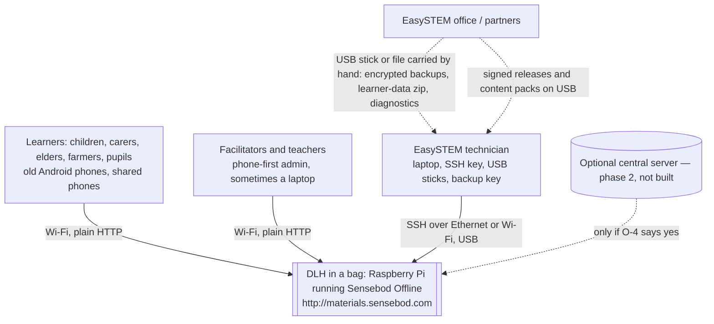
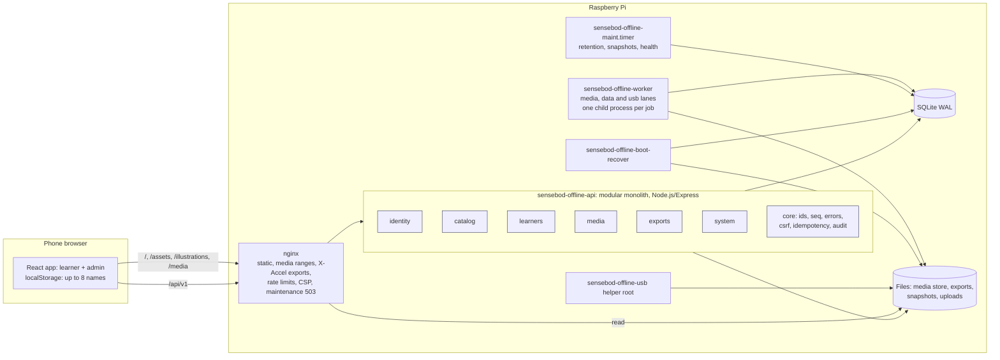
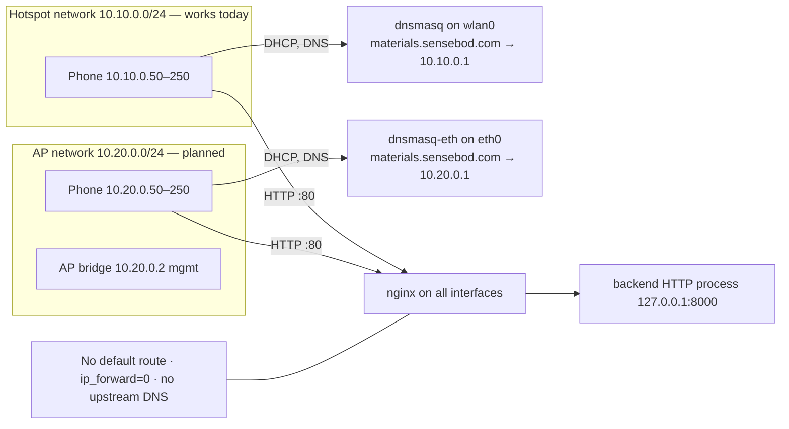
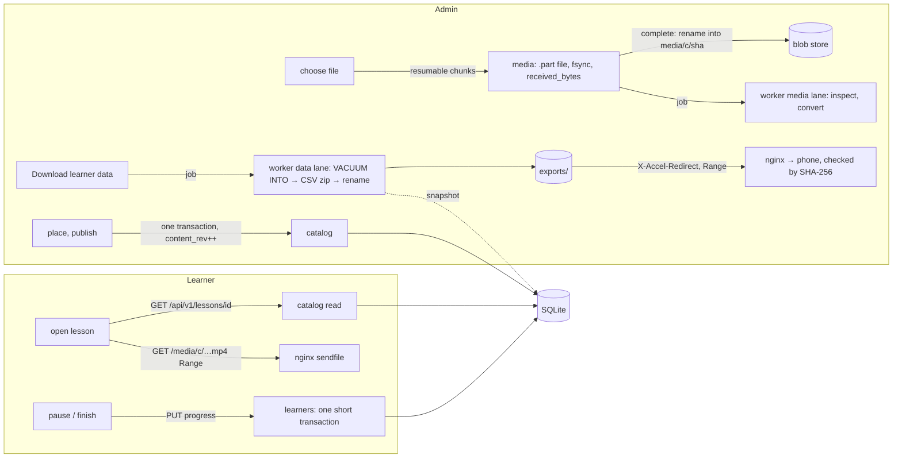
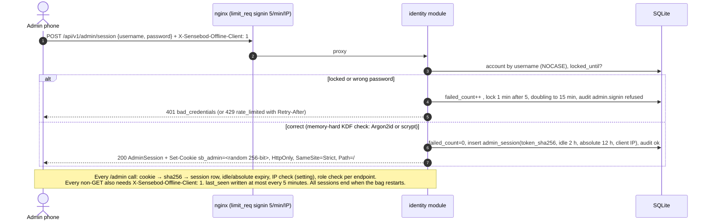
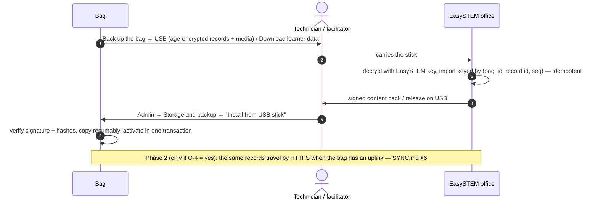
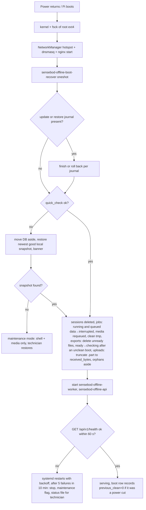
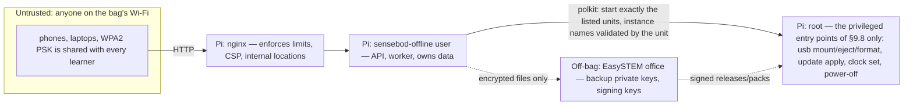

# Sensebod Offline system architecture

Version 0.5 · 13 Nov 2026 (revision 5: V-030…V-036; revision 4: OWNER-2…6) · System Architecture Agent · status: **revision 2: answers verification round 2 and the owner's runtime correction (OWNER-1: backend is Node.js/Express, design stays tooling-agnostic, §4.1), changes listed in `the revision notes` (revision 1: `the revision notes`); awaiting reverification**

Deliverables A (system architecture), B (diagrams), F (deployment), G (security), plus requirements and constraints register, failure-mode analysis, resource budget, monitoring and the test plan. Companion documents in `docs/system/`:

| File | Deliverable |
|---|---|
| `DATABASE.md` | C — database |
| `openapi.yaml`, `API-DECISIONS.md` | D — API contract and the item-by-item review of the frontend's proposal |
| `SYNC.md` | E — synchronisation (USB-first; cloud sync is phase 2) |
| `DATA-EXPORT-AND-BACKUP.md` | Owner requirement: safe download of user data, backup, restore, power loss |
| `ADR/` | H — decision records |
| `HANDOFF-PACKAGES.md` | I — work packages |
| `poc/` | Throwaway proofs of concept and their output (run on a Mac) |

**Evidence rule used throughout.** "Measured" means measured, and says where (all measurements in this design are on the development Mac, never on a Pi or a phone). "Kit fact" means stated by the DLH-in-a-bag build guide or the IIAB review (treated as data; they win over assumptions). "Assumption" and "policy" figures are marked as such and have a verification step. Nothing here has run on a Raspberry Pi.

---

## 1. Objectives and scope

**Objective.** Turn the "DLH in a bag" Raspberry Pi into a self-contained Sensebod Offline server: it serves the existing React app (built by the frontend streams, `app/`), a backend API that implements the agreed contract, learners' optional progress, the facilitators' content tools, and safe export, backup and restore of data, on its own Wi-Fi, with no internet, through power cuts.

**In scope.** Everything on the Pi (OS configuration, network services, nginx, backend, database, files, jobs, updates, monitoring), the API contract, the client-side behaviours the backend depends on, the USB/technician path, and the plan to validate it.

**Out of scope for phase 1 (deliberately).** Any central server or cloud sync (owner question O-4; `SYNC.md` designs it as an optional phase 2); HTTPS (ADR-004); an offline-capable app on the phone (Mode B; frontend `ARCHITECTURE.md` §10); H5P player; Krio UI translation delivery (O-5); screens not yet designed (Learners and progress, Settings) beyond the API they will need.

## 2. Requirements register

Ids are used in the failure-mode analysis, tests and handoffs. "Src" = where the requirement comes from (DD = `docs/DESIGN-DECISIONS.md`, AC = `docs/API-CONTRACT.md`, FA = `docs/ARCHITECTURE.md`, KIT = DLH build guide, OWN = owner instruction, INS = architect instructions).

### 2.1 Functional

| Id | Requirement | Src | Answered in |
|---|---|---|---|
| FR-1 | Serve the app shell, assets, fonts, illustrations from the Pi; no external origin | DD §1, FA §10–12 | §8, §10 |
| FR-2 | Learner content API: portals → groups → series → lessons, only published and placed lessons | AC §2–3 | `openapi.yaml`, DATABASE §6 |
| FR-3 | Serve media with byte ranges (video seek), captions, narration audio | DD §2.4, AC §3 | §8.2 |
| FR-4 | Optional "Save my progress": learner = name + role, no password; progress per lesson, monotonic, quiz scores; "continue where you stopped" | DD §2.1, §2.6; AC §4 | DATABASE §6.3 |
| FR-5 | No "list all learners" for learners; unguessable learner ids | DD §2.1 | ADR-016, §9 |
| FR-6 | Child protection activity treated as sensitive; counted anonymously (no learner id on the wire, in the database or in logs) unless the owner decides otherwise | DD §2.3, §5 | ADR-009 |
| FR-7 | Admin sign-in working offline; session surviving a sleeping phone during an upload; protection against other Wi-Fi users acting as admin | DD §3.1 | §9.3–9.5 |
| FR-8 | Uploads of large files from phones over weak Wi-Fi; streamed to disk; retry without duplicates; never a half-written file presented as complete | DD §3.2, AC §6.2 | ADR-006, DATA-EXPORT §15 |
| FR-9 | Automatic lesson type from the file; server-side inspection; background conversions (voice note, smaller video copy, PDF pages, Word text, package checks) without starving learners | DD §2.4, §3.2 | §5.4, §11 |
| FR-10 | Drafts, placement with renumbering, quiz always last, publish/unpublish, whole-list order with conflict detection | DD §3.3, AC §6.3–6.5 | DATABASE §6.2 |
| FR-11 | Questions, Try it setup (package or hotspots), pictures gallery | AC §6.4, §6.6 | `openapi.yaml` |
| FR-12 | **Download learner data safely, accounting for power loss** (scope, consistency, atomic creation, power-loss behaviour, resumable/verifiable download, USB, encryption, audit, retention, UI states) | OWN, DD §4 | `DATA-EXPORT-AND-BACKUP.md` |
| FR-13 | Back up the bag and restore it | DD §4.7, INS §18 | DATA-EXPORT §9–12 |
| FR-14 | Storage information for the admin; "not enough space" states | AC §6.1, DD §4.8 | §11, `openapi.yaml` StorageInfo |
| FR-15 | Install content and software updates without internet (USB) | INS §19, KIT | §10.6–10.7 |
| FR-16 | Admin password set by EasySTEM at deployment; reset online when connected; offline override code from EasySTEM ("longer ttl" than an authenticator code) | OWNER (DD §7.2–7.3) | §9.4, §9.9, ADR-017 |
| FR-17 | Learner data kept two months, removed automatically; hub manager can clean on demand after seeing the last export date | OWNER (DD §7.5) | DATABASE §7, DATA-EXPORT §8.1 |
| FR-18 | Data goes to EasySTEM ("Export for EasySTEM" is the default export) | OWNER (DD §7.4) | DATA-EXPORT §1 |

### 2.2 Non-functional

| Id | Requirement | Target (how verified) |
|---|---|---|
| NFR-1 Offline | Every learner and admin journey works with the Pi's uplink unplugged | Test OFF-1: 100 % of journeys pass with no default route on the Pi and DNS answering only local names |
| NFR-2 Durability | A save the API confirmed (2xx) survives a sudden power cut | Test PL-1: 0 acknowledged writes lost in 200 power cuts |
| NFR-3 Integrity | Database never corrupt after power loss; if it is (storage failure), automatic recovery to the last good snapshot | Test PL-1/PL-2: 0 `integrity_check` failures; DB-5 recovery test |
| NFR-4 Responsiveness | Content API p95 < 300 ms, progress PUT p95 < 300 ms at 40 simulated phones on the Pi, while a smaller-copy transcode runs | Test PERF-2 (target; unverified) |
| NFR-5 Footprint | Sensebod Offline services (excluding ffmpeg while it runs) < 600 MB RSS total; no swap use in normal operation | Test PERF-3 |
| NFR-6 Old phones | Android 8-era Chrome/WebView 58+, plain HTTP, no service worker, no secure-context APIs | Frontend floor (FA §4, §13); tests BR-1..4 |
| NFR-7 Security | Admin actions require an admin session; learner data leaves the bag only encrypted and audited; no plaintext secrets | §9; tests SEC-* |
| NFR-8 Recoverability | RTO and RPO as in §13.2 | Tests PL-*, BK-* |
| NFR-9 Maintainability | No command line for facilitators in normal use; technician tasks are single documented commands | §10, HANDOFF DEV package |
| NFR-10 Wear | Bounded writes: no per-request writes for reads; progress coalescing; logs capped | §12, DATABASE §4 |

### 2.3 Deployment constraints (kit facts unless marked)

| Id | Constraint | Source / status |
|---|---|---|
| DC-1 | Raspberry Pi 5, 8 GB, 256 GB microSD, official-grade 5 A USB-C supply, fan fitted | KIT (README "Hardware used") |
| DC-2 | Raspberry Pi OS 64-bit **desktop** edition (pi-gen stage4), built 2026-10-06 (Debian 13 base per brief); nginx 1.26.3, dnsmasq 2.91 installed | KIT; Debian version of this image to confirm with `cat /etc/os-release` |
| DC-3 | Hostname `easystem`, user `admin`, SSH key-only; mDNS name `easystem.local` (technicians) | KIT |
| DC-4 | Hotspot "Offline Library": WPA2, 2.4 GHz ch 6, Pi `10.10.0.1/24`, DHCP `.50–.250`, DNS answers only `materials.sensebod.com → 10.10.0.1` | KIT `setup-hotspot.sh` |
| DC-5 | External AP path (planned, **not yet run**): Pi `eth0 10.20.0.1/24` + separate `dnsmasq-eth`, AP in bridge mode with DHCP off; 100 Mbps link on the units tried; no AP working yet | KIT Step 15, App. E |
| DC-6 | Plain HTTP only; HTTPS deferred (needs DNS-01 at Hostinger, 90-day renewals with internet) | KIT App. H |
| DC-7 | Journald is in memory on the Pi today (logs lost at restart); one unexplained restart seen | KIT App. C |
| DC-8 | Wi-Fi, not the Pi, is the bottleneck: hotspot ≈ 55 Mbps total, Pi CPU ≤ 3 % at 50 simulated users; plan on ≈ 10 devices on the hotspot until tested; real device limit not measured | KIT App. A |
| DC-9 | Heat: without fan throttles at 83 °C under full load; with fan 65 °C | KIT App. B |
| DC-10 | Battery runtime unmeasured (planning estimate 3–4 h on 100 Wh for Pi + AP) | KIT App. C |
| DC-11 | Old Android phones (Android 8 era), 320 px screens, plain HTTP: no service worker, no Web Crypto, no `getUserMedia` | DD §1, FA §10 |
| DC-12 | Pi 4 may be used where available (INS §2) | Assumption: same arm64 image; Pi 4 slower for conversions |

### 2.4 Operational requirements

| Id | Requirement | Answered in |
|---|---|---|
| OR-1 | Install and clone cards without internet at the site | §10.1, §10.5 |
| OR-2 | Admin-facing backup, export, update and power-off as buttons; technician tasks as single commands | §10, DATA-EXPORT |
| OR-3 | Diagnostics collectable offline by a technician (USB or download) | §12, DATA-EXPORT §3.4 |
| OR-4 | Bounded logs, no storage exhaustion by logs | §12.3 |
| OR-5 | Recovery from lost admin password without internet | §9.4 |
| OR-6 | Per-bag secrets even when cards are cloned from one master image | §10.5 |

### 2.5 Synchronisation requirements

| Id | Requirement | Answered in |
|---|---|---|
| SR-1 | Edge works stand-alone indefinitely | §3, ADR-010 |
| SR-2 | Learner data and diagnostics can leave the bag by USB/technician | DATA-EXPORT, SYNC §3 |
| SR-3 | Content can arrive by USB with integrity checks and atomic activation | §10.7, SYNC §5 |
| SR-4 | A later cloud sync must be possible without redesign (stable ids, change sequence, tombstones) | DATABASE §4.6, SYNC §6 |

## 3. Architecture overview

A **modular monolith on one Pi**: nginx serves every static byte and media file and proxies `/api/` to one backend application process (the owner's runtime is **Node.js with Express**; this architecture states requirements, not framework choices, §4.1) on `127.0.0.1:8000`; one worker process runs background jobs from a job table in the same SQLite database; systemd supervises everything; dnsmasq and NetworkManager provide the local network. There is no broker, no container runtime, no second database, no cloud dependency.

### 3.1 System context (B-1)



### 3.2 Logical components (B-2)



### 3.3 Physical deployment (B-3)

```mermaid
flowchart TB
  subgraph Bag[The bag]
    PS[Power bank or mains<br/>USB-C 5 A] --> PI
    subgraph PI[Raspberry Pi · kit model Pi 5 with 8 GB · microSD 256 GB · fan · RTC battery recommended]
      subgraph OS[Raspberry Pi OS 64-bit, Debian 13 base]
        NM[NetworkManager hotspot wlan0 10.10.0.1]
        DQ[dnsmasq wlan0 + dnsmasq-eth eth0]
        NGX[nginx :80]
        GU[backend HTTP process 127.0.0.1:8000<br/>Node.js/Express]
        WRK[sensebod-offline-worker]
        J[journald persistent 64 MB]
      end
      SD[(microSD ext4<br/>/opt/sensebod-offline releases<br/>/var/lib/sensebod-offline data)]
      USBP[USB 3 port: sticks for backup, updates, content]
    end
    AP[External dual-band AP, bridge mode, DHCP off<br/>planned, not yet working] -->|Ethernet 10.20.0.0/24| PI
    PoE[PoE injector: POE→AP, LAN→Pi] --- AP
  end
  Phones[Phones and laptops] -. 2.4 GHz WPA2 .-> NM
  Phones -. Wi-Fi .-> AP
```

### 3.4 Local networking (B-4)



### 3.5 Data flow (B-5)



### 3.6 Authentication flow (B-6)



### 3.7 Edge-to-central flow (B-7) — phase 1 is USB



### 3.8 Failure recovery flow (B-8)



## 4. Technology selections

| Concern | Choice | Why (alternatives in the ADR) | ADR |
|---|---|---|---|
| Architecture | Modular monolith: one backend code base and deployable, two systemd services (api, worker) + timers | Small team; no independent deployables needed | ADR-001 |
| Language/runtime | **Owner's choice: Node.js with Express** (OWNER-1). The architecture is runtime-agnostic: it binds the backend to the requirements of §4.1, not to libraries. The Node runtime is pinned inside each release (an official LTS `linux-arm64` build in the release folder, so native modules match its ABI and A/B releases switch runtime and code together); dependencies, including native modules built for `linux-arm64`, are shipped in the release; no package download on the Pi | Owner decision; runtime pinning makes offline installs and rollbacks atomic. The frontend's "no Node on the Pi" (FA §12) referred to serving the static app and is superseded for the backend | ADR-001 |
| Validation | Explicit validators per endpoint, tested against `openapi.yaml` (generated or hand-written; library is the backend engineer's choice) | The contract is small | ADR-001 |
| Database | SQLite WAL, `synchronous=FULL` | Read-heavy, few writes, one owner process group, power-loss recovery is a WAL replay | ADR-002 |
| Background work | Job table in SQLite + one worker with three lanes, a child process per job, stall timeouts; systemd timers for snapshots and retention | No broker for < 1 job/min | ADR-003 |
| Web server | nginx (kit 1.26.3) | Already chosen and verified in a container by the frontend; sendfile, ranges, `X-Accel-Redirect` | ADR-001 |
| Transport | Plain HTTP on port 80 | No maintainable certificate path for offline bags and learners' own phones | ADR-004 |
| Media | Content-addressed files under `/var/lib/sensebod-offline/media/c/`, metadata in `blob` | Dedupe, immutable files, safe names (fixes B-03), easy incremental USB backup | ADR-005 |
| Uploads | Resumable chunked protocol (+ single request ≤ 16 MiB) | 34 MB is normal, hundreds of MB possible over weak Wi-Fi | ADR-006 |
| Media tools | `ffmpeg`/`ffprobe` (Debian), `pdftoppm`/`pdfinfo` (poppler-utils), Word `.docx` text extraction in the backend (unzip + XML parsing; no office suite), no LibreOffice | LibreOffice is large and memory-hungry; `.docx` → Read text blocks suits old phones; `.doc` refused ("Save it as PDF or .docx") | ADR-005 |
| Export/backup | Snapshot + atomic file + nginx-served download with tickets + in-page SHA-256 | Owner requirement | ADR-007 |
| Encryption | `age` (backups, to EasySTEM public keys); AES-256 (WinZip AE-2) zip for learner data — any writer that produces AE-2 (§4.1 R-8) | Bag cannot read its own backups; partners can open zips | ADR-008 |
| Release signing | OpenSSH signatures (`ssh-keygen -Y verify`, already on the Pi) | No new tool; key rotation via `allowed_signers` | ADR-011 |
| Ids | Prefixed 128-bit random base32 | Unguessable, globally unique, URL-safe | ADR-016 |
| Network | NetworkManager hotspot + dnsmasq (kit), external AP in bridge mode | Kit decisions kept | ADR-015 |

### 4.1 Backend runtime requirements (binding) and Node.js examples (not binding)

The owner chose **Node.js with Express** for the backend and asked that this architecture stay tooling-agnostic (OWNER-1). The table states **what the backend must do**. Libraries in the last column are **examples only**; the backend engineer may use others that meet the requirement, and each choice is checked by the listed test, not by name.

| # | Requirement (binding) | Why | Node.js examples (not binding) | Checked by |
|---|---|---|---|---|
| R-1 | The HTTP process streams request bodies to disk in bounded pieces, with back-pressure; it never buffers a whole upload in memory; it `fsync`s a chunk before acknowledging it | ADR-006, power loss | the raw request stream (`req`) piped to an `fs` write stream with `pipeline()`; no body parser on upload routes; `busboy` only if multipart were ever added | BE-7, PL-2, BR-2 |
| R-2 | The SQLite driver supports WAL, `busy_timeout`, `BEGIN IMMEDIATE`, `RETURNING`, and the **online backup API or `VACUUM INTO`**; it reports `SQLITE_BUSY`/`SQLITE_FULL`/`SQLITE_CORRUPT` as distinguishable errors | DATABASE §3–4, §9 | `better-sqlite3` (`.pragma()`, `.backup()`, `db.transaction(fn).immediate()`) | DB-1, DB-2, BK-1 |
| R-3 | **Writes are serialized**: one writer connection per process (or one process doing all writes); every write transaction is `BEGIN IMMEDIATE`, short, with **no `await`, timer, file or network I/O inside it** (with an asynchronous driver: one connection per transaction or a per-connection mutex, so two requests never interleave in one transaction) | SQLite single writer | with a synchronous driver in a single Node process, transactions are naturally serialized; keep each one short because it blocks the event loop while it runs | DB-2, code review |
| R-3L | **A lock wait never blocks a process that serves HTTP (V-026). Binding outcome:** while another process holds the write lock for up to 5 s, the API's event-loop delay stays p99 < 50 ms and max < 200 ms (test **DB-6**); after a bounded total wait of 5 s the request answers `503 busy` with `Retry-After: 2`. **Binding default (R-3a, revision 3a):** the API's connections use **`busy_timeout=0`**, and all API writes go through **one in-process single-flight write gate** (a promise queue): only the request at the head of the queue touches SQLite; it tries `BEGIN IMMEDIATE` and, on `SQLITE_BUSY`, retries **asynchronously** with timer-based backoff (5, 10, 20 … ms, capped at 200 ms per step, ±20 % jitter); the requests behind it wait in the queue without touching SQLite. Each request's total wait, **measured from its arrival including time in the queue**, is ≤ 5 s; when it is exceeded the request answers `503 busy`. Reads stay outside the gate (WAL readers do not take the write lock) and, on the rare `SQLITE_BUSY`, retry asynchronously with `busy_timeout=0`. A per-request retry with a non-zero `busy_timeout` is **not** allowed: each failed attempt blocks the loop for its timeout and many waiting requests add up (V-026, revision 3a). **Allowed alternative (R-3b):** all database access of the API runs off the event loop (a worker thread or a dedicated writer process); then `busy_timeout=5000` is allowed **inside** that thread/process, and the API awaits its answer. Either way, DB-6 decides | A synchronous wait freezes every request in the process: measured 1,503 ms frozen for a 1.5 s lock with `busy_timeout=5000`; with **200 concurrent writes** during the hold, per-request retry with `busy_timeout=20` froze the loop for 1,521 ms, while the revision-3a default (`busy_timeout=0` + single-flight gate) stayed at 6 ms with 212 lock attempts, and 8 ms with steady arrivals; R-3b: 6 ms (`poc/poc_lock_wait.out`, Mac, `node:sqlite`; the verifier measured 9–30 ms) | R-3a: a small `writeGate.run(fn)` promise queue whose head calls `db.transaction(fn).immediate()` (`better-sqlite3`) or `BEGIN IMMEDIATE` on `DatabaseSync` (`node:sqlite`) with `busy_timeout=0`; R-3b: `node:worker_threads` with the driver inside, messages in and out | **DB-6**, `poc/poc_lock_wait.out` |
| R-3H | **Lock-hold discipline for every other writer**, so that waits stay short: each write transaction of the worker supervisor, job children, `sensebod-offline-maint`, boot-recover and the CLIs holds the lock ≤ 50 ms on the Pi (target, measured in DB-6); job progress/heartbeat are single-row commits at most every 2 s; retention/GC batches ≤ 500 rows with ≥ 100 ms pause between batches; checkpoints are `PASSIVE` except a `TRUNCATE` attempted only when no job runs and **with `busy_timeout` ≤ 100 ms on that connection**, so a `TRUNCATE` that cannot finish gives up instead of stalling writers; processes that do not serve HTTP (job children, maint, CLIs) may use `busy_timeout=5000`; update and restore stop the API first (maintenance mode) | Bounds how long the API can ever wait | measured on the Mac: job commit ≤ 0.17 ms, progress commit ≤ 0.25 ms, 500-row batch ≤ 2.2 ms, `TRUNCATE` with a reader open gave up after 117 ms (`poc/poc_lock_wait.out`; the Pi's microSD will be slower, P-3) | DB-6, P-3 |
| R-4 | Passwords are hashed with a **memory-hard KDF**, Argon2id (preferred) or scrypt, stored as a self-describing string with parameters and salt; comparison in constant time; hashing must not block the event loop (asynchronous API). **Thread pool (V-028):** in Node, async `scrypt`, `fs` (incl. the `fsync` of upload chunks, R-1) and `crypto` hashing share libuv's pool (default 4 threads); set `UV_THREADPOOL_SIZE` (e.g. 8, in the systemd unit) so a few sign-ins cannot delay chunk `fsync`s, and keep the KDF cost measured on the Pi (PERF-1: < 1 s per hash, memory per hash recorded) | §9.3 T-1/T-2; R-1 latency | `node:crypto.scrypt` (async; built in, no native module, so a native Argon2 binding is optional) or an Argon2id binding; `crypto.timingSafeEqual` | SEC-3, PERF-1 |
| R-5 | Schema changes are **numbered, forward-only SQL migrations**, each applied in one transaction and recorded in a `schema_migrations` table; they run **only** from the update procedure; the schema after migration equals DATABASE §6 | DATABASE §10 | plain `.sql` files plus a small runner script, or any migration tool that meets this | DB-3, PL-4 |
| R-6 | The background worker is a **separate process supervised by systemd**, running each job in its own child process with progress over IPC and stall timeouts | ADR-003 | `child_process.fork` + `process.send` | PL-6, PL-7 |
| R-7 | The backend reads `/etc/sensebod-offline/sensebod-offline.toml` at start and refuses to start on unknown or invalid keys | §10.3 | any TOML parser, or the file may be JSON if the backend prefers (format is not architectural) | DEP-1 |
| R-8 | The learner-data zip is written with **WinZip AES-256 (AE-1 or AE-2)** encryption and opens in 7-Zip, ZArchiver and Keka; written streaming, **or** from the CSV files in the export's `.tmp/` folder, which are removed with it (acceptable: the snapshot with names is already there); the password is **never on argv or in the environment** of any process (V-027) | ADR-008 | **Proven on the Mac:** a ≈ 150-line AE-2 writer/reader using only `node:crypto` (PBKDF2-HMAC-SHA1, AES-256 with the WinZip little-endian counter, HMAC-SHA1) and `node:zlib` interoperates with libarchive both ways, refuses a wrong password and detects tampering (`poc/poc_ae2.out`); libarchive's library API is another writer; a CLI is acceptable only if it reads the password from a pipe or file descriptor (bsdtar's `--passphrase` is argv and therefore **not** acceptable) | P-2 (incl. 7-Zip and ZArchiver; `/proc/<pid>/cmdline` and `environ` show no password), EX-1 |
| R-9 | Request logging records the **route template**, status and duration only (§12.3); no framework access logger | V-001 | Express `req.baseUrl + req.route.path` in a small middleware | SEC-7 |
| R-10 | Every non-GET needs `X-Sensebod-Offline-Client: 1`; `Origin` checked when present; Host allow-list | §9.5 | a few lines of middleware | SEC-2 |
| R-11 | The release carries its own runtime and dependencies (no package download on the Pi), built for `linux-arm64`; native modules match the bundled runtime's ABI and the image's glibc; the release has a **self-check** (`bin/sensebod-offline-selfcheck`) that loads every native module, opens both databases through the chosen driver, does one write and one `VACUUM INTO` on the card, and reports runtime, SQLite and module versions; the updater runs it at step 6 and P-1 runs it on the kit Pi (V-028) | OR-1, ADR-011 | an official Node.js LTS `linux-arm64` tarball in `runtime/`; `npm ci --omit=dev` on an arm64 build machine (or in an arm64 container of the same Debian release) | P-1, DEP-1, DEP-3 |
| R-12 | One API process is the baseline; if more are used (e.g. a cluster), R-3/R-3L still hold through `BEGIN IMMEDIATE` and the asynchronous retry, and in-memory state (rate limits, idempotency in-progress markers) must live in SQLite or nginx, not in process memory | single writer, restarts | — | CON-1 |

The proofs of concept in `poc/` stay in Python on purpose: they test SQLite and filesystem behaviour (WAL, snapshots, fsync/rename ordering, crash recovery), which does not depend on the backend's language.

## 5. Backend modules

One backend code base (Node.js/Express in the owner's choice) organised as these modules. No module calls another's tables directly except through the listed service functions; all share `core`. The module boundaries are architectural; how they map to folders, routers or packages is the backend engineer's choice.

### 5.1 `core`
- **Responsibilities:** id generation (ADR-016); `next_seq()` (DATABASE §4.6); error model (`ApiErrorBody`), JSON responses and `Cache-Control`; CSRF header middleware (§9.5); `Host` allow-list; idempotency middleware for marked endpoints; audit writer; clock trust; settings access; request logging without query strings.
- **Data:** `bag_meta`, `setting`, `idempotency_record`, `audit_event`, `boot`.
- **Rules:** idempotency: first request with a key stores `in_progress`, executes, stores the response in the same transaction as the change; replay returns the stored status and body, **except one-time secrets: the export password is never stored (the replay carries `password: null, passwordShown: true`, V-004)**; different body hash → `422 idempotency_mismatch`; concurrent duplicate while `in_progress` → `409 in_progress`, `Retry-After: 2`.
- **Failures:** DB busy → `503 busy`; unhandled exception → `500 internal` with a generic message, details only in the log.
- **Tests:** idempotency replay and mismatch; CSRF header enforcement on every unsafe method; no query strings in logs.

### 5.2 `identity`
- **Responsibilities:** admin accounts, password hashing with a **memory-hard KDF** (Argon2id preferred, scrypt acceptable; stored as a self-describing PHC string so parameters can be raised later; parameters chosen so one hash takes 0.2–1 s and ≤ 64 MiB on the Pi, **unverified**, PERF-1), sign-in throttle and lockout, sessions, re-authentication, roles, technician CLI for account recovery.
- **Data:** `admin_account`, `admin_session`.
- **Interfaces:** `/admin/session*`, `/admin/accounts*`; `require_admin(role=None)` decorator used by every admin view.
- **Rules:** roles `hub_manager` (everything, incl. exports, backups, accounts, audit, clock, power-off, USB installs) and `admin` (content, uploads, own password, diagnostics). Max 10 accounts per bag (policy). Idle expiry 2 h, absolute 12 h; long uploads keep the session alive because each chunk is a request. Disabling an account or changing a password deletes its sessions at once.
- **Failures:** clock jumps can expire sessions early (acceptable: sign in again). Sessions and lockouts do not survive a reboot (boot recovery deletes them), because their expiry used a wall clock that may jump after a power cut (V-012).
- **Security:** no plaintext passwords stored or logged; constant-time comparisons; generic "Wrong name or password".
- **Tests:** lockout timings; session expiry; role matrix (§9.4) for every admin endpoint.

### 5.3 `catalog`
- **Responsibilities:** portals, groups, series, lessons, placement and renumbering, publish rules, questions, Try it setup, pictures gallery, learner-facing content reads with ETag (`W/"c<content_rev>"` combined with the path), admin library search.
- **Data:** `portal`, `content_group`, `series`, `lesson`, `lesson_asset`, `picture`, `tryit_package`.
- **Rules:** DATABASE §6.2; quiz validation (prompt, ≥ 2 answers, exactly 1 correct); type override; a lesson whose files are missing cannot be published.
- **Performance:** content reads are indexed lookups returning < 50 KB JSON; `GET /series/{id}` for 27 lessons is one query per table (no N+1); target p95 < 100 ms on the Pi (unverified).
- **Tests:** contract tests against `openapi.yaml`; renumbering properties (positions always 1..n); conflict on stale order.

### 5.4 `media`
- **Responsibilities:** upload sessions and chunks, file inspection (`ffprobe`, magic bytes, `pdfinfo`, zip listing), automatic type rule, blob store, derived files (smaller copy, voice-note conversion, PDF page images, `.docx` text), animation package checks and unpacking, garbage collection.
- **Data:** `upload`, `blob`, files in `media/`, `uploads/.partial/`.
- **Rules:** allow-list of extensions and sniffed types (video mp4/mov/3gp/webm; audio m4a/mp3/ogg/opus/wav/aac; pdf; docx; jpeg/png/webp; zip; h5p accepted but `becomes: try` only if an H5P player is installed — otherwise 415 with the board's message). The original file name is never used as a path. SVG and HTML uploads are refused outside animation packages. Packages: zip-slip safe extraction, total size cap (policy 200 MiB), must contain `index.html`, "opens without internet" check = no `http:`/`https:` URLs in HTML/CSS/JS other than in comments (heuristic; reported, not blocking for false positives: admin sees the reason).
- **Conversions** (worker media lane; one at a time; `nice 19`, `ionice -c3`, `ffmpeg -threads 2`): smaller copy = H.264 Baseline/Main, AAC, ≤ 480p, ≈ 600 kbit/s video (assumption from FA §13 "H.264 Baseline + AAC is the safe choice"; bitrate to be tested on real phones); voice note → AAC m4a; PDF → JPEG pages ≤ 1080 px wide. The Pi 5 has no hardware H.264 encoder, so encoding is software; time per minute of video is **unverified** (test PERF-4).
- **Failures:** conversion failure → `processing.state = failed` with a plain note; the original remains usable where the phone can play it.
- **Tests:** truncated and malicious files (zip-slip, zip bomb with ratio cap 100:1, polyglot), resumable upload across power loss (PL-4).

### 5.5 `learners`
- **Responsibilities:** learner create/read/delete, progress read/write, continue lesson, anonymous Child protection activity counts.
- **Data:** `learner`, `lesson_progress`, `sensitive_activity_count`, `sensitive_activity_seen`, `tombstone`.
- **Rules:** DATABASE §6.3–6.5; no list endpoint; `DELETE` removes progress (cascade), writes a tombstone and runs with `secure_delete=ON`; Child protection lessons are counted only through `POST /lessons/{id}/activity` (no learner id; de-duplicated per page view, V-009) and `PUT …/progress` on them answers `409 sensitive_lesson`; per-IP rate limits at nginx.
- **Tests:** monotonic state; coalescing; Child protection never stored per learner by default; 3 pauses + 2 finish retries in one view → opened +1, finished +1; a guest view is counted; 404 after delete of a never-existing id, 204 after a repeated delete.

### 5.6 `exports`
- **Responsibilities:** everything in `DATA-EXPORT-AND-BACKUP.md`: exports, backups, diagnostics (with the privacy scan), download tickets, export checks, USB status/eject/check/format and stick retention; the snapshot and retention code that `sensebod-offline-maint` runs.
- **Data:** `export`, `job` rows of data kinds, files in `exports/`, `snapshots/`.
- **Tests:** DATA-EXPORT §18.

### 5.7 `system`
- **Responsibilities:** `/health`, `/admin/status`, `/admin/audit`, clock, power-off, health sampling, USB package listing and installation (releases and content packs; the install itself is run by root helpers, §10.6–10.7), maintenance mode flag.
- **Data:** `health_sample`, `boot`, `content_pack`.

### 5.8 Worker and timers
- `sensebod-offline-worker`: one supervisor process with **three lanes** (threads): `media`, `data` (exports and backups to download), `usb` (everything that touches a stick). Each lane claims the oldest `queued` job of its lane with `UPDATE job SET state='running', boot_id=?, attempts=attempts+1, started_at=? WHERE id = (SELECT id … LIMIT 1) AND state='queued' RETURNING …` and runs it **in its own child process** (for Node, e.g. `child_process.fork` of a job runner script), so a crash in native code or an OOM kill ends the job, not the worker (V-002, V-003).
- **Stall timeouts:** the child writes `progress`/`heartbeat_at` at least every 30 s; no progress for 15 min (media, per 60-s segment), 10 min (data) or 5 min (usb) → `SIGTERM`, then `SIGKILL` after 20 s, job `failed/stalled`. A child stuck in uninterruptible I/O on a dead stick cannot be killed: the job is marked failed anyway, the USB lane stops taking jobs until the stick is removed, and the other lanes carry on.
- **Worker-start recovery** (every start, not only after a boot; V-002): any job still `running` is orphaned (there is one worker): data/usb → `interrupted/worker_restart`, media → `queued`; their temp folders and export password files are removed. Then lanes start claiming.
- Media jobs are idempotent and retried up to 3 times with 1 min, 5 min backoff; data and USB jobs are not retried automatically. `SIGTERM` to the worker (shutdown): children get `SIGTERM`, media jobs return to `queued`, data/usb jobs become `interrupted`, exit within 20 s (`TimeoutStopSec=30`).
- **Snapshots, retention and garbage collection are not jobs**: `sensebod-offline-maint` (its own process) runs them, so no export, conversion or stick can delay them (V-003).
- `sensebod-offline-maint.timer` (every 15 min, `Persistent=false`): retention (DATABASE §7), export expiry, local snapshot when due, `wal_checkpoint(TRUNCATE)` when no job runs, health sample (hourly), GC of blobs, weekly integrity check.

| Job | Trigger | Lane | Limits | Retry | Idempotent because |
|---|---|---|---|---|---|
| inspect | upload complete | media | 60 s timeout | 3 | reads only, writes one row |
| smaller_copy | upload with `smallerCopy` | media | `nice 19`, `-threads 2`, 2 h timeout | 3 | output to temp, rename when complete |
| voice_convert, pdf_pages, docx_text, package_check | upload complete | media | 10 min | 3 | same |
| export_learner_data, backup_records, diagnostics (to download) | admin | data | stall 10 min | 0 (admin remakes) | new file per export |
| the same kinds to a stick, backup_full_usb, usb_check, usb_format | admin | usb | stall 5 min | 0 | content-addressed copies skip existing |
| content_pack_install, release_stage | admin (USB) | usb | stall 5 min | "Install again" resumes | hash-checked copies, one activation transaction |
| *(not jobs)* local snapshot, retention, GC, export re-check after an unclean boot | `sensebod-offline-maint` timer | — | batches of 500 | next tick | new file / deletes only what is still unreferenced |

## 6. Client-device architecture (frontend alignment)

- Mode A only (FA §10): no service worker, no offline app; `index.html` never cached without revalidation; content cached 60 s in memory; learner names (≤ 8) in `localStorage`.
- What the backend contract requires from the client (summarised; detail in `API-DECISIONS.md`): header `X-Sensebod-Offline-Client: 1` on every non-GET; resumable uploads for files > 16 MiB; in-page verified download with a pure-JS SHA-256; for Child protection lessons call `POST /lessons/{id}/activity` with a per-view random id and **never** the progress PUT (no learner id on the wire; no progress chips or "continue" there; navigate with `location.replace` so the Back history does not keep lesson addresses, and use the neutral page title "Sensebod Offline" on those screens); upload chunks of 2 MiB; the export flow's "Received and checked" → save → **Check the saved file** → "Downloaded and checked" (DATA-EXPORT §7.3); names-included exports to a USB stick by default; ask for a new download link after `403 ticket_invalid`, and handle `401` during a download, upload or saved-file check with an in-place sign-in dialog that keeps the page's state (V-022); handle `429`, `503 busy`/`maintenance`, `507 storage_full`, `412` (lesson edited by someone else), `409 checking`/`sensitive_lesson`/`pack_owned`, `422 names_need_usb`.
- Plain HTTP consequences kept: camera/recorder via `<input capture>`; no Web Crypto (hence JS SHA-256); no `Secure` cookies.
- **Hostname:** phones use `http://materials.sensebod.com` (kit DNS) or the IP. `.local` names (e.g. `sensebod.local`, `easystem.local`) are for technicians only: Android resolves mDNS `.local` names only from Android 12 onwards (widely reported; **unverified on the target phones**, test NET-3). The frontend docs mention `sensebod.local`; that name must not be printed on learner-facing material.

## 7. Network design

| Function | Design | Notes |
|---|---|---|
| Wi-Fi | Pi hotspot `Offline Library` (kit: WPA2, 2.4 GHz ch 6) for up to ≈ 10 devices (kit planning figure); external dual-band AP in bridge mode for larger groups | AP model open (kit App. E) |
| DHCP | dnsmasq on the Pi, one scope per interface (`10.10.0.50–250` wlan0, `10.20.0.50–250` eth0), 12 h leases, `dhcp-authoritative`. **The AP's DHCP must be off** (kit Step 15.2) | Exactly one DHCP server per segment |
| Gateway option | dnsmasq currently advertises the Pi as router (kit config). Keep: phones need a gateway to treat the network as usable; the Pi does not forward (`net.ipv4.ip_forward=0`), so nothing reaches the internet | Android shows "No internet, stay connected?" (kit); users answer Yes (instruction card) |
| DNS | dnsmasq answers `materials.sensebod.com` with the interface's own address; `no-resolv` (no upstream); all other names NXDOMAIN | Keeping the site name per interface avoids a wrong address on the other segment |
| Stable addressing | Static `10.10.0.1` / `10.20.0.1` on the Pi; nginx `listen 80 default_server` on all addresses; backend Host allow-list `materials.sensebod.com, 10.10.0.1, 10.20.0.1, easystem.local, localhost, 127.0.0.1` | Requests with another `Host` get the app shell from nginx but `400` from the API |
| Final boot state | Hotspot `autoconnect=yes`; setup Wi-Fi profile removed from production images; `dnsmasq` (wlan0) and `dnsmasq-eth` enabled; the kit's two dnsmasq instances may be merged into one config with two `interface=` lines (kit "Open") | Kit: "make the network start at boot — not written yet" → DEV-3 |
| AP restart / cable unplugged | NetworkManager keeps `offline-eth`; `bind-dynamic` lets dnsmasq answer again when `eth0` returns; leases persist in the lease file; hotspot users unaffected | Test NET-4 |
| Firewall (nftables) | `input` policy drop; accept `lo`, established/related; on `wlan0`/`eth0`: TCP 80, UDP+TCP 53, UDP 67; TCP 22 (key-only SSH); ICMP echo. `forward` policy drop. The backend binds `127.0.0.1` only | IPv6 disabled on the hotspot (kit) |
| Client isolation | Turn on AP isolation on the external AP; for the hotspot set NetworkManager `802-11-wireless.ap-isolation=1` (**verify** supported by the Pi's Wi-Fi driver) | Stops phones attacking each other; does not affect phone → Pi |
| Mobile data on phones | A phone with mobile data on may send DNS or traffic over mobile data when Wi-Fi "has no internet" | Instruction card: turn mobile data off or answer "Stay connected"; test NET-2 on real phones |
| Public DNS of the site name (V-018) | `materials.sensebod.com` is a real public name. A phone resolving it on mobile data must never reach another host with the admin password or learner names | **Owner action O-13:** keep **no public A/AAAA record** for `materials.sensebod.com` (DNS-01 for a future certificate needs only a TXT record), or, if one must exist, its public host never serves `/api/`. The card prints the IP (`http://10.10.0.1`) as the fallback. NET-2 checks it |
| Wi-Fi management frames | The kit's hotspot file sets `pmf=1`, which in NetworkManager means **disabled** | Set `pmf=2` (optional) so phones that support protected management frames use them (against deauthentication tricks; does not stop sniffing). Verify old phones still join (DEV-3, NET-1) |
| Internet when available | Phase 1: never routed for clients. Phase 2 sync: the Pi may use an uplink for its own outbound HTTPS only | SYNC.md |

## 8. Content and media delivery

### 8.1 Paths on the Pi

```
/opt/sensebod-offline/releases/<version>/         root:root 0755, immutable after install
    runtime/ (pinned Node.js LTS linux-arm64)  backend/ (code + installed dependencies)  web/  deploy/  bin/  VERSION  MANIFEST.sha256  MANIFEST.sig
/opt/sensebod-offline/current -> releases/<version>       (atomic symlink switch)
/var/www/sensebod-offline/current -> /opt/sensebod-offline/current/web   (keeps the frontend's nginx root unchanged)
/etc/sensebod-offline/sensebod-offline.toml               root:sensebod-offline 0640 (bag name, limits, feature flags)
/etc/sensebod-offline/backup-recipients.txt       age public keys of EasySTEM
/etc/sensebod-offline/allowed_signers             release, content-pack and bag-registry public keys, each restricted by namespaces= (SYNC §3.2)
/var/lib/sensebod-offline/                         sensebod-offline:sensebod-offline 0751
    db/            0700  sensebod-offline.sqlite3 (+wal, shm), corrupt-*/
    media/         0755  c/<aa>/<sha256>.<ext>   d/ (derived) tryit/<id>/   .orphans/
    uploads/.partial/  0700
    exports/       0750 sensebod-offline:www-data  (+ .tmp/ 0700)
/run/sensebod-offline/export-secrets/   tmpfs, 0700 sensebod-offline (tmpfiles.d): one-time export passwords, gone at power-off (V-004)
    snapshots/     0700
    jobs/tmp/      0700
    keys/          0700  ticket.key, session pepper, override.key (per-bag override secret, ADR-017)
    run/           0700  clean-shutdown marker, clock.json
    update/ restore/ tmp/   0700
/run/sensebod-offline/     usb mount point, usb.json, maintenance flag
```

### 8.2 nginx additions to the frontend's `app/deploy/nginx.conf`

The frontend's config stays the base (verified in a container by Reviewer B). The backend adds, and the DevOps package owns:

1. `/media/` served from `/var/lib/sensebod-offline/media/` as today, **plus** Reviewer B's fixes: B-02 (no year-long cache on 404s), B-03 (`Content-Security-Policy: sandbox; default-src 'none'; img-src 'self'; media-src 'self'; style-src 'unsafe-inline'` on `/media/`, except `/media/tryit/` which keeps its own sandbox policy), B-04 (`include /etc/nginx/mime.types;` first). Content-addressed names make B-03 unreachable through naming as well.
2. `location /_protected/exports/` (internal, DATA-EXPORT §7.2).
3. Per-endpoint body limits: `client_max_body_size 1m` for `/api/`; `17m` for `= /api/v1/admin/uploads` and `/api/v1/admin/pictures`; `5m` for `~ ^/api/v1/admin/uploads/[^/]+/bytes$` (chunks ≤ 4 MiB, 2 MiB recommended, V-010); `proxy_request_buffering off` on the upload locations only. During the transition (until the frontend ships resumable uploads, API-DECISIONS D-6.2) the single-request location keeps `2g`; the transition ends in the first backend release after HANDOFF FE-3 is merged (`release.json` flag `uploads.single_max_bytes = 16 MiB`), not later than the first release that is installed on a field bag.
4. `limit_req_zone $binary_remote_addr zone=signin:1m rate=5r/m;` (burst 5) on `= /api/v1/admin/session`; `zone=learners:1m rate=30r/m` on `= /api/v1/learners` (POST); `zone=cpactivity:1m rate=10r/m` (V-023) on `~ ^/api/v1/lessons/[^/]+/activity$`; `zone=api:1m rate=20r/s` (burst 40) on `/api/`. Answer `429` in the API's JSON error shape. `limit_req_log_level` is irrelevant because `/api/` error logging is at `crit` (item 6).
5. Maintenance: `if (-f /run/sensebod-offline/maintenance) { return 503 '{"error":{"code":"maintenance","message":"The bag is being looked after. Please try again later."}}'; }` inside `/api/` (except `/api/v1/health`).
6. Logging (V-001): **`access_log off` for `/api/`** and for `/_protected/exports/`, `/assets/`, `/illustrations/`, `/media/`, `/brand/`, `/pictures/`; inside every `/api/` location `error_log /var/log/nginx/error.log crit;` (nginx error lines quote the request line, which can hold learner ids, tickets and search terms; `crit` keeps them out); the server-level error log stays at `warn` for static paths only. Per-request API information is recorded by the application as **route templates** (§12.3). The nginx error log is never included in diagnostics.
7. Media rate limit (`limit_rate 190k` after 2 MB) kept as the frontend set it; the value is unverified for real classes (FA §13 item 6).

### 8.3 Content packs (USB)

A content pack (e.g. the 64 agriculture videos, 3.3 GB) is a folder on a stick: `sensebod-offline-pack-<id>-<version>/manifest.json` (+ `.sig`), `files/<sha256>.<ext>`. Install: verify the signature (`ssh-keygen -Y verify -n sensebod-offline-content`), check space, copy each file into the blob store if absent (temp + fsync + rename, hash verified while copying), then one transaction inserts/updates groups, series, lessons and assets from the manifest and bumps `content_rev`. Interrupted → resumes (already-copied blobs are skipped). Removing a pack unpublishes its lessons and lets GC delete unreferenced files after 24 h. The existing `/var/www/materials` test files are not part of Sensebod Offline; the livestock videos become the first content pack (HANDOFF DEV-6).

## 9. Security architecture (G)

### 9.1 Assets
Children's names and progress; Child protection activity (counts only); admin credentials and sessions; lesson content and drafts; export and backup files; the bag itself (hardware, card); release and content signing keys; EasySTEM backup private keys.

### 9.2 Trust boundaries



### 9.3 Threat model (STRIDE-style, condensed)

| # | Threat | Likelihood / impact | Controls | Residual |
|---|---|---|---|---|
| T-1 | Someone on the Wi-Fi calls admin APIs | Medium / high | Session cookie + role check on every `/admin` call; CSRF header; rate limits; lockout | Low |
| T-2 | Sniffing the admin password, session, export password or export file on plain HTTP (the WPA2 PSK is known to all learners, so a capture of the handshake allows decryption) | Low–medium / high | Per-bag strong admin passwords; sessions bound to client IP (setting, default on); idle 2 h, end at reboot; "Sign out" on shared phones; audit of every sensitive action; **names-included learner exports go to a USB stick by default** (the file never crosses the Wi-Fi; override audited); backups encrypted to keys the bag does not hold. The zip password does **not** help here: it travels in the same channel as the download link (V-005). **Accepted risk, documented** (ADR-004) | Medium — the main residual risk; HTTPS is the only full fix |
| T-3 | Reading or deleting another learner's progress (no learner password, by design) | Low / medium | 128-bit random ids, no list endpoint, rate limits; Child protection not stored per learner | Low (accepted trade-off DD §2.1) |
| T-4 | Malicious upload (stored XSS, zip-slip, zip bomb, huge file) | Low / high | Allow-list + sniffing, generated names, `/media/` sandbox CSP (B-03), packages in sandboxed iframe with `connect-src 'none'`, extraction checks, size caps, storage reserve | Low |
| T-5 | XSS through text fields (lesson titles, learner names) | Low / high | React renders text only (FA §14, B: no `innerHTML`); CSP `script-src 'self'` | Low |
| T-6 | CSRF (another page in the phone's browser posting to the bag) | Low / high | `SameSite=Strict` cookie, required custom header (forces a CORS preflight that the API never approves), `Origin` check when present | Low |
| T-7 | Theft of the bag or card | Medium / high | Names minimised (no Child protection per learner; exports without names by default); backups unreadable without EasySTEM key; per-bag secrets; no full-disk encryption (no one to type a key at boot) — **accepted** | Medium: the live DB on a stolen card is readable |
| T-8 | Lost phone/laptop/stick with an export | Medium / high | AES zip password not stored with the file (this, at rest, is what the password protects); backups encrypted; retention on the bag and on the stick (learner-data zips removed from Sensebod Offline sticks after 7 days); reminders | Low–medium |
| T-9 | Malicious update or content pack | Low / high | OpenSSH signature with EasySTEM keys in `allowed_signers`, version and hash checks, root-owned release dirs | Low |
| T-10 | Admin abuse (exporting names, cleaning data, misusing an override) | Low / high | Re-authentication for names; names to a USB stick by default (partner spreadsheet); cleaning and accounts only for `hub_manager`; audit readable by hub managers and carried to EasySTEM in every export; override banner to every admin until a hub manager acknowledges it (V-031, V-035) | Low |
| T-11 | API abuse / DoS from a phone | Medium / medium | nginx `limit_req`, body limits, timeouts, a cap on concurrent upload streams and in-flight requests in the backend; media per-connection rate | Low |
| T-12 | Privilege escalation from the `sensebod-offline` user, or a root helper started from the admin UI touching the wrong target (e.g. formatting the bag's own card) | Low / high | systemd hardening of api and worker (`NoNewPrivileges`, `ProtectSystem=strict`, `ReadWritePaths=/var/lib/sensebod-offline /run/sensebod-offline/export-secrets /run/sensebod-offline/requests`, `PrivateTmp`, `ProtectHome`, `CapabilityBoundingSet=`); polkit allows `sensebod-offline` to start **exactly the units of the privileged entry-point table (§9.8)**, each of which validates its instance name and its target itself; no sudo (V-020) | Low |
| T-13 | Same admin password / SSH host keys on cloned cards | High / medium | First-boot provisioning regenerates SSH host keys and bag secrets and forces a new hub manager password (§10.5) | Low |
| T-14 | Compromised central sync credentials | n/a in phase 1 | No sync credentials exist on bags in phase 1 | — |
| T-15 | Personal data leaking through logs or diagnostics (e.g. learner id + Child protection lesson id + IP in an access log, V-001) | Medium / high | Child protection requests carry no learner id; nginx writes no access lines for `/api/`, `crit` error log there; application logs route templates without IPs on learner routes; diagnostics contain no raw logs and are scanned before publishing (DATA-EXPORT §3.4) | Low |
| T-17 | Abuse of the override: guessing, reuse, minting for other bags, **denial of recovery by flooding** (V-030), **social engineering EasySTEM** (V-031), hijacking the online reset (V-032) | Low / high | 50-bit single-use codes bound to bag, account, request and the requesting browser's cookie; 5 tries per request; no bag-wide pause; ceiling with an unblockable USB-presence path; one-way per-bag secrets; offline-only minting with call-back to registered contacts, two-person rule, office log; store-and-forward reset service without keys; banner on every admin screen | Low; residual: a determined social engineer who also controls a registered phone |
| T-16 | A phone on mobile data resolves the site name publicly and sends credentials to another host (V-018) | Low / high | No public A/AAAA record (O-13); IP fallback on the card; NET-2 | Low once O-13 is done |

### 9.4 Authentication and authorisation

| Actor | How identified | May do |
|---|---|---|
| Guest learner | nothing | Read published content |
| Saved learner | knows their `lr-…` id (kept in the phone's `localStorage`) | Read/write own progress, delete own record |
| Admin | admin session, role `admin` | All content endpoints, uploads, pictures, series, questions, Try it; **learner-data exports and backups ("Export for EasySTEM")**, USB status/eject/copy; own password change; `GET /admin/status`; diagnostics; power-off |
| Hub manager | admin session, role `hub_manager` | Everything an admin may, plus **cleaning learner data**, **accounts** (create, disable, change role), audit, clock, USB format/check/installs, settings |
| Technician | SSH key on the Pi (`admin` Linux user), physical access | `sensebod-offline-admin` CLI: create hub manager, reset password (emergency only), restore, `new-epoch`, status, update apply/rollback |

**Roles (OWNER-6, assumption — not yet confirmed by the owner).** The owner mentions an "admin" and a "hub manager" without saying whether they differ. The design keeps two roles with the default above (hub manager: everything; admin: content and export, but not cleaning data or managing accounts). If the owner says they are the same, every account is created as `hub_manager` and nothing else changes. Earlier revisions called these roles `lead` and `facilitator`; all documents now use `hub_manager` and `admin`.

- **Provisioning (OWNER-3):** the admin password is **set by EasySTEM at deployment**. `sensebod-offline-office provision-bag` (office machine) generates the bag's provisioning bundle: `bag_id`, bag name, the per-bag override secret (§9.9), and the first `hub_manager` account with a password EasySTEM chooses and keeps in its own password manager (only a memory-hard hash goes into the bundle). The bundle is `age`-encrypted with a passphrase the technician types on the bag (`sensebod-offline-admin provision --bundle …`). No forced change at first sign-in (EasySTEM sets and knows the password; the owner's choice); the holder may still change it. Passwords ≥ 10 characters, checked against a short common-password list.
- **Forgotten password (OWNER-3, OWNER-4, OR-5):** there is **no local reset by another admin**. (a) **Online reset**, the normal path when the bag has internet: the bag sends the override request to EasySTEM's reset service, EasySTEM approves, the bag receives the code and the person sets a new password (§9.9; needs the phase-2 reset service). (b) **Offline override code**: the person reads the request code to EasySTEM, EasySTEM's tool returns a one-time code, the person enters it and must set a new password (§9.9, ADR-017). (c) Emergency only: a technician with physical access or SSH runs `sensebod-offline-admin reset-password`. Hub managers may still **create** accounts (with an initial password) and **disable** them locally.
- **Revocation:** disabling an account takes effect at once (sessions deleted). There is no central identity to propagate from in phase 1; if phase 2 adds central accounts, an offline bag keeps honouring local state until its next sync (SYNC.md §6.6).
- **Shared phones:** admin sessions idle out after 2 h; "Sign out" clears the session (and, per Reviewer B B-06, the typed draft).

### 9.5 CSRF and request integrity
Every `POST/PUT/PATCH/DELETE` under `/api/v1` must carry `X-Sensebod-Offline-Client: 1` (else `403 csrf`). Browsers cannot send a custom header cross-origin without a CORS preflight, and the API never answers preflights with permission. When an `Origin` header is present it must match the `Host`. Cookies are `SameSite=Strict` (supported by Chrome ≥ 51).

### 9.6 Secrets
| Secret | Where | Created |
|---|---|---|
| Admin password hashes | `admin_account.password_hash` | sign-up / reset |
| Session tokens | cookie only; DB holds SHA-256 | sign-in |
| Ticket HMAC key, session pepper | `/var/lib/sensebod-offline/keys/` `0600` | first boot, per bag; regenerated on restore |
| Wi-Fi PSK | NetworkManager connection file `0600` (kit) | provisioning |
| SSH host keys | `/etc/ssh` | regenerated at first boot of a cloned card |
| Backup public keys; release, content-pack and **registry** signing public keys (namespace-restricted, rotated with `valid-after`/`valid-before`, V-029) | `/etc/sensebod-offline/` | release |
| Backup private keys, release/content signing keys, **registry signing key**, **override master key `M_v`** (only on the office machine running `sensebod-offline-office`) | **never on a bag** | EasySTEM office |
| Bag Ed25519 sync key (revision 5a) | private half only on the bag (`keys/sync_ed25519`, `0600`), created at provisioning; public half in EasySTEM's registry | provisioning |
| Per-bag override secret `K_bag` (derived one-way from `M_v`) | `/var/lib/sensebod-offline/keys/override.key` `0600`; not in backups, logs or diagnostics | provisioning bundle (§9.4), re-written on restore |

### 9.7 Data protection
Encryption in transit: none on the Wi-Fi beyond WPA2 (accepted, ADR-004). Files that leave the bag: backups are encrypted to EasySTEM's public keys (safe even if sniffed); learner-data zips are password-protected, which protects them **at rest** (lost phone or stick) but **not** against someone sniffing the Wi-Fi, because the password is shown over the same channel — hence names-included exports go by USB by default (V-005); diagnostics hold no personal data (scanned); media is public lesson content. At rest: none on the card (T-7 accepted; no one could unlock it at boot). Minimisation: names typed by learners, nothing else personal; Child protection counts only; exports without names by default; coarse dates in exports; no IPs in exports or diagnostics.

### 9.8 Privileged entry points (V-020)

Everything that runs as root is listed here; anything not listed does not exist. polkit rule `/etc/polkit-1/rules.d/50-sensebod-offline.rules` allows the user `sensebod-offline` the action `org.freedesktop.systemd1.manage-units` with verb `start` **only** for unit names matching these patterns; every other unit, verb or user is refused. Requests that need data (a label, a time, a bundle name) pass it through a one-time JSON file the API writes in `/run/sensebod-offline/requests/` (`0700 sensebod-offline`; root reads it, checks it is younger than 60 s and carries the nonce named in the instance, then deletes it).

| Unit (instance) | Started by | Allowed instance / arguments | Target checks inside the unit (refuse otherwise) | What it may change |
|---|---|---|---|---|
| `sensebod-offline-usb@<kernel name>.service` | udev only (not polkit) | `sd[a-z][0-9]*` | `ID_BUS=usb`, `ID_FS_TYPE` vfat/exfat, removable; parent disk is not the disk of `/` or `/boot/firmware` (via `findmnt`/`lsblk -no PKNAME`) | Check, mount at `/run/sensebod-offline/usb`, repair only a stick formatted by this bag (DATA-EXPORT §10.1); writes `/run/sensebod-offline/usb.json` (records the kernel name) |
| `sensebod-offline-usb-eject.service` | polkit (sensebod-offline) | none | the recorded mount only | `sync`, `umount` |
| `sensebod-offline-usb-format@<kernel name>-<nonce>.service` | polkit (sensebod-offline), hub-manager action | kernel name `sd[a-z]` or `sd[a-z][0-9]*`, nonce 16 hex | (1) kernel name equals the one in `/run/sensebod-offline/usb.json`; (2) `ID_BUS=usb` and removable; (3) the whole disk is **not** the parent of `/` or `/boot/firmware`, and never `mmcblk*`/`nvme*`; (4) no partition of the disk is mounted except at `/run/sensebod-offline/usb` (unmounted first); (5) a matching request file with `label` A/B and `confirm: "FORMAT"` exists | `wipefs -a`, one MBR partition (`sfdisk`), `mkfs.exfat -L SENSEBOD-A|B`, writes `SENSEBOD-OFFLINE/STICK.json`; nothing else |
| `sensebod-offline-update@<bundle id>.service` | polkit (sensebod-offline), hub-manager action; or technician | bundle id `[0-9A-Za-z._-]{1,64}` | bundle file present on the mounted stick, signature valid (`allowed_signers`), version ordering | `/opt/sensebod-offline/releases`, the `current` symlink, listed system files (§10.6), service restarts |
| `sensebod-offline-clock@<unix seconds>-<nonce>.service` | polkit (sensebod-offline), hub-manager action | digits, within ±10 years of the release build date | request file matches | system time (`clock_settime`), `clock.json`; audited by the API |
| `sensebod-offline-poweroff.service` | polkit (sensebod-offline), hub-manager action | none | — | bounded stop of services, lazy unmount of the stick, `systemctl poweroff` (DATA-EXPORT §15) |
| `sensebod-offline-boot-recover.service`, `sensebod-offline-firstboot.service` | systemd at boot | none | — | as specified (DATA-EXPORT §13, §10.5) |

Test SEC-9 checks every row: a crafted instance (`mmcblk0p2`, `sda1/../`, a non-USB disk, a stale or missing request file) is refused by the unit itself, and the polkit rule refuses any other unit name.

### 9.9 Offline override code and online reset (OWNER-3, OWNER-4, ADR-017)

The owner asked for a code EasySTEM can send to a locked-out admin, "same how an authenticator app works … but with longer ttl". **Decision: challenge-response, not TOTP.** TOTP needs both sides to agree on the time, and the bag's clock can be wrong after a power cut (ADR-014). A TOTP code with a 72 h window would also be valid for every request in that window, and could be replayed. Challenge-response gives the owner what they asked for: a code EasySTEM can send, valid for about 3 days, with no technician visit. It needs no clock, and each code is single-use and bound to one bag and one account.

**Flow.** On the sign-in screen: "Forgot your password?" → the admin types their username → the bag shows a **request code** and the bag's name → the admin calls or messages EasySTEM and reads the code → EasySTEM's tool returns an **override code** → the admin enters it → the admin must set a new password → done.

| Element | Specification |
|---|---|
| Per-bag secret `K_bag` | 32 bytes = HMAC-SHA256(`M_v`, `"sensebod-offline-override-bag/1\|" + bag_id`), where `M_v` is EasySTEM's **override master key**, version `v`. Derived at the office and delivered in the provisioning bundle (§9.4). On the bag it is stored at `/var/lib/sensebod-offline/keys/override.key` (`0600 sensebod-offline`, inside the data directory). It is never in backups, logs, diagnostics or the API. A restore re-derives it from the bundle the technician brings (DATA-EXPORT §12) |
| Master key `M_v` | Kept only on EasySTEM's offline office machine that runs `sensebod-offline-office`, passphrase-protected, with a second copy stored with the backup private keys (O-11). It is **separate** from the backup keys (`age`), the release, content and registry signing keys (SYNC §3.2) and the bag registry. The registry holds only the non-secret `key_version` for each bag and a `revoked` flag |
| Request code | 13 Crockford-base32 characters, shown as `1-Z470-G6F1-3NE0`: key version (1 character), bag tag (4 characters from SHA-256 of `bag_id`, so EasySTEM can check it belongs to the bag it was told about) and a **40-bit random nonce** (8 characters, never reused on a bag). The username is typed by the admin and told to EasySTEM separately |
| Override code | First 10 Crockford-base32 characters (**50 bits**) of HMAC-SHA256(`K_bag`, `"sensebod-offline-override/1\|" + bag_id + "\|" + v + "\|" + nonce + "\|" + lower(username)`), shown as `WB0DE-D5F56`. Read tolerantly (case, dashes, I/L→1, O→0) and compared in constant time |
| Expiry without a trusted clock | The bag keeps `bag_meta.uptime_total_s`, the bag's accumulated uptime across reboots. It is written every 5 minutes and at clean shutdown, so a power cut loses at most 5 minutes per cut. A request **expires at the first of**: **72 h of accumulated uptime** since creation; **20 boots** since creation (this bounds a bag that is switched on and off often); 72 h of wall clock **only if the clock was trusted at both creation and use**; one successful use; 5 wrong codes; or any replacement of the database (epoch change). The code itself carries no expiry, so EasySTEM's tool cannot extend one. Stated limit: a bag that is on 4 hours a day keeps a request open for up to 18 calendar days. The code stays single-use and bound to one bag and one account, so the owner's "longer ttl" is honoured without a clock |
| Single use, one bag, one account | Marking the request `used` and setting the new password happen in one transaction. A code works only for the request (nonce), the bag (`K_bag`) and the username it was minted for |
| Request binding (V-030, V-032, V-036) | Creating a request sets an **HttpOnly, `SameSite=Strict` cookie `sb_ovr`** holding a 256-bit request secret, and returns a `requestId` of **128 random bits**. Entering a code, reading the request's state and continuing an online reset all require **both** the `requestId` and the matching cookie (only the secret's SHA-256 is stored). Another client cannot spend a request's tries, void it, read it or complete it. A browser that lost the cookie simply asks for a new code |
| Rate limits (V-030) | **Per request:** 5 wrong codes, then the request is void. **No bag-wide failure pause** (the revision-4 pause let one phone block recovery on 30 of 30 days; `poc/poc_override_dos.out`). **Request creation over the network:** nginx 3/hour per IP, and a bag-wide ceiling of **2,000 new network requests per 24 h of uptime**. When the ceiling is reached, network creation pauses for the rest of that window; requests already open keep working, and the USB-presence path below stays open. Open requests have no per-username cap, so nobody can crowd out someone else's request |
| Path the attacker cannot block (V-030, V-038) | **USB presence.** On the bag, the person taps **"I am at the bag"** (their browser gets a 2-minute presence token), then plugs **any USB stick** into the Pi within those 2 minutes. An **insertion** is a USB block-device *add* event of any filesystem, recorded with its time by the root helper `sensebod-offline-usb@`. Every browser holding a token that was live at an insertion may create one **presence request**, exempt from the network ceiling. **Token creation is limited to 3 per hour per IP** (nginx and backend); live tokens have no bag-wide cap, so the person cannot be crowded out. Tokens are stored as hashes and deleted after 2 minutes. An attacker on the Wi-Fi cannot plug in a stick; an attacker who holds tokens only gets their own presence requests, never the person's. Technicians keep the console path (`sensebod-offline-admin` on the Pi, or SSH) |
| Online guessing bound (revision 5a, V-038) | Per 24 h of uptime, guesses ≤ (2,000 network requests + insertions per day × live tokens at each insertion) × 5. Live tokens at one moment ≤ 3 per IP × the DHCP pool of about 200 addresses = **600**. Assuming ≤ 20 insertions per day (physical sticks, including routine backups): (2,000 + 20 × 600) × 5 = **70,000 guesses per day**, each with chance 2^-50, so **≈ 6.2 × 10^-11 per day** and **≈ 2.3 × 10^-8 per year** of continuous uptime. That is still negligible, and below 10^-10 per day. Even 100 insertions a day give ≈ 2.7 × 10^-10. One phone alone manages ≈ 3.2 × 10^-13 per day (`poc/poc_override_dos.out`) |
| On success | All sessions of the account end and its lockout clears. A **restricted session** (15 min, bound to the browser holding the request cookie) is issued that may only call `POST /admin/session/password`, and the new password (≥ 10 characters) is required. Audited: `admin.override.request`, `admin.override.used`, `admin.override.refused`, `admin.override.presence`, `admin.override.ack` |
| Visible to every admin (V-031) | After a successful override, **every** admin screen shows a banner to every admin: "An EasySTEM override code was used for [username] on [date]. If this was not you, call EasySTEM." It stays **until a hub manager acknowledges it** (`POST /admin/override/notices/{id}/ack`, audited); the acknowledging hub manager may be the overridden one if they are the only one. The next "Export for EasySTEM" carries the audit events, so EasySTEM sees every use |
| Persistence rules (V-034) | Binding: (a) every wrong attempt and every state change is **committed (synchronous=FULL) before the answer is sent**; (b) `bag_meta.boot_seq` is a monotonic counter **incremented and committed by boot-recover before the API starts**, and requests store `created_boot_seq` from it (never a count of `boot` rows, which may be pruned); (c) `bag_meta.uptime_total_s` is persisted **at least every 5 minutes** and at clean shutdown, so the expiry bound is 72 h + 5 min per power cut, capped by the 20-boot rule |
| Stolen SD card | `K_bag` is on the card, so the thief can mint codes **for that bag only**. They already hold that bag's whole database, so this adds little. HMAC is one-way, so `K_bag` does not reveal `M_v`, and **no other bag's codes can be minted** (PoC case 6). EasySTEM marks the bag `revoked` in the office tool, which then refuses to mint for it. The replacement card is provisioned with a new key version |
| Rotation | `M_v` is versioned. A new master (`v+1`) is used for newly provisioned bags. Existing bags move to it when a technician re-provisions, or when the online path (below) delivers a rekey bundle. The office tool keeps old versions so old bags keep working. If `M_v` is compromised, every bag provisioned with `v` must be rekeyed |
| EasySTEM tool and identity check (V-031; **proposed procedure for the owner to confirm, O-17**) | `sensebod-offline-office override --bag <name or tag> --user <username> --request <code>` runs on the offline office machine. **Before a code is printed:** (1) the registry has a **per-hub enrolment record** made at provisioning: hub name, the hub manager's name, **registered contact numbers** (two), and the list of admin usernames; (2) the operator must record the verification method. The normal method is **calling back a registered number** (never a number the caller gives), with the requester's name and the username matching the enrolment record. The code is read out **only on that call-back**; (3) **two-person approval** is required when no registered number can be reached, when the username is a hub manager's and the caller is not that person, or when it is the second override for the same bag within 30 days: a second named staff member confirms in the tool; (4) the tool refuses `revoked` bags and checks the bag tag. **Office log** (append-only, per code): date and time, staff member(s), bag, username, request code, verification method, number called, outcome. It is reviewed monthly |
| Online reset (normal path, OWNER-3; V-032) | Used only when the bag has internet and NTP has synchronised its clock (needed for TLS); the offline path always works, and normal use never depends on the internet. **Who approves:** EasySTEM staff, with the same identity check and two-person rules as the offline tool. **Where the code is made:** **only** on the offline office machine with `M_v`. The reset service is **store-and-forward**: it never holds `M_v` or any `K_bag`, and it cannot make codes. **Steps:** (1) the person taps **"Send to EasySTEM now"**; the bag sends `{bag_id, request code, username, requestId}` over HTTPS, signed with the bag's **Ed25519 sync key**, to the reset service. That key is **created on the bag at provisioning** by `sensebod-offline-admin provision` (private half only on the bag, `/var/lib/sensebod-offline/keys/sync_ed25519`, `0600`). Its public half is carried back on the technician's key stick and registered at EasySTEM with `sensebod-offline-office register-bag-key`, which writes it into the registry. EasySTEM holds only the public key. A replacement card gets a new key, and a stolen bag's key is marked `revoked` (revision 5a, V-032); (2) staff verify the caller, mint the code offline, and paste it into the service against that request; (3) the bag **polls** (every 30 s while the request screen is open, then every 5 min, for at most the request's life) with a signed `GET`; the service returns the code; the bag stores it in the request row and sends a signed acknowledgement, after which the service deletes it; (4) the bag does **not** redeem by itself: the browser holding the request cookie sees "Code received", taps **Continue**, and gets the restricted session. **Binding:** the code is valid only for this bag (HMAC under `K_bag`), this request's nonce and this username; the session goes only to the browser with the request cookie. **If the connection drops:** every step is idempotent (keyed by `requestId`). The bag retries with backoff; a code already fetched but not acknowledged is returned again; codes not acknowledged within 72 h are deleted by the service; if the request expired in the meantime, the screen shows "This request expired. Ask for a new code." **Service secrets:** its TLS key and the staff logins (with second factor). It holds no signing key for codes. A compromise of the service exposes pending codes for pending requests only, and they are still useless without the request cookie in the right browser |
| Proof | `poc/poc_override.py` / `.out`: normal use, reuse and expiry controls, binding, attempt limit, stolen card. `poc/poc_override_dos.py` / `.out` (V-030): with the revision-4 policy, one phone blocks recovery on **30 of 30** days and 200 rotating addresses also block it (control); with the revision-5 policy the hub manager recovers on **30 of 30** days in both cases (via the USB-presence path when the ceiling is reached) |

**UI states for the designer (override and reset):**

| State | Plain words (proposal) | Data |
|---|---|---|
| Sign-in, link | "Forgot your password?" under the sign-in button | — |
| Ask for a code | "Type your username. The bag will show a code to give to EasySTEM." | — |
| Request code | Large code `1-Z470-G6F1-3NE0`, the bag's name, "Call or message EasySTEM and read this code. Valid for about 3 days while the bag is on." Buttons **I have a code** · **Send to EasySTEM now** (only when the bag has internet) | `OverrideRequest` |
| Waiting (online) | "Sent to EasySTEM. Waiting for them to approve… You can leave this screen." | `state: waiting-for-easystem` |
| Enter code | "Type the code EasySTEM gave you" (10 characters, dashes optional) | — |
| Wrong code | "That code is not right. 4 tries left." | `401 bad_code`, `attemptsLeft` |
| Used / expired / void | "This code can't be used any more. Ask for a new code." | `410`, `state` |
| Busy (ceiling reached) | "The bag is getting too many code requests from other phones. Tap **I am at the bag**, then plug any USB stick into the bag." | `429` with `details.presenceAvailable` |
| I am at the bag | "Now plug any USB stick into the bag within 2 minutes." → "Done. Here is your code to give to EasySTEM." | presence token |
| Code received (online) | "EasySTEM sent your code. Tap **Continue** to choose a new password." | `state: code-received` |
| EasySTEM declined | "EasySTEM could not confirm who you are. Please call EasySTEM." | `state: declined` |
| Could not reach EasySTEM | "The bag could not reach EasySTEM. Read the code to them by phone instead." | `state: send-failed` / `503 offline` |
| Override notice (all admins) | Banner: "An EasySTEM override code was used for [username] on [date]. If this was not you, call EasySTEM." Hub managers see **I know about this** | `GET /admin/status` → `overrideNotices` |
| After first sign-in (optional) | "Choose your own password?" offered once, never forced (V-036; the password EasySTEM set stays valid until changed) | — |
| Set new password | "Choose a new password (at least 10 characters). Other phones signed in as you are signed out." | restricted session |
| Done | "Password changed. You are signed in." | — |


## 10. Deployment specification (F)

### 10.1 Pi prerequisites
- Pi 5 (kit) or Pi 4 with ≥ 2 GB (assumption; desktop edition on 2 GB is tight, test PERF-3); arm64 Raspberry Pi OS (Debian 13 base). **Recommended for production images: the Lite edition** (fewer background services, no desktop automounter); the kit currently runs the desktop edition and this design works on both (USB automount suppressed by udev rule) — decision O-9.
- Power: official-grade 5 A supply or a power bank that delivers it; `vcgencmd get_throttled` = `0x0` at idle and load (kit Step 4). Fan fitted (kit). **RTC battery recommended** (ADR-014).
- Storage: the kit's 256 GB microSD; for production prefer a high-endurance card (ADR-013); keep a cloned spare card in the bag.
- Packages (all on the master image, so no internet at the site): `nginx` (kit), `dnsmasq` (kit), `ffmpeg`, `poppler-utils`, `age`, `nftables`, `sqlite3` (CLI, for technicians), `exfatprogs`, `dosfstools`, `openssh-server` (kit). The Node.js runtime and the backend's dependencies are shipped **inside each release** (§4.1 R-11), not installed from apt.

### 10.2 Services

| Unit | Type / user | Key settings | Starts after |
|---|---|---|---|
| `sensebod-offline-boot-recover.service` | oneshot, root (needs to fix ownership; drops to `sensebod-offline` for DB work) | `TimeoutStartSec=10min` | `local-fs.target` |
| `sensebod-offline-api.service` | `sensebod-offline` | `ExecStart=/opt/sensebod-offline/current/runtime/bin/node /opt/sensebod-offline/current/backend/<entry>` (example; one HTTP process bound to `127.0.0.1:8000`, heap bounded e.g. `--max-old-space-size=256`, value to be set after PERF-1; `Environment=UV_THREADPOOL_SIZE=8`, R-4); **no per-request access log** written by the framework or a logger middleware (V-001, §12.3); `WorkingDirectory=/opt/sensebod-offline/current/backend`; graceful stop: stop accepting, finish in-flight requests ≤ 20 s; `ExecStop` writes the clean-shutdown marker; `Restart=on-failure`, `RestartSec=2`, `StartLimitIntervalSec=600`, `StartLimitBurst=5`; `MemoryMax=800M`; hardening as T-12 | boot-recover |
| `sensebod-offline-worker.service` | `sensebod-offline` | `ExecStart=/opt/sensebod-offline/current/runtime/bin/node /opt/sensebod-offline/current/backend/<worker entry>` (example); `Nice=10`; `MemoryMax=1200M` (job children and ffmpeg included); `TimeoutStopSec=30`, `KillMode=mixed`; same restart policy; worker-start recovery on every start (§5.8) | boot-recover |
| Hardening of api, worker and maint (V-004 remainder, V-020) | — | `NoNewPrivileges=yes`, `ProtectSystem=strict`, **`ReadWritePaths=/var/lib/sensebod-offline /run/sensebod-offline/export-secrets /run/sensebod-offline/requests`**, `PrivateTmp=yes`, `ProtectHome=yes`, `CapabilityBoundingSet=`, `RestrictAddressFamilies=AF_UNIX AF_INET AF_INET6`; `/run/sensebod-offline/usb` and `/run/sensebod-offline/usb.json` are readable (the USB lane writes to the stick through `/run/sensebod-offline/usb`, so the **worker** also lists `/run/sensebod-offline/usb` in `ReadWritePaths`) | — |
| `tmpfiles.d/sensebod-offline.conf` | — | `d /run/sensebod-offline 0755 root root -`, `d /run/sensebod-offline/export-secrets 0700 sensebod-offline sensebod-offline -`, `d /run/sensebod-offline/requests 0700 sensebod-offline sensebod-offline -` | — |
| `sensebod-offline-maint.timer` / `.service` | `sensebod-offline` | `OnBootSec=1min`, `OnUnitActiveSec=15min` (the boot run re-hashes `checking` exports, V-017), `Nice=15`, `IOSchedulingClass=idle` | api |
| Root entry points | root | exactly the units of §9.8 (USB mount, eject, format; update; clock; power-off), started through the polkit rule of §9.8 | — |
| `nginx`, `dnsmasq`, `dnsmasq-eth`, NetworkManager | distro | kit configuration + §8.2 | — |
| `systemd-journald` | — | `Storage=persistent`, `SystemMaxUse=64M`, `MaxRetentionSec=30day` (kit App. C suggested 200M; 64M chosen for card wear, enough for ~weeks of these services; verify) | — |

Start-up order: network → nginx (serves the shell and media even if the API is not up; `/api/` answers the 503 JSON) → boot-recover → worker → api. Health: `GET /api/v1/health` (DB reachable, migration head matches, not in maintenance). Restart loop protection: after 5 failures in 10 minutes systemd stops trying; the boot-recover script on the next boot, or a technician, inspects (`/admin/status` is unavailable then; nginx's 503 JSON tells phones "The bag is starting…").

### 10.3 Configuration
`/etc/sensebod-offline/sensebod-offline.toml` (read at start; root-owned, changed only by a release or a technician): bag display name, allowed hosts, limits (upload max, in-page download max, reserve bytes, retention), `session.bind_ip`, feature flags (`uploads.single_max_bytes` for the transition), and **`child_protection.progress_mode = "counts-only"`** (the only other value is `"per-learner"`; ADR-009, V-014). The boot-recover service compares the mode with the value recorded at the previous boot, writes an audit event `config.child_protection_mode` when it changed, and the admin screens show a permanent banner while it is `per-learner`. Admin-changeable values live in the `setting` table and are listed in `/admin/status`.

### 10.4 Startup and health checks
See §3.8. `GET /api/v1/health` → `200 {ok, version, maintenance:false}` within 60 s of boot is the acceptance gate (test DEP-2).

### 10.5 Provisioning a bag (master image + first boot)
1. Build the master image from a finished, tested kit (kit App. I) with the Sensebod Offline release installed, the setup Wi-Fi removed and the network set to start at boot.
2. On first boot of each clone, `sensebod-offline-firstboot.service` (runs once, then disables itself): regenerate SSH host keys; create `ticket.key` and the session pepper; ask for nothing (no screen). The technician then runs `sensebod-offline-admin provision --bundle <file>` with the **provisioning bundle made at the EasySTEM office** by `sensebod-offline-office provision-bag` (revision 4, OWNER-3/4): it carries the `bag_id`, the bag name, the per-bag override secret (ADR-017) and the hub manager account with the password EasySTEM set (hash only); the bundle is `age`-encrypted with a passphrase the technician types. The command also **creates the bag's Ed25519 sync key** (private half stays on the bag; the public half is written to the technician's key stick and registered at EasySTEM with `sensebod-offline-office register-bag-key`; used by the online reset and any later sync; revision 5a, V-032), sets a new Wi-Fi password (kit rules: 12–63 characters) and prints a provisioning card (bag name, Wi-Fi name and password, site address, hub manager username).
3. Acceptance: test DEP-1 checklist (services up, `throttled=0x0`, health ok, sign-in, upload, export, backup to USB, restore drill on a spare).

### 10.6 Software updates
Release bundle: `sensebod-offline-<version>.tar` + `.sig` (OpenSSH signature, namespace `sensebod-offline-release`), containing `MANIFEST.sha256`, `release.json` (version, minimum version it can update from, runtime version, migration list with `reversible: true/false`, frontend build id), `runtime/` (the pinned Node.js linux-arm64 build), backend with its installed dependencies (native modules built for linux-arm64 and that runtime), `web/`, deploy files (nginx snippets, unit files, udev/polkit rules). **No `.deb` files** (see the end of this section; V-016).

Update procedure (`sensebod-offline-update@<bundle>.service`, root; started by a hub manager from "Install from USB stick" or by a technician), journaled in `/var/lib/sensebod-offline/update/state.json` (written with temp + fsync + rename at every step):

| Step | Action | If power is lost during/after it |
|---|---|---|
| 1 `verified` | signature, manifest hashes, version ordering, free space ≥ 2 × bundle + 2 × DB | Nothing changed; journal discarded at boot |
| 2 `staged` | unpack to `/opt/sensebod-offline/releases/<v>.staging/`, fsync, rename to `<v>/` | Partial staging dir removed at boot |
| 3 `snapshot` | maintenance flag on; stop worker and api; `pre-update-<from>-<to>` snapshot | Boot: if the snapshot is not complete, maintenance off and the old release starts (symlink unchanged, no migration has run) |
| 4 `migrated` | run migrations of the new release against the live DB | **One rule (V-016):** at boot, with the journal at `snapshot` or `migrated`, re-run the migration runner (each migration is one transaction and the runner skips migrations already recorded in `schema_migrations`, DATABASE §10) and continue to step 5. Only if it fails: restore the pre-update snapshot (epoch + 1, V-008) and start the old release |
| 5 `switched` | `ln -sfn` + `mv -T` to switch `/opt/sensebod-offline/current`; install changed nginx/systemd/udev/polkit files **each as temp + fsync + rename** (the previous copies stay in the previous release folder for rollback); `systemctl daemon-reload`; `nginx -t && reload` | Boot re-installs the files of the release `current` points to (idempotent), then step 6 |
| 6 `health` | start worker and api; `GET /health` ok within 60 s; smoke test (portals, one lesson, sign-in page) | Failure → automatic rollback: switch symlink back, restore pre-update snapshot through `replace_live_database()` (**epoch + 1, new nonce**, SYNC §3.2; allowed because the bag has not reopened yet), restart, audit `update.rollback` |
| 7 `done` | maintenance off; audit `update.apply`; keep the previous release folder (FA §12: open phones may still request old chunks) | — |

Rollback after the bag has reopened: allowed without data loss only if every migration in the update is `reversible` (expand-only, DATABASE §10); otherwise the technician must choose between staying or restoring the pre-update snapshot (losing data written since; **epoch + 1**, V-008) — the CLI states the cost.

Field update bundles carry **no `.deb` files** (V-016: `dpkg` is not atomic across power loss, ADR-011). A release that needs new system packages is installed by a technician (offline package bundle) or arrives with a new master image; `release.json` declares `requires_packages` and the updater refuses the bundle if they are missing.

### 10.7 Content and OS updates
Content packs: §8.3. OS packages: not updated in the field by facilitators; technicians re-image from a newer master or apply an offline package bundle; Debian security updates require a visit or a phase-2 uplink (accepted; the bag is not reachable from the internet).

## 11. Resource budget

**Nothing here is measured on a Pi.** Figures are planning assumptions with the command that verifies each one (test PERF-3).

### 11.1 Memory (Pi 5, 8 GB)

| Component | Planning figure (assumption) | Verify with |
|---|---|---|
| OS (desktop edition, no one logged in to the desktop) | 400–800 MB | `free -m` after boot, idle |
| nginx (2–4 workers) | 10–30 MB | `ps -o rss -C nginx` |
| dnsmasq ×2, NetworkManager | < 30 MB | `ps` |
| sensebod-offline-api (one Node.js process: V8 heap + native SQLite driver + page cache) | 60–150 MB (assumption, **unverified**; bounded by `--max-old-space-size` and `MemoryMax`) | `ps -o rss` under PERF-2 load |
| SQLite page cache | ≤ 16 MB per connection actually used | included above |
| sensebod-offline-worker supervisor idle (Node.js) | 40–80 MB (assumption, **unverified**) | `ps` |
| one job child process (Node.js, while a job runs; up to three at once, one per lane) | 50–120 MB each (assumption, **unverified**) | `ps` during EX-1 and PERF-4 |
| ffmpeg during a smaller copy (480p, 2 threads) | 150–400 MB | `ps` during PERF-4 |
| journald, others | < 50 MB | — |
| **Total in normal use** | **≈ 1–1.9 GB** of 8 GB (worst case: all three job lanes busy plus a transcode; figures redone for Node.js processes in OWNER-1, all **unverified**) | Pass if < 2 GB with a transcode running and no swap-in (`vmstat`) |

On a Pi 4 with 2 GB the same budget fits only with the Lite edition (assumption, test PERF-3 on that hardware before supporting it).

### 11.2 CPU
- Serving: kit measurement shows nginx static serving at ≤ 3 % CPU over Wi-Fi with 50 simulated users (KIT App. A). API calls are small; expected low single-digit percent (unverified).
- Conversions: software H.264 encoding on 2 of 4 cores at `nice 19`; with the fan the kit saw 65 °C at 100 % load on all cores (KIT App. B), so sustained conversion is thermally acceptable with the fan; **without the fan it throttles** (83 °C). The worker pauses media jobs when `vcgencmd measure_temp` > 80 °C or `get_throttled` shows active throttling (checked between ffmpeg segments: conversions run per 60-second segment and concatenate, so a pause loses at most one segment). Time per video minute: unverified (PERF-4).

### 11.3 Storage (256 GB card, kit)

| Item | Planning figure | Basis |
|---|---|---|
| OS + packages | 8–12 GB (desktop edition) | assumption; verify `df -h /` |
| Sensebod Offline releases (current + previous) | < 500 MB | assumption: web 4.4 MB (Reviewer B), backend + vendor < 100 MB each |
| Content: livestock videos | 3.3 GB | ROUND brief (64 videos) |
| Content: smaller copies | ≈ 30–60 % of originals that get one | assumption; verify per video |
| Uploads by admins | unknown; grows | `GET /admin/storage` breakdown |
| Database | 1–100 MB | DATABASE §8 (measured row size) |
| Local snapshots | ≤ min(2 GB, 10 % free) | policy |
| Exports | ≤ 2 GB cap | policy |
| Logs | journald 64 MB + nginx (rotated daily, 7 kept, `maxsize 20M`) | policy |
| Reserve | 1 GiB (setting) + ext4 root reserve (5 % default) | policy |

Upgrade trigger: when content + uploads exceed ≈ 70 % of the card, or `GET /admin/storage` reports `low` for a week, move to a larger card or an SSD (ADR-013).

### 11.4 Storage I/O and wear
Writes per day are dominated by uploads and conversions (admin-driven), not by learners: progress writes are < 5/s at peak and coalesced; reads do not write (no access logs for static and media, sessions write `last_seen` at most every 5 min). SD endurance is unknown for the kit's card; a high-endurance card is recommended (ADR-013).

### 11.5 Capacity limits and when hardware must change

| Limit | Current knowledge | Upgrade/mitigation |
|---|---|---|
| Wi-Fi clients | ≈ 10 on the hotspot (kit planning); AP not tested | External AP (kit plan) |
| Media streaming | 55 Mbps total measured on the hotspot; ≈ 0.67 Mbps per test video; theoretical ≈ 40 streams at 50 % allowance (kit, "rough estimate only") | AP; smaller copies |
| API writes | far above need (Mac: 209 durable commits/s); Pi unknown | PERF-1 decides; PostgreSQL only if sustained writes > 50/s (ADR-002) |
| Conversions | unknown on the Pi | Queue is serial; facilitators see "Making a smaller copy…" |

## 12. Monitoring and diagnostics

### 12.1 What is observed

| Signal | Source | Where it shows |
|---|---|---|
| Service health | `/api/v1/health`; systemd state | nginx 503 JSON; `/admin/status` |
| CPU temperature, throttling, undervoltage | `vcgencmd measure_temp`, `get_throttled` hourly → `health_sample`; also sampled at each status call | `/admin/status.power`; banner "The bag's power supply is too weak" when undervoltage bits are set |
| Memory, load | `/proc/meminfo`, `/proc/loadavg` hourly | diagnostics |
| Storage | `statvfs` per call; hourly sample | `GET /admin/storage` (`state: ok/low/full`); banner at `low` (< 2 × reserve) |
| Database | size, WAL size, last `quick_check` / `integrity_check` | `/admin/status.database` |
| API errors and latency | application event log with route templates, status and duration (§12.3); a counter of 4xx/5xx per route template per hour in memory, written hourly | diagnostics (`events.txt`, `status.json`) |
| Jobs | `job` table | `/admin/status.jobs`; upload screens |
| Backups | last local snapshot, last off-bag backup | admin home reminder after 14 days |
| Power losses | `boot.previous_clean = 0` | `/admin/status.previousShutdownClean`; diagnostics `boots.csv` |
| Clock | `boot.clock_trust` | badge on dates |
| Content updates | `content_pack` | Storage and backup screen |
| Sync | n/a in phase 1 | — |

No Prometheus, Grafana or agents: the admin status page, banners and the diagnostics report are the monitoring.

### 12.2 Diagnostics for technicians offline
"Download diagnostics report" (any admin) or to USB (DATA-EXPORT §3.4); over SSH `sensebod-offline-admin status` prints the same JSON.

### 12.3 Logs
journald persistent capped at 64 MB. **Request logging (V-001):**
- nginx writes **no access log** for `/api/` (nor for static, media and exports); its error log is at `crit` inside `/api/` locations; the backend has no framework access logger (no `morgan`-style middleware writing paths).
- The application writes one JSON event per request to journald: `{"ev":"http","route":"PUT /learners/{id}/progress/{lessonId}","status":200,"ms":41,"role":"anon|admin|hub_manager"}` — the **route template** of the matched route (in Express, e.g. `req.baseUrl + req.route.path`), never the path, never query strings, never ids, never names, never tokens, and **no client IP** on learner routes (admin sign-in failures keep the IP in the audit, not in the log).
- Other application events (job state changes, recovery steps, errors) carry ids only of non-personal objects (export, job, upload, lesson ids outside sensitive portals) and error codes.
- Enforcement: a logging filter rejects any record containing the learner-id pattern `lr-[a-z2-7]{26}` or a known sensitive lesson id (replaced by `[redacted]` and counted); test SEC-7.
- logrotate for the remaining nginx error log: daily, 7 rotations, `maxsize 20M`.

## 13. Resilience and failure-mode analysis

### 13.1 Failure modes

| # | Failure | Detection | Behaviour | User impact | Data-loss risk | Recovery (auto / admin / technician) |
|---|---|---|---|---|---|---|
| F-1 | Sudden power loss during DB writes | `boot.previous_clean = 0` | WAL replay at next open; unconfirmed writes absent | Last unconfirmed save may be missing | Only unacknowledged writes, **if** the card honours flush (PL-1) | Auto |
| F-2 | Power loss during sync | n/a phase 1; USB copy → `interrupted` | DATA-EXPORT §10.2 | "Make the copy again" | None on the bag | Admin remakes |
| F-3 | Power loss during software update | journal `update/state.json` | §10.6 per step | Bag starts on old or new version, never a mix | None (pre-update snapshot) | Auto; technician if both releases fail health |
| F-4 | Storage reaching capacity | `statvfs` before every upload/export; SQLite `SQLITE_FULL` | Uploads and exports refused at `reserve`; progress keeps working inside the reserve; `507 storage_full` | Admin sees "Not enough space"; learners unaffected until the reserve is exhausted | None while the reserve holds | Admin deletes lessons/exports; maint deletes expired exports; technician enlarges |
| F-5 | Corrupted or unreadable DB | `quick_check` at boot, `SQLITE_CORRUPT` at run time (API → 503, sets a flag to check at next boot) | DATABASE §9.3: automatic restore of newest good local snapshot | Banner "went back to its saved copy from …" | Changes since snapshot (≤ 2 h uptime with changes) | Auto; technician salvages `corrupt-*/` |
| F-6 | Backend process crash (API) | systemd | Restart in 2 s; nginx answers 503 JSON meanwhile | "The bag is starting…" for seconds | In-flight request only (not acknowledged) | Auto |
| F-6b | Worker or job process crash / OOM kill, Pi stays up (V-002) | systemd (worker); lane supervisor (job child) | Job child death → job `interrupted`/requeued at once; worker death → systemd restart → worker-start recovery | Export shows "interrupted — make it again"; conversion resumes | None | Auto (test PL-6) |
| F-7 | Reverse proxy failure (nginx down) | systemd `Restart=on-failure` for nginx (add drop-in) | Phones get "cannot reach the bag" | No service until restart | None | Auto; technician `nginx -t` |
| F-8 | Wi-Fi AP failure | phones lose network; Pi eth0 carrier down (`health_sample`) | Hotspot continues for its users | AP users must join "Offline Library" | None | Facilitator: power-cycle AP; instruction card |
| F-9 | Local address/DNS failure (dnsmasq down) | systemd; phones get no address | Restart; phones that already have a lease keep working by IP | New phones cannot join | None | Auto; card shows the IP address `10.10.0.1` as a fallback |
| F-10 | Incorrect system time | `clock_trust` (ADR-014) | Ordering by `seq`; expiry by uptime counters; dates badged | Dates may be wrong in exports (flagged in manifest) | None | Hub manager "Use this phone's time"; RTC battery |
| F-11 | Interrupted content transfer (upload, pack, download) | chunk offsets, journal, Range | Resume from last confirmed byte/file | "Try again" continues | None | Auto / user tap |
| F-12 | Expired credentials or certificates | — | No certificates (HTTP); admin sessions expire → sign in again; signing keys are long-lived public keys (rotation by release) | Sign-in prompt | None | — |
| F-13 | Prolonged absence of internet | — | Normal operation; nothing waits for the internet | None | None | — |
| F-14 | Partial disk failure (bad blocks, card wearing out) | `SQLITE_IOERR`, ext4 errors in journal, failed snapshot integrity, read errors when hashing exports | API 503 for affected requests; boot recovery; banner "The bag's memory card may be failing. Make a backup to a USB stick now." | Varies | Up to the last off-bag backup if the card dies | Technician swaps to the spare card and restores |
| F-15 | Repeated restart loops | systemd `StartLimitBurst` | Unit stops after 5 failures in 10 min; nginx keeps serving shell + media with the 503 JSON | Lessons lists unavailable | None | Technician (status, logs, rollback release) |
| F-16 | Overheating / undervoltage | `health_sample`, `get_throttled` | Media jobs pause > 80 °C; banner for undervoltage | Slower conversions | None | Facilitator: fan/power supply |
| F-17 | USB stick removed, full, or hung mid-copy | `EIO`, `ENOSPC`, stall timeout (V-003) | Job fails cleanly; a hung stick blocks only the USB lane; snapshots, retention and download exports continue | "Taken out too early" / "full" / "not answering" | None on the bag; earlier backups on the same FAT stick may be damaged → two sticks A/B (DATA-EXPORT §10.3) | Admin remakes; uses the other stick |
| F-18 | Phone sleeps during upload | client loses connection | Session stays valid (idle 2 h); upload resumes from `receivedBytes` | "Keep this page open"; "Try again" continues | None | User tap |

### 13.2 Recovery objectives

| Scenario | RTO (target) | RPO |
|---|---|---|
| Power cut, healthy card | Boot + recovery < 2 min (unverified; DEP-2) | Last acknowledged write |
| DB corruption, card readable | < 5 min, automatic | ≤ newest good local snapshot (≤ 2 h of uptime with changes) |
| Card dead, spare card in the bag | Technician visit; restore < 1 h on site | Last off-bag backup (reminder after 14 days) |
| Failed update | Automatic rollback < 5 min | None |

Zero data loss is **not** claimed: an SD card that acknowledges writes it has not stored, a dead card, or a week without an off-bag backup can all lose data.

## 14. Testing and validation plan (pass/fail)

All "Pi" tests run on a kit-equivalent Pi 5 with the production image and the real microSD model. "Phones" = the oldest real Android phones available (FA §13). Nothing may be declared production-ready until the **bold** tests pass.

| Id | Category | Test | Pass/fail criterion |
|---|---|---|---|
| **FN-1** | Functional | Every learner and admin journey in the boards against the real backend (frontend `journeys.sh` from Reviewer B, pointed at the Pi) | 100 % pass; 0 console errors; 0 CSP violations |
| FN-2 | Functional | Contract tests generated from `openapi.yaml` (every operation, success and each documented error) | 100 % pass; responses validate against the schemas |
| **OFF-1** | Offline | All of FN-1 with no default route, upstream DNS absent, Ethernet uplink unplugged | 100 % pass; 0 requests to non-bag hosts (DNS log) |
| **CON-1** | Concurrency | 40 simulated phones (scripted HTTP) browsing and saving progress for 30 min, plus **4 admins uploading** 300 MB videos in 2 MiB chunks at a throttled 1–2 Mbit/s each (V-010), one export, and **one abusive client posting Child protection activity as fast as it can** (V-023) | 0 errors other than designed 429s; no `503 busy`; learner p95 < 300 ms; the abusive client raises the counts by at most 10 per minute |
| CON-2 | Concurrency | 10 real phones on the hotspot / AP, all playing video while saving progress | No stalls longer than 5 s; every confirmed save present afterwards |
| **DB-1** | Database | Commit rate with `synchronous=FULL` on the real card | ≥ 50 commits/s (else revisit progress coalescing and ADR-002) |
| DB-2 | Database | Write latency under CON-1 | p95 progress PUT < 300 ms; max lock wait < 5 s |
| DB-3 | Database | Schema conformance: migrated DB vs DATABASE §6 | Only the documented deviations |
| DB-4 | Database | Renumbering/order property tests (10,000 random operations) | Positions always 1..n; quiz always last; 409 on stale order |
| DB-5 | Database | Corrupt the DB file (overwrite a page) and boot; separately, corrupt `counts.sqlite3` (V-025) | Automatic snapshot restore, banner, `integrity_check` ok; with a corrupt counts file the API still starts, counts continue (restored from the newest counts snapshot or recreated empty) and a recovery note is recorded |
| **DB-6** | Database | Event loop under lock contention (V-026): (a) **200 concurrent API writes arriving while another process holds `BEGIN IMMEDIATE` for 1.5 s**, and the same with steady arrivals (as `poc/poc_lock_wait.mjs` Part 1b); (b) CON-1 load, plus a job child committing progress every 2 s, `sensebod-offline-maint` running retention and a `TRUNCATE` attempt, plus one injected process that holds `BEGIN IMMEDIATE` for 1.5 s every minute; event-loop delay of the API measured with `perf_hooks.monitorEventLoopDelay` (or the runtime's equivalent) | API event-loop delay p99 < 50 ms and max < 200 ms; 0 `503 busy` except while the injected hold exceeds 5 s; lock-hold of every other writer ≤ 50 ms (R-3H) |
| **PL-1** | Power | Relay cuts power at random every 30–120 s during CON-1 load, 200 cycles; client logs every acknowledged write id | 0 integrity failures; **0 acknowledged writes missing**; bag serving within 2 min each time |
| **PL-2** | Power | 50 cuts during uploads (chunks), conversions, snapshots | No upload presented as complete with wrong size/hash; all resumable; no orphan presented as a lesson |
| **PL-3** | Power | 100 cuts during exports (DATA-EXPORT §18) | Invariants hold every time |
| **PL-4** | Power | 30 cuts at each update journal step | Old or new release runs and is healthy; never a mix; DB matches the expected snapshot/migration |
| PL-5 | Power | 30 cuts during USB full backups alternating sticks A/B, two brands, FAT32 and exFAT | Each stick mounts read-write after a cut; the newest complete backup on the other stick restores |
| **PL-6** | Worker crash | `kill -9` the worker and, separately, a job child, during an export and a conversion (V-002) | Within 30 s the export is `interrupted`, a new export can start, `.tmp` and the password file are gone, the conversion resumes |
| PL-7 | Hung stick | `dm-delay`/FUSE stick during a full backup (V-003) | Snapshot taken on schedule; a download export completes; the USB job ends `failed/stalled` |
| **PERF-1** | Performance | Measure on the Pi: memory per service idle/load (Node.js processes), snapshot time for 10 MB and 100 MB DBs, password KDF time and memory with the chosen parameters, SHA-256 throughput | Recorded; budgets of §11 confirmed or revised before handoff closes |
| PERF-2 | Performance | Latency under CON-1 with a transcode running | Content API and progress p95 < 300 ms |
| PERF-3 | Performance | Total RAM with transcode running | < 2 GB, no swap-in |
| PERF-4 | Performance | Smaller copy of a 10-min 720p video | Time recorded; CPU temperature < 80 °C with fan; learners' p95 still < 300 ms |
| **BR-1** | Browser | Oldest real phone: learner journeys, video seek, captions | Pass on device, recorded with model/OS/browser |
| BR-2 | Browser | Oldest phone: admin upload of a 100 MB video with Wi-Fi toggled twice | Completes; one lesson created |
| **BR-3** | Browser | Oldest phone: learner-data export in-page download and save (Mode 1), "Check the saved file", and Mode 2 fallback | "Downloaded and checked" only after the saved file matched; truncated or unsaved file detected; tab memory recorded for a 15 MiB file |
| BR-4 | Browser | Ticket download on the phone's download manager without cookies | Works |
| **DEP-1** | Deployment | Fresh card from master image → provisioning → acceptance checklist, by someone who did not write the guide | Done without help; all checks pass |
| DEP-2 | Deployment | Cold boot to `health ok` | < 2 min |
| DEP-3 | Deployment | Update N→N+1 from USB by a hub manager on a phone; then rollback (reversible release) | Success; data intact |
| DEP-4 | Deployment | Bad signature / tampered bundle | Refused, nothing changed |
| DEP-5 | Deployment | Restart loop (break config) | Unit stops after 5 tries; nginx 503 JSON; technician diagnosis from `sensebod-offline-admin status` |
| DEP-6 | Deployment | Pi 5 power button and "Switch off the bag safely" | Clean shutdown; next boot `previous_clean = 1` |
| **BK-1** | Backup | Records backup while CON-1 runs | Decrypts with EasySTEM key; `integrity_check` ok; counts match snapshot |
| BK-2 | Backup | Full USB backup, then incremental | Second run copies only new blobs |
| **BK-3** | Backup | Restore drill on a second Pi (DATA-EXPORT §18) | Everything present incl. Child protection counts (`counts.sqlite3`); media plays; admin can sign in |
| NET-1 | Network | AP restart, Ethernet unplug/replug, hotspot restart | Phones regain service within 60 s of the AP being back |
| NET-2 | Network | Real phones with mobile data on / off; "stay connected" prompt; with mobile data on, open `materials.sensebod.com` (V-018) | Documented behaviour per phone; the name reaches the bag or fails — never another host; instruction card validated |
| NET-3 | Network | `.local` resolution on the oldest phones | Recorded (expected: not resolved on Android < 12) |
| NET-4 | Network | DHCP: only the Pi answers on each segment (`dhcping`/packet capture) | Exactly one DHCP server |
| **SEC-1** | Security | Role matrix: every admin endpoint as guest / admin / hub manager | Matches §9.4 exactly |
| SEC-2 | Security | CSRF: unsafe requests without `X-Sensebod-Offline-Client`, with foreign `Origin` | 403 |
| SEC-3 | Security | Brute force sign-in | Lockout and 429 as specified |
| SEC-4 | Security | Upload attacks: HTML, SVG with script, zip-slip, zip bomb, polyglot, 3 GB file | All refused or neutralised; nothing executable served from `/media/` outside the sandbox |
| SEC-5 | Security | Learner id guessing (sequential/random probes) | 404s, rate limited |
| SEC-6 | Security | Cloned card first boot | New SSH host keys, new bag secrets, override secret from the bundle, hub manager account as provisioned by EasySTEM |
| **SEC-9** | Security | Privileged entry points (§9.8, V-020): start each root unit with crafted instance names (`mmcblk0p2`, `sda1/../`, a non-USB disk, a stale or missing request file); try other unit names through polkit; record `systemd-analyze security` for api, worker, maint | All crafted cases refused by the unit; polkit allows exactly the listed units; EX-9 (password path under hardening) passes |
| **SEC-11** | Security | Override code (ADR-017) on a real bag (revision 5a adds: 200 addresses requesting presence tokens continuously while a stick is inserted 5 times; presence requests and guesses counted against the bound; the person's request redeems): normal use across reboots; reuse; expiry by 72 h uptime with the bag off for days and the clock reset; 20 short boots; code for another bag or user; 5 wrong codes; request for an unknown user; stolen `override.key` used against a second bag; `override.key` absent from backups, diagnostics and logs. **Revision 5:** one client at the maximum rate for 7 days, where the real user's request redeems every day; at the ceiling, the USB-presence path still works; a different client with the `requestId` but no cookie can neither enter codes nor complete; a power cut right after a wrong code still counts it; a code is not printed by the office tool without a recorded verification; the banner is visible to a second admin until a hub manager acknowledges it; the reset service's deployment contains no master key (review checklist) | As `poc/poc_override.out` and `poc/poc_override_dos.out`; restricted session can only change the password; every event audited |
| SEC-12 | Security | Roles (OWNER-6): `admin` cannot clean learner data, manage accounts, format sticks or set the clock; `hub_manager` can; cleaning shows the last export date and needs `acknowledgeUnexported` when data is unexported | As specified |
| SEC-10 | Security | Child protection counts unlinkable (V-019): after interleaved progress writes and Child protection events, inspect `counts.sqlite3`, `sensebod-offline.sqlite3` and its WAL | No column of the count tables comparable with `lesson_progress.seq`/`updated_at`; 0 bytes added to the main WAL by a Child protection event (as `poc/poc_cp_unlink.out`) |
| **SEC-7** | Security | Run FN-1 **including Child protection journeys with a saved learner and as a guest**, then grep nginx access and error logs, journald and a diagnostics report for every seeded learner id and name, Child protection lesson ids, export passwords, tickets, client IPs on learner routes (V-001) | 0 learner ids, 0 names, 0 passwords, 0 tickets; 0 lines with a Child protection lesson id together with any learner id; unit test on the nginx config: no `access_log` other than `off` under `/api/` |
| SEC-8 | Security | Child protection requests from the real frontend (packet capture) | No request to the bag carries a learner id while a Child protection lesson is open |
| SEC-E3 | Security | Packet capture on the hotspot during a names-on export (V-005) | Download without override refused (`422 names_need_usb`); USB export works; override audited |
| SYNC-1 | Sync (USB) | Import the same backup twice at the office tool; import an older backup after a newer one; **B1 imported → automatic corruption recovery to an older snapshot → delete a learner → B2 imported** (V-008) | Idempotent; a registry signed with the release key (wrong namespace) is refused; after an injected `epoch_clash` with a name removal and progress recorded during the clash, `sensebod-offline-admin new-epoch` (with re-stamping) makes the next import succeed and the removal and progress reach the office (V-029, revision 3a); no duplicates; no regression of newer rows; the deleted learner is absent at the office and progress rows equal the bag's |

## 15. Key trade-offs

| Trade-off | Chosen | Cost accepted |
|---|---|---|
| HTTP vs HTTPS | HTTP | Admin credentials sniffable by a determined person on the Wi-Fi (T-2) |
| SQLite vs PostgreSQL | SQLite | Single writer; fine for the measured-need write rate |
| `synchronous=FULL` vs `NORMAL` | FULL | One flush per commit (wear, latency), justified by the "confirmed means saved" promise |
| Counts-only Child protection | Counts only | No "continue where you stopped" or progress chips in Child protection |
| Backups readable only by EasySTEM | Public-key encryption | No facilitator self-restore; technician needed for card loss |
| Exports without names by default | Minimisation | One extra choice and re-authentication when names are needed |
| No full-disk encryption | None | A stolen card reveals learner names in the live DB |
| No cloud in phase 1 | USB | Data reaches the office only with visits |
| Desktop vs Lite OS | Works on both; Lite recommended | Desktop uses more RAM and automounts USB (suppressed) |

## 16. Open questions for the owner (consolidated)

| # | Question | Assumption used until answered |
|---|---|---|
| O-1 | ~~Is Child protection progress recorded per named learner at all?~~ **Decided (OWNER-2): option A, anonymous counts only** | ADR-009 accepted |
| O-2 | ~~Who receives learner-data exports?~~ **Decided (OWNER-5): EasySTEM.** Default export is "Export for EasySTEM" (encrypted to EasySTEM's keys); the partner spreadsheet stays as a secondary option | DATA-EXPORT §1 |
| O-3 | ~~How is a forgotten password recovered?~~ **Decided (OWNER-3/4):** set by EasySTEM at deployment; online reset when connected; offline override code (§9.9). **Still open (O-15):** are "admin" and "hub manager" different roles? | Two roles, default of §9.4 |
| O-4 | Is there ever a central server? | No in phase 1; USB-first (SYNC.md) |
| O-5 | Krio: text, audio or both? | Not in this architecture beyond `language` fields |
| O-6 | ~~Automatic deletion?~~ **Decided (OWNER-5): two months** (61 days after a learner's last activity), plus cleaning on demand | DATABASE §7 |
| O-7 | ~~Retention of exports on the bag~~ **Closed with OWNER-5:** export files stay as specified (24 h / 7 days; they are copies); the two-month rule applies to the learner data itself | DATA-EXPORT §8 |
| O-8 | Are drafts/own uploads sensitive enough to encrypt media on USB backups? | No |
| O-9 | Lite or desktop edition for production images? | Works on both; Lite recommended |
| O-10 | Buy the Pi 5 RTC battery and a high-endurance card / SSD per bag? | Recommended (ADR-013, ADR-014) |
| O-11 | Who holds the EasySTEM backup and signing keys, and who may restore? | Two technician keys held separately |
| O-12 | Buy two USB sticks (A and B) per bag for alternating backups? | Recommended (DATA-EXPORT §10.3) |
| O-13 | Confirm that `materials.sensebod.com` has no public A/AAAA record (and never gets one), or that any public host for it never serves `/api/` | Assumed no record; must be checked by the owner (V-018) |
| O-14 | May learner-data exports with names ever go over the Wi-Fi (with the warning), or USB only? | USB by default, Wi-Fi with an audited override (applies to the partner spreadsheet; "Export for EasySTEM" is encrypted to EasySTEM and may go either way) |
| O-15 | Are "admin" and "hub manager" different roles, and is the default split right (hub manager everything; admin content + export, no cleaning, no accounts)? | Two roles as in §9.4 (OWNER-6, assumption) |
| O-16 | Should automatic removal after two months **hold back learners whose data has not been exported**? Options A (remove anyway), B (hold up to 30 more days with warnings, then remove), C (never remove unexported) | **Recommended: B** (DATA-EXPORT §8.1); the owner decides |
| O-17 | Confirm EasySTEM's identity check before minting an override code: per-hub enrolment record with two registered contact numbers; call-back only to those; two-person approval when no registered number answers, for another person's hub-manager account, or for a second override within 30 days; append-only office log reviewed monthly (§9.9) | Proposed procedure; owner to confirm |
| O-18 | EasySTEM keeps every bag's hub-manager password (it sets them, OWNER-3): where is that password store kept, and who may read it? It is as sensitive as the override master key (V-036) | Kept with the other office secrets (O-11), two people |
